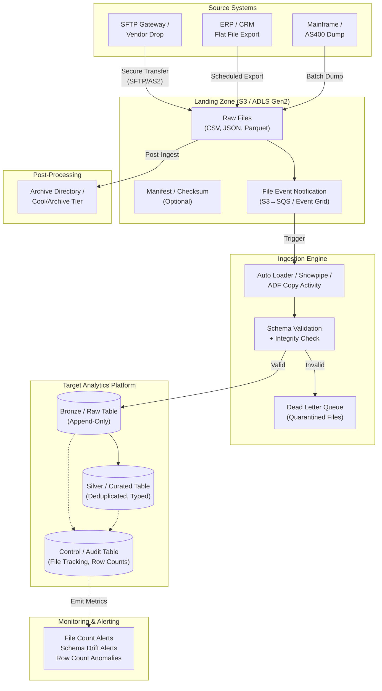
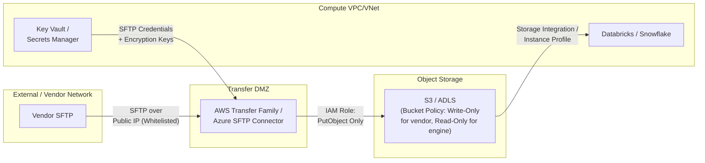
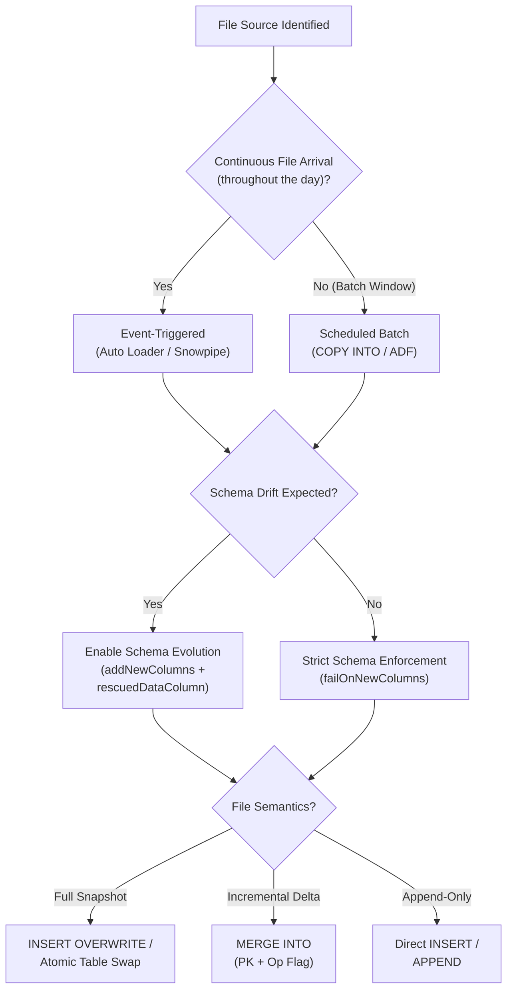

# Pattern 01: Batch File / Object Drop

## 1. Pattern Overview

- **Pattern Name:** Batch File / Object Drop
- **Pattern ID:** 01
- **Version:** 2.0
- **Objective:** Ingest file-based data arriving periodically or sporadically in Cloud Object Storage (S3/ADLS Gen2) into the target analytics platform via event-triggered or scheduled batch processing.
- **Applicable Sources:** ADLS Gen2, Amazon S3, SFTP gateways (via transfer services), third-party vendor data feeds, legacy system flat-file exports.
- **Applicable File Formats:** CSV, JSON, XML, Parquet, Avro, ORC, fixed-width text.
- **Applicable Targets:** Databricks Lakehouse (Delta Lake), Snowflake, Cloud Data Lake (ADLS/S3).
- **Typical Use Cases:**
  - End-of-day batch extracts from ERP/CRM systems (SAP, Salesforce flat-file exports).
  - Third-party vendor data feeds (credit bureaus, market data providers, regulatory filings).
  - Legacy mainframe/AS400 file dumps (COBOL copybook → fixed-width files).
  - Data sharing between business units via object storage.
- **When to Use:**
  - Source system cannot support direct database connections or real-time APIs.
  - Data arrives as discrete files (not continuous database changes).
  - Business SLA permits batch latency (minutes to daily).
- **When NEVER to Use (Red Lines):**
  - **Sub-minute latency requirement on a continuous stream**: Use Pattern 10 (Native Kafka).
  - **Source is a transactional database with update/delete churn**: Use Pattern 03/05/06 (Incremental/CDC).
  - **Files are < 1MB and arriving every few seconds**: The small-file problem will destroy lakehouse performance. Either buffer upstream or use a streaming pattern.

---

## 2. Pre-Ingestion Profiling

Execute the following assessments **before** building the ingestion pipeline.

### 2.1 Source File Characterization

| Assessment | Question | Impact |
|:---|:---|:---|
| **Volume** | How many files per day? What is the average file size? | Determines trigger mode (event vs. schedule) and compute sizing |
| **Velocity** | Do files arrive continuously throughout the day, or in a single batch window? | Continuous → event-triggered. Batch window → scheduled. |
| **File Size Distribution** | Are files consistently sized (e.g., 200MB) or wildly variable (1KB–5GB)? | Wildly variable requires `maxBytesPerTrigger` guards against OOM |
| **Format Stability** | Does the source silently change column names, add/remove columns, or change data types? | Schema evolution mode must be configured proactively |
| **Change Semantics** | Are files full snapshots (replace all) or incremental deltas (append/upsert)? | Determines target load strategy (OVERWRITE vs. MERGE) |
| **Encoding** | UTF-8? Windows-1252? EBCDIC (mainframe)? | Incorrect encoding → corrupt characters in string columns |
| **Compression** | Gzip, Snappy, ZSTD, LZ4, none? | Affects read performance and storage cost |
| **Delimiter / Quoting** | CSV: What delimiter? Are fields quoted? Are there embedded newlines? | Misparse → silent data corruption |

### 2.2 Critical Pre-Flight Checks

| Check | Target | Consequence of Failure |
|:---|:---|:---|
| Landing zone isolation | Dedicated bucket/container per source | Cross-source file collision, security blast radius |
| File naming convention | Deterministic, includes timestamp or sequence ID | Cannot detect duplicates or ordering |
| Source provides manifest/checksum | MD5/SHA256 hash or row count manifest file | Cannot validate file integrity post-transfer |
| Landing zone lifecycle policy | Archive/delete after 30–90 days | Unbounded storage growth |

---

## 3. Reference Architecture

### 3.1 Detailed End-to-End Architecture



### 3.2 Security & Networking Boundary



---

## 4. End-to-End Data Flow

### Step 1 — Source Drop
The external system writes files to an isolated Landing Zone (S3 bucket or ADLS container). Each source system has its own dedicated prefix/container to prevent cross-source contamination.

**File naming convention (recommended):**
```
s3://landing-zone/<source_name>/<entity>/year=YYYY/month=MM/day=DD/<entity>_<timestamp>_<sequence>.<format>.gz
```

### Step 2 — Detection & Trigger
File arrival triggers ingestion via one of two modes:

| Mode | Mechanism | Best For |
|:---|:---|:---|
| **Event-Triggered** | S3 Event → SQS → Auto Loader / Snowpipe | Continuous file arrival (files land throughout the day) |
| **Scheduled** | Cron/Orchestrator polls directory listing | Batch windows (files land in a known window, e.g., 2:00 AM) |

### Step 3 — Landing to Bronze (Raw Ingestion)
The ingestion engine reads the file, validates/infers the schema, appends ingestion metadata, and writes to the Bronze/Raw layer:
- **Ingestion metadata added:** `_file_name`, `_file_modification_time`, `_ingestion_timestamp`, `_rescued_data` (quarantined unparseable fields).
- **Schema handling:** See §8 for schema evolution modes.
- **Bronze table format:** Delta Lake (Databricks) or Snowflake managed table.

### Step 4 — Bronze to Silver (Curated Target)
A transformation job reads the Bronze table and applies business logic:
- **Full snapshot files:** `INSERT OVERWRITE` (or atomic table swap) into the Silver table.
- **Incremental delta files:** `MERGE INTO` Silver using the source primary key.
- **Append-only files:** Direct `INSERT` (no deduplication needed).

### Step 5 — Archive & Lifecycle
Processed files are handled post-ingestion:
- **Move to archive prefix:** `s3://landing-zone-archive/<source>/<entity>/...`
- **OR** apply S3/ADLS lifecycle policy: transition to Infrequent Access after 30 days, Archive/Cool after 90 days, delete after 365 days.

> **⚠️ WARNING:** Do NOT delete source files immediately after ingestion. Retain for at least 30 days to enable replay if Bronze data is corrupted or the pipeline had a bug.

---

## 5. Insert / Update / Delete Handling

| File Semantics | Detection | Target Load Strategy |
|:---|:---|:---|
| **Full Snapshot** (entire table exported as file) | File replaces all previous data for that entity | `INSERT OVERWRITE` or atomic table swap (Delta `REPLACE WHERE`, Snowflake `CREATE OR REPLACE`) |
| **Incremental Delta** (only changed rows) | File contains operation flags (`I`, `U`, `D`) | `MERGE INTO` Silver using PK + operation flag |
| **Append-Only** (new records only, e.g., log files) | File contains only new records since last export | Direct `INSERT` / `APPEND` to Bronze. No MERGE needed. |
| **Delete Detection** (full snapshot comparison) | Compare current snapshot to previous snapshot | `EXCEPT` / `ANTI JOIN` to find rows present in previous but missing in current → mark as deleted |

---

## 6. SCD Strategy

- **SCD Type 1 (Overwrite):** Default for full snapshot files. The Silver table reflects the latest state. Applied via `MERGE` overwriting matched rows.
- **SCD Type 2 (Historical Tracking):** Compare incoming snapshot against existing Silver table. For changed rows: close the existing record (`effective_end_date = current_timestamp`) and insert the new version (`effective_start_date = current_timestamp, is_current = TRUE`).

```sql
-- SCD Type 2: Detect changes between snapshots (Databricks/Snowflake)
MERGE INTO silver.customers t
USING (
    SELECT s.*, md5(concat_ws('|', s.name, s.email, s.address)) AS _row_hash
    FROM bronze.customers_latest s
) s
ON t.customer_id = s.customer_id AND t.is_current = TRUE
WHEN MATCHED AND t._row_hash != s._row_hash THEN UPDATE SET
    t.is_current = FALSE,
    t.effective_end_date = current_timestamp()
WHEN NOT MATCHED THEN INSERT
    (customer_id, name, email, address, _row_hash, is_current, effective_start_date, effective_end_date)
    VALUES (s.customer_id, s.name, s.email, s.address, s._row_hash, TRUE, current_timestamp(), NULL);
```

---

## 7. File Format Decision Matrix

### 7.1 Landing Zone Format

The landing zone format is typically **dictated by the source** and cannot be changed. Accept CSV/JSON/XML as-is.

### 7.2 Target Table Format

| Requirement | Parquet (Raw) | Delta Lake | Apache Iceberg |
|:---|:---|:---|:---|
| Append-only logs | ✅ High | ✅ High | ✅ High |
| Frequent Updates/Deletes | ❌ Requires full rewrite | ✅ ACID MERGE + Deletion Vectors | ✅ ACID MERGE |
| Multi-engine interchange | ✅ Excellent (universal) | 🟡 Good (UniForm for Iceberg compat) | ✅ Excellent (Snowflake + Spark + Trino) |
| Databricks Native | 🟡 Good | ✅ Excellent (DLT, Auto Loader, Z-Order) | 🟡 Good |
| Snowflake Native | 🟡 External Tables only | 🟡 Via UniForm/External Tables | ✅ Excellent (Managed Iceberg Tables) |
| Schema Evolution | ❌ Manual | ✅ `mergeSchema = true` | ✅ Native |
| Time Travel | ❌ None | ✅ Yes (30-day default) | ✅ Yes |

---

## 8. Schema Evolution Handling

Schema drift from upstream sources is the #1 cause of file ingestion pipeline failures in production.

| Scenario | Auto Loader (Databricks) | Snowpipe (Snowflake) | ADF Copy Activity |
|:---|:---|:---|:---|
| **New column added** | `schemaEvolutionMode = addNewColumns` | Fails unless `MATCH_BY_COLUMN_NAME` + manual `ALTER TABLE` | Fails unless mapping updated |
| **Column removed** | Column becomes NULL in new rows | No impact (missing columns = NULL) | Fails unless mapping updated |
| **Column renamed** | Treated as drop + add. Rescued data column catches it. | Depends on `MATCH_BY_COLUMN_NAME` setting | Fails |
| **Type change** (e.g., INT→STRING) | `mergeSchema = true` handles widening. Narrowing fails. | Fails on incompatible types | Fails |
| **Delimiter change** (CSV) | Pipeline breaks | Pipeline breaks | Pipeline breaks |

**Recommended Auto Loader Configuration:**
```python
# Schema evolution with safety net
(spark.readStream
    .format("cloudFiles")
    .option("cloudFiles.format", "csv")  # or json, parquet
    .option("cloudFiles.schemaLocation", "/mnt/checkpoints/schema/<source>/<entity>")
    .option("cloudFiles.schemaEvolutionMode", "addNewColumns")
    .option("cloudFiles.schemaHints", "order_id LONG, amount DECIMAL(18,2)")  # Pin critical columns
    .option("rescuedDataColumn", "_rescued_data")  # Catch unparseable fields
    .option("header", "true")
    .option("inferColumnTypes", "true")
    .load("s3://landing-zone/<source>/<entity>/")
)
```

> **🚨 CAUTION:** Always set `cloudFiles.schemaHints` for critical columns (PKs, amounts, dates). Without hints, Auto Loader may infer `order_id` as STRING from a CSV, causing downstream MERGE failures when joining against a LONG column.

---

## 9. Target-Side Optimization

### 9.1 Databricks (Auto Loader → Delta Lake)

```python
# Complete Auto Loader pipeline: Landing → Bronze
(spark.readStream
    .format("cloudFiles")
    .option("cloudFiles.format", "csv")
    .option("cloudFiles.schemaLocation", "/mnt/checkpoints/schema/vendor_x/orders")
    .option("cloudFiles.schemaEvolutionMode", "addNewColumns")
    .option("cloudFiles.maxBytesPerTrigger", "512mb")   # Prevent OOM on large file bursts
    .option("cloudFiles.maxFilesPerTrigger", "1000")     # Cap files per micro-batch
    .option("rescuedDataColumn", "_rescued_data")
    .option("header", "true")
    .option("inferColumnTypes", "true")
    .option("badRecordsPath", "/mnt/dlq/vendor_x/orders")  # Quarantine corrupt rows
    .load("s3://landing-zone/vendor_x/orders/")
    .withColumn("_file_name", input_file_name())
    .withColumn("_ingestion_ts", current_timestamp())
    .writeStream
    .format("delta")
    .option("checkpointLocation", "/mnt/checkpoints/bronze/vendor_x/orders")
    .option("mergeSchema", "true")
    .outputMode("append")
    .trigger(availableNow=True)   # Cost-effective: process all pending, then stop
    .toTable("catalog.bronze.vendor_x_orders")
)
```

**Compaction & Maintenance:**
```sql
-- Compact small files after ingestion (run daily)
OPTIMIZE catalog.bronze.vendor_x_orders;

-- Liquid Clustering on filter/join keys
ALTER TABLE catalog.bronze.vendor_x_orders CLUSTER BY (order_date, order_id);

-- Vacuum old versions (respect retention period)
VACUUM catalog.bronze.vendor_x_orders RETAIN 168 HOURS;
```

### 9.2 Snowflake (Snowpipe → Managed Table)

```sql
-- Create staging table with metadata columns
CREATE TABLE IF NOT EXISTS raw.vendor_x_orders (
    order_id        NUMBER,
    customer_id     NUMBER,
    amount          DECIMAL(18,2),
    order_date      DATE,
    -- Ingestion metadata
    _file_name      STRING DEFAULT METADATA$FILENAME,
    _file_row_number NUMBER DEFAULT METADATA$FILE_ROW_NUMBER,
    _load_ts        TIMESTAMP_NTZ DEFAULT CURRENT_TIMESTAMP()
);

-- Snowpipe: Auto-ingest from S3/ADLS
CREATE OR REPLACE PIPE vendor_x_orders_pipe
  AUTO_INGEST = TRUE
AS
COPY INTO raw.vendor_x_orders (order_id, customer_id, amount, order_date)
FROM @vendor_x_stage/orders/
FILE_FORMAT = (
    TYPE = 'CSV',
    FIELD_DELIMITER = ',',
    SKIP_HEADER = 1,
    FIELD_OPTIONALLY_ENCLOSED_BY = '"',
    NULL_IF = ('', 'NULL', 'null'),
    ERROR_ON_COLUMN_COUNT_MISMATCH = FALSE
)
ON_ERROR = 'SKIP_FILE';  -- Skip corrupt files; monitor via COPY_HISTORY

-- Monitor ingested files
SELECT * FROM TABLE(INFORMATION_SCHEMA.COPY_HISTORY(
    TABLE_NAME => 'VENDOR_X_ORDERS',
    START_TIME => DATEADD(hours, -24, CURRENT_TIMESTAMP())
)) ORDER BY LAST_LOAD_TIME DESC;
```

---

## 10. AWS & Azure Implementation Reference

### 10.1 AWS

| Component | Service | Configuration |
|:---|:---|:---|
| **Landing Zone** | S3 (versioning enabled) | Bucket policy: vendor role `PutObject` only. SSE-KMS encryption. |
| **Secure Transfer** | AWS Transfer Family (SFTP) | Public-facing endpoint with IP whitelisting. IAM role scoped to landing prefix. |
| **File Notification** | S3 Event → SQS | Used by Auto Loader (`file notification` mode) or Snowpipe. |
| **Orchestration** | Step Functions / MWAA (Airflow) | Schedule-based ingestion, dependency management, retry logic. |
| **Monitoring** | CloudWatch | S3 `NumberOfObjects`, Snowpipe `insertErrors`, Lambda invocation errors. |

### 10.2 Azure

| Component | Service | Configuration |
|:---|:---|:---|
| **Landing Zone** | ADLS Gen2 (hierarchical namespace) | Storage firewall: Allow only ingestion managed identity. CMK encryption. |
| **Secure Transfer** | Azure Blob SFTP Connector | Local user authentication with SSH keys. Scoped to landing container. |
| **File Notification** | ADLS Event Grid → Storage Queue | Used by Auto Loader or Snowpipe. |
| **Orchestration** | Azure Data Factory / Databricks Workflows | Trigger-based or schedule-based pipeline execution. |
| **Monitoring** | Azure Monitor + Diagnostic Logs | Blob creation events, ADF pipeline run metrics, ingestion failures. |

---

## 11. Security & Governance

### 11.1 Mandatory Security Controls

| Control | Implementation | Non-Compliance Consequence |
|:---|:---|:---|
| **Landing Zone Isolation** | Dedicated bucket/container per source system. No shared write access. | Cross-source data contamination, blast radius amplification. |
| **Vendor Write Isolation** | Vendor IAM role/SAS token scoped to `PutObject` on their specific prefix only. No `ListBucket`, no `GetObject`, no `DeleteObject`. | Vendor can read other vendors' data or delete files. |
| **Encryption at Rest** | S3: SSE-KMS (customer-managed key). ADLS: CMK. | Regulatory violation (GDPR, HIPAA, SOC2). |
| **Encryption in Transit** | SFTP (SSH). HTTPS (TLS 1.2+). No FTP (unencrypted). | Credential and data interception. |
| **Secrets Management** | SFTP credentials, encryption keys in Key Vault / Secrets Manager. | Credential rotation impossible. |
| **PII Detection** | Scan landing zone files for PII patterns before promoting to Bronze. Use Unity Catalog tags or Snowflake classification. | PII exposure in analytics layer. |
| **File Integrity** | Validate MD5/SHA256 checksum or manifest row count before ingestion. | Silent data corruption or incomplete file ingestion. |

### 11.2 RBAC Model

```
Vendor / External Source:
  └─ IAM Role / SAS Token: "vendor-x-writer"
       ├─ s3:PutObject → arn:aws:s3:::landing-zone/vendor_x/*
       └─ DENY s3:GetObject, s3:ListBucket, s3:DeleteObject

Ingestion Engine:
  └─ IAM Role / Managed Identity: "ingestion-reader"
       ├─ s3:GetObject → arn:aws:s3:::landing-zone/*
       ├─ s3:ListBucket → arn:aws:s3:::landing-zone
       └─ DENY s3:DeleteObject (files archived by lifecycle policy only)

Analysts / BI:
  └─ No direct access to Landing Zone.
       └─ Access Silver/Gold tables only via Unity Catalog / Snowflake RBAC.
```

---

## 12. Reliability, Resumability & Failure Recovery

### 12.1 Failure Scenarios & Recovery Playbook

| Failure Scenario | Impact | Recovery Procedure |
|:---|:---|:---|
| **Corrupt file lands in S3/ADLS** (truncated transfer, encoding error) | Auto Loader: Batch fails or rows quarantined. Snowpipe: File skipped. | Auto Loader: `badRecordsPath` quarantines bad rows. Snowpipe: `ON_ERROR = 'SKIP_FILE'` + `COPY_HISTORY` monitoring. Contact source to re-send. |
| **Duplicate file delivered** (same data, same or different filename) | Duplicate rows in Bronze | Auto Loader: Same filename → already tracked (no re-ingest). Different filename → ingested again. Silver MERGE deduplicates on PK. |
| **Schema drift** (source adds/removes/renames column) | Pipeline failure or silent NULL columns | Auto Loader: `schemaEvolutionMode = addNewColumns` + `_rescued_data`. Alert on non-empty rescue column. |
| **Ingestion engine crashes mid-batch** | Partial Bronze write | Auto Loader: Resumes from checkpoint (exactly-once). Snowpipe: File metadata tracked for 14 days (no re-ingest). |
| **Files stop arriving** (source system failure) | Stale Silver table — downstream consumers unaware | SLA-based alerting: "No files received in past 4 hours for source X" → alert on-call. |
| **Landing zone accidentally deleted** | All source files lost | S3 versioning + cross-region replication. ADLS soft delete (7-day retention) + GRS. |

### 12.2 Idempotency Model

```
┌─────────────────────────────────────────────────────────┐
│                   IDEMPOTENCY MODEL                      │
├──────────────┬──────────────────────────────────────────┤
│  Layer       │  Guarantee                               │
├──────────────┼──────────────────────────────────────────┤
│  Landing     │  Vendor may re-deliver files.            │
│              │  Same filename = safe (tracked).          │
│              │  Different filename = duplicate risk.     │
├──────────────┼──────────────────────────────────────────┤
│  Bronze      │  Append-only. May contain duplicates     │
│              │  from re-delivered files with new names.  │
├──────────────┼──────────────────────────────────────────┤
│  Silver      │  MERGE on PK deduplicates.               │
│              │  Full snapshot OVERWRITE is inherently    │
│              │  idempotent.                              │
└──────────────┴──────────────────────────────────────────┘
```

---

## 13. Observability & Monitoring

### 13.1 Mandatory Alerts

| Metric | Threshold | Alert Severity | Action |
|:---|:---|:---|:---|
| **Files received per SLA window** | 0 files in expected window | 🔴 P1 CRITICAL | Contact source system team. Check SFTP transfer logs. |
| **File size anomaly** | File size < 10% or > 200% of historical average | 🟡 P2 WARNING | Possible truncated or duplicated file. Validate row counts. |
| **Row count anomaly** | Row count deviates > 20% from historical average | 🟡 P2 WARNING | Possible data quality issue. Compare against manifest. |
| **Schema drift detected** | Non-empty `_rescued_data` column in Bronze | 🟡 P2 WARNING | Source schema changed. Review and adapt. |
| **Ingestion failures** | Any Auto Loader / Snowpipe failure | 🔴 P1 CRITICAL | Check `badRecordsPath` or `COPY_HISTORY`. |
| **Small file accumulation** | Average file size < 1MB in landing zone | 🟡 P2 WARNING | Request source to batch files or implement file coalescing. |
| **Landing zone storage growth** | > 500GB unbounded growth | 🟡 P3 INFO | Review lifecycle policies. Ensure archive/delete is working. |

### 13.2 Control / Audit Table Schema

```sql
CREATE TABLE IF NOT EXISTS control.file_ingestion_audit (
    pipeline_id         STRING      NOT NULL,
    source_name         STRING      NOT NULL,
    entity_name         STRING      NOT NULL,
    file_name           STRING      NOT NULL,
    file_size_bytes     BIGINT,
    file_modification_ts TIMESTAMP,
    ingestion_start_ts  TIMESTAMP   NOT NULL,
    ingestion_end_ts    TIMESTAMP,
    rows_ingested       BIGINT,
    rows_quarantined    BIGINT,     -- Bad records count
    schema_drift_detected BOOLEAN,
    manifest_row_count  BIGINT,     -- Expected count from manifest (if provided)
    row_count_match     BOOLEAN,    -- ingested == manifest?
    status              STRING      NOT NULL,   -- RUNNING | SUCCESS | FAILED | SKIPPED
    error_message       STRING,
    PRIMARY KEY (pipeline_id, file_name)
);
```

---

## 14. Cost Model

### 14.1 Cost Components

| Component | Cost Driver | Optimization Lever |
|:---|:---|:---|
| **Object Storage** | Storage volume ($/GB/month) + PUT/GET requests | Lifecycle policies (IA after 30d, Archive after 90d). Parquet compression in target. |
| **Secure Transfer** | AWS Transfer Family: $/hour + $/GB transferred. Azure SFTP: $/hour. | Right-size transfer endpoints. Shut down when not in active transfer window. |
| **Ingestion Compute** | Auto Loader cluster hours / Snowpipe credits / ADF DIU-hours | `trigger(availableNow=True)` avoids idle cluster. Snowpipe is serverless. ADF: use minimal DIUs. |
| **Bronze-to-Silver Compute** | MERGE/OVERWRITE processing time | Liquid Clustering on MERGE key. Minimize full-table scans. |
| **Network Egress** | Cross-region file transfers | Ensure landing zone and compute are co-located in the same region. |

### 14.2 Cost Optimization Tips

| Strategy | Savings |
|:---|:---|
| `trigger(availableNow=True)` instead of continuous Auto Loader | 60–80% compute cost reduction (no idle cluster) |
| Snowpipe (serverless) instead of warehouse-based `COPY INTO` | Pay-per-file instead of per-minute warehouse billing |
| S3 Intelligent Tiering / ADLS lifecycle policies | 40–60% storage savings on aged landing zone files |
| Parquet target format with ZSTD compression | 5–10× storage reduction vs. raw CSV |

---

## 15. Constraints & Red Lines

| # | Red Line | Consequence | Mitigation |
|:---|:---|:---|:---|
| 1 | **Small File Proliferation** | Thousands of < 1MB files destroy lakehouse query performance (metadata overhead, file listing latency). | Source must batch files ≥ 100MB. If not possible, run `OPTIMIZE` on Bronze daily. Set `maxFilesPerTrigger`. |
| 2 | **No File Integrity Validation** | Truncated or corrupt files silently ingested → data quality failures downstream. | Validate checksum/manifest before promoting to Bronze. Use `badRecordsPath`. |
| 3 | **Landing Zone Shared Access** | Multiple vendors writing to the same prefix → file collision, security leak. | Dedicated prefix per vendor with isolated IAM role / SAS token. |
| 4 | **Immediate File Deletion Post-Ingest** | No replay capability if pipeline bug discovered days later. | Retain source files 30+ days. Use lifecycle policies, not manual deletion. |
| 5 | **CSV Without Schema Pinning** | Auto-inferred types change between batches (e.g., ZIP code `07102` inferred as INT → leading zero lost). | Always set `cloudFiles.schemaHints` for critical columns. |

---

## 16. Trade-Offs

| Decision | Option A | Option B | Trade-Off Analysis |
|:---|:---|:---|:---|
| **Trigger Mode** | Event-driven (SNS/Event Grid) | Scheduled (Cron/Airflow) | Event-driven minimizes latency but can cause compute fragmentation (many small triggers). Scheduled is cheaper and predictable but adds latency. **Use event-driven for continuous arrival, scheduled for batch windows.** |
| **Ingestion Engine** | Databricks Auto Loader | ADF Copy Activity | Auto Loader handles schema drift natively and has RocksDB checkpointing. ADF is serverless and cheaper for simple CSV copies but requires explicit schema mapping. **Use Auto Loader for schema-volatile sources; ADF for stable, high-volume bulk copies.** |
| **Target Load** | INSERT OVERWRITE (full replace) | MERGE (incremental upsert) | OVERWRITE is simpler and guarantees no duplicates but discards inter-snapshot history. MERGE preserves history but requires a reliable PK and operation flag. **OVERWRITE for full snapshot files; MERGE for incremental deltas.** |
| **Landing Format** | Accept source format (CSV/JSON) | Require Parquet from source | Accepting source format maximizes vendor compatibility. Requiring Parquet reduces storage/compute but most vendors cannot produce Parquet. **Accept source format in landing; convert to Parquet/Delta in Bronze.** |
| **File Retention** | Retain indefinitely | Lifecycle-delete after 30–90 days | Indefinite retention enables unlimited replay but costs storage. **Retain 90 days minimum; archive to cool/archive tier after 30 days.** |

---

## 17. Decision Tree



---

## 18. Pattern Selection Checklist

> This checklist must be completed and submitted to the Architecture Review Board before pipeline provisioning.

- [ ] Source file format, encoding, delimiter, and compression documented.
- [ ] File arrival pattern (continuous vs. batch window) confirmed with source team.
- [ ] Average and maximum file sizes profiled. Small-file problem assessed (files ≥ 100MB preferred).
- [ ] File naming convention agreed with source (includes timestamp or sequence for ordering).
- [ ] Landing zone isolated: dedicated bucket/container with vendor-specific IAM role / SAS token.
- [ ] Landing zone encrypted (SSE-KMS / CMK). No unencrypted storage.
- [ ] Transfer mechanism secured (SFTP/HTTPS only — no FTP).
- [ ] All credentials stored in **Key Vault / Secrets Manager** (zero hardcoded secrets).
- [ ] Schema evolution mode configured (Auto Loader) or DDL monitoring in place (Snowpipe).
- [ ] `cloudFiles.schemaHints` set for all critical columns (PKs, amounts, dates).
- [ ] `badRecordsPath` / `ON_ERROR = 'SKIP_FILE'` configured for corrupt file handling.
- [ ] File integrity validation implemented (checksum / manifest row count).
- [ ] Post-ingestion file lifecycle policy configured (archive 30d, delete 365d).
- [ ] Monitoring alerts configured per §13.1 thresholds (file arrival SLA, schema drift, row count anomalies).
- [ ] Control/audit table tracks per-file row counts, schema drift, and ingestion status.
- [ ] PII scan/classification applied to landing zone files before Bronze promotion.
- [ ] Cost estimate reviewed and approved (transfer + storage + compute).