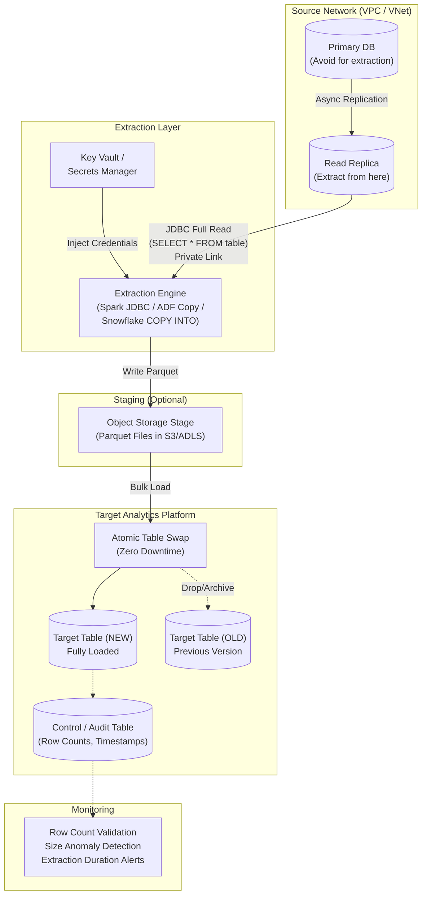
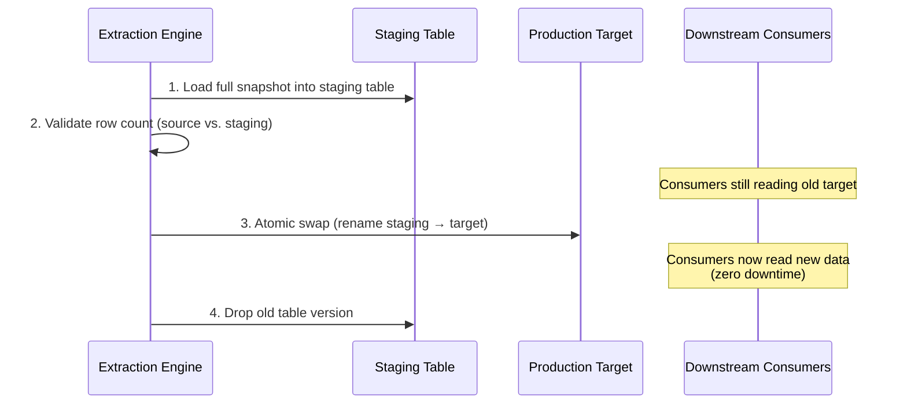

# Pattern 02: Full Snapshot / Truncate-Reload

## 1. Pattern Overview

- **Pattern Name:** Full Snapshot / Truncate-Reload
- **Pattern ID:** 02
- **Version:** 2.0
- **Objective:** Extract the entirety of a source table and atomically replace the target table with a complete, point-in-time copy of the source.
- **Applicable Sources:** Relational Databases (PostgreSQL, MySQL, SQL Server, Oracle, Azure SQL, Amazon RDS/Aurora).
- **Applicable Targets:** Databricks Lakehouse (Delta Lake), Snowflake, Cloud Data Lake (ADLS/S3).
- **Typical Use Cases:**
  - Small lookup/dimension tables (country codes, product categories, currency rates).
  - Legacy systems lacking `updated_at` timestamps or CDC capability.
  - Systems where physical hard deletes are common, unlogged, and must be reflected in the target.
  - Reference data that changes infrequently (daily/weekly) and is small enough for full extraction.
- **When to Use:**
  - Table size is small (< 5–10 GB) and fits within the batch extraction window.
  - Source application does not reliably update an `updated_at` column.
  - Hard deletes occur and must be captured (rows disappear from source → must disappear from target).
  - No CDC/replication infrastructure is available or justified for this table.
- **When NEVER to Use (Red Lines):**
  - **Large transactional tables (> 10 GB)**: Network egress, DB I/O, and compute cost make this pattern prohibitively expensive. Use Pattern 03 (Incremental) or Pattern 05 (CDC).
  - **High-frequency extraction (sub-hourly) on active OLTP**: Repeated full table scans will degrade source database performance.
  - **Source database has no Read Replica and is under heavy transactional load**: Full scan will cause lock contention and I/O starvation.

---

## 2. Pre-Ingestion Profiling

Execute on the source database to validate pattern applicability.

### 2.1 Table Size Assessment

```sql
-- PostgreSQL: Row count and physical size
SELECT 
    relname AS table_name,
    n_live_tup AS estimated_row_count,
    pg_size_pretty(pg_total_relation_size(relid)) AS total_size
FROM pg_stat_user_tables
WHERE relname = 'target_table';
```

```sql
-- SQL Server: Row count and physical size
SELECT 
    t.name AS table_name,
    SUM(p.rows) AS row_count,
    CAST(ROUND(SUM(a.total_pages) * 8.0 / 1024, 2) AS DECIMAL(18,2)) AS total_size_mb
FROM sys.tables t
JOIN sys.indexes i ON t.object_id = i.object_id
JOIN sys.partitions p ON i.object_id = p.object_id AND i.index_id = p.index_id
JOIN sys.allocation_units a ON p.partition_id = a.container_id
WHERE t.name = 'target_table'
GROUP BY t.name;
```

```sql
-- MySQL: Row count and physical size
SELECT 
    table_name,
    table_rows AS estimated_row_count,
    ROUND(data_length / 1024 / 1024, 2) AS data_size_mb,
    ROUND(index_length / 1024 / 1024, 2) AS index_size_mb
FROM information_schema.tables
WHERE table_schema = 'your_database' AND table_name = 'target_table';
```

> **ℹ️ IMPORTANT:** If the result is **> 10 million rows or > 10 GB**, strongly consider Pattern 03 (Incremental Batch) or Pattern 05 (CDC to Object Storage). Full snapshot becomes cost-prohibitive at scale.

### 2.2 Critical Pre-Flight Checks

| Check | Target | Consequence of Failure |
|:---|:---|:---|
| Table size within threshold | < 10 GB | Network egress and compute cost explosion |
| Read Replica availability | Provisioned and lag < 1 min | Full scan saturates primary DB I/O |
| Extraction window defined | Off-peak hours (e.g., 2:00–4:00 AM) | Full scan during peak → OLTP degradation |
| Primary Key exists | PK identified for downstream joins | Cannot reliably MERGE or detect changes for SCD2 |
| Source locking behavior assessed | `SELECT` doesn't acquire exclusive locks | Full scan causes application deadlocks |

---

## 3. Reference Architecture

### 3.1 End-to-End Architecture



### 3.2 Atomic Table Swap (Zero-Downtime Overwrite)



---

## 4. End-to-End Data Flow

### Step 1 — Extraction (Source)
The ingestion engine connects via JDBC/ODBC to the **Read Replica** (never the primary) and executes a full table read:

```sql
-- Simple full extract (used by Spark JDBC, ADF Copy)
SELECT * FROM schema_name.target_table;
```

For tables approaching the 10 GB threshold, parallelize the extraction:

```python
# Spark JDBC: Parallelized extraction using partitionColumn
df = (spark.read
    .format("jdbc")
    .option("url", "jdbc:postgresql://replica-host:5432/mydb")
    .option("dbtable", "public.customers")
    .option("user", dbutils.secrets.get("kv", "db-user"))
    .option("password", dbutils.secrets.get("kv", "db-pass"))
    .option("partitionColumn", "customer_id")    # Must be numeric
    .option("lowerBound", "1")
    .option("upperBound", "10000000")
    .option("numPartitions", "8")                 # Parallel JDBC connections
    .option("fetchsize", "10000")                 # Rows per fetch
    .load()
)
```

### Step 2 — Staging Load
Data is written to a staging location:
- **Databricks:** Write to a staging Delta table (`catalog.staging.customers_new`).
- **Snowflake:** Export to Parquet on S3/ADLS stage, then `COPY INTO` a staging table.

### Step 3 — Validation
**Mandatory row count validation** before promoting the staging table:

```sql
-- Source row count (captured during extraction)
SELECT COUNT(*) AS source_count FROM public.customers;

-- Staging row count (post-load)
SELECT COUNT(*) AS staging_count FROM staging.customers_new;

-- VALIDATION: These must match within tolerance (e.g., ±0.1%)
-- If mismatch > tolerance → ABORT. Do NOT swap.
```

> **⚠️ WARNING:** Never skip row count validation. A network interruption during extraction can silently truncate the result set. Swapping a partial snapshot into production causes data loss for downstream consumers.

### Step 4 — Atomic Swap (Zero-Downtime Replace)

**Databricks (Delta Lake):**
```sql
-- Option A: INSERT OVERWRITE (atomic, versioned, time-travel safe)
INSERT OVERWRITE catalog.silver.customers
SELECT * FROM catalog.staging.customers_new;

-- Option B: Deep Clone (creates independent copy)
CREATE OR REPLACE TABLE catalog.silver.customers
DEEP CLONE catalog.staging.customers_new;
```

**Snowflake:**
```sql
-- Option A: Atomic table swap (zero downtime, preserves grants)
ALTER TABLE silver.customers SWAP WITH staging.customers_new;

-- Option B: CREATE OR REPLACE (drops and recreates — grants lost!)
CREATE OR REPLACE TABLE silver.customers AS
SELECT * FROM staging.customers_new;
-- WARNING: CREATE OR REPLACE drops all grants. Use SWAP instead.
```

### Step 5 — Post-Load Audit
```sql
-- Insert audit record
INSERT INTO control.snapshot_audit
    (table_name, extraction_ts, source_row_count, target_row_count, match_status, duration_seconds)
VALUES
    ('customers', CURRENT_TIMESTAMP(), 5000000, 5000000, 'MATCH', 127);
```

---

## 5. Insert / Update / Delete Handling

| Operation | Handling | Explanation |
|:---|:---|:---|
| **Inserts** | ✅ Inherently captured | New rows exist in source → extracted in full snapshot → present in target. |
| **Updates** | ✅ Inherently captured | Updated rows exist in source → extracted with current values → overwrite old values in target. |
| **Hard Deletes** | ✅ **Major advantage** | Deleted rows are absent from source → absent from snapshot → absent from target after swap. No special logic needed. |

> **ℹ️ NOTE:** This is the primary reason to choose Pattern 02 over Pattern 03 (Incremental Batch). Pattern 03 cannot detect hard deletes without supplemental logic.

---

## 6. SCD Strategy

- **SCD Type 1 (Overwrite):** Default behavior. The target table reflects the exact latest state of the source after every extraction. No history retained.
- **SCD Type 2 (Historical Tracking):** Achievable by comparing the incoming full snapshot against the previous version of the target table:

```sql
-- Detect changes between snapshots for SCD2 (Databricks)
-- Step 1: Find new/changed rows
SELECT s.*
FROM staging.customers_new s
LEFT JOIN silver.customers t ON s.customer_id = t.customer_id
WHERE t.customer_id IS NULL                                    -- New rows
   OR md5(concat_ws('|', s.name, s.email, s.address))
      != md5(concat_ws('|', t.name, t.email, t.address));     -- Changed rows

-- Step 2: Find deleted rows (present in old, absent in new)
SELECT t.customer_id
FROM silver.customers t
LEFT JOIN staging.customers_new s ON t.customer_id = s.customer_id
WHERE s.customer_id IS NULL;
```

---

## 7. Target-Side Optimization

### 7.1 Databricks (Delta Lake)

```python
# Full snapshot extraction and overwrite
df = spark.read.format("jdbc").options(**jdbc_options).load()

# Validate row count
source_count = df.count()
assert source_count > 0, "Source returned 0 rows — aborting snapshot"

# Write with atomic overwrite
(df.write
    .format("delta")
    .mode("overwrite")
    .option("overwriteSchema", "true")  # Handle schema changes
    .saveAsTable("catalog.silver.customers")
)
```

**Post-Load Optimization:**
```sql
-- Compact files after overwrite
OPTIMIZE catalog.silver.customers;

-- Liquid Clustering on common filter/join keys
ALTER TABLE catalog.silver.customers CLUSTER BY (customer_id, region);

-- Time Travel: Retain 7 days for rollback
ALTER TABLE catalog.silver.customers
SET TBLPROPERTIES ('delta.logRetentionDuration' = '7 days');
```

### 7.2 Snowflake

```sql
-- Preferred: Staged Parquet → COPY INTO staging → SWAP
-- Step 1: Load into staging
COPY INTO staging.customers_new
FROM @extraction_stage/customers/
FILE_FORMAT = (TYPE = 'PARQUET')
MATCH_BY_COLUMN_NAME = CASE_INSENSITIVE;

-- Step 2: Validate
SELECT COUNT(*) FROM staging.customers_new;  -- Must match source

-- Step 3: Atomic swap
ALTER TABLE silver.customers SWAP WITH staging.customers_new;

-- Step 4: Recluster (if clustering defined)
ALTER TABLE silver.customers RESUME RECLUSTER;
```

---

## 8. AWS & Azure Implementation Reference

### 8.1 AWS

| Component | Service | Configuration |
|:---|:---|:---|
| **Source** | RDS / Aurora Read Replica | Read-only endpoint. `max_connections` headroom for extraction sessions. |
| **Extraction** | Glue / EMR (Spark JDBC) / DMS Full Load | JDBC partitioning on numeric PK for parallelism. |
| **Staging** | S3 (Parquet) | Temporary prefix. Lifecycle: delete after 7 days. |
| **Secrets** | AWS Secrets Manager | DB credentials. Rotated every 90 days. |
| **Networking** | VPC Peering / PrivateLink | Extraction engine ↔ RDS: Same VPC or peered. S3: VPC Gateway Endpoint. |
| **Orchestration** | Step Functions / MWAA | Schedule extraction during off-peak. Include validation step before swap. |

### 8.2 Azure

| Component | Service | Configuration |
|:---|:---|:---|
| **Source** | Azure SQL / PostgreSQL Flexible Server Read Replica | Read-only endpoint in same region as extraction engine. |
| **Extraction** | ADF Copy Activity / Databricks JDBC | ADF: Auto-partition with physical partitioning. Databricks: `partitionColumn` JDBC option. |
| **Staging** | ADLS Gen2 (Parquet) | Temporary container. Lifecycle: delete after 7 days. |
| **Secrets** | Azure Key Vault | DB credentials via Managed Identity. |
| **Networking** | VNet Service Endpoints / Private Link | ADF ↔ Azure DB: Private Endpoint. ADLS: VNet firewall. |
| **Orchestration** | ADF Pipelines / Databricks Workflows | Include Validation activity between load and swap. |

---

## 9. Security & Governance

### 9.1 Mandatory Security Controls

| Control | Implementation | Non-Compliance Consequence |
|:---|:---|:---|
| **Network Isolation** | Extraction engine connects to source DB via Private Link / VNet only. | ARB rejection. DB exposed to public internet. |
| **Encryption at Rest** | Staging files: SSE-KMS (S3) / CMK (ADLS). Target tables: Platform-managed encryption. | Regulatory violation. |
| **Encryption in Transit** | JDBC connections use TLS 1.2+. `sslmode=verify-full` (PostgreSQL). | Credential interception. |
| **Secrets Management** | All DB credentials in Key Vault / Secrets Manager. Zero hardcoded passwords. | Security violation. |
| **Least-Privilege IAM** | Extraction role: `SELECT` only on source tables. No DDL, no DML. | Blast radius if compromised. |
| **PII Handling** | Mask/hash PII columns during extraction or in Bronze→Silver transformation. | PII in analytics layer. |
| **Read Replica Enforcement** | Extraction engine MUST target Read Replica endpoint, not primary. | Primary DB performance degradation. |

---

## 10. Reliability, Resumability & Failure Recovery

### 10.1 Failure Scenarios & Recovery Playbook

| Failure Scenario | Impact | Recovery Procedure |
|:---|:---|:---|
| **Network drop during extraction** | Partial data in staging | Re-run extraction from scratch (idempotent: staging table is fully replaced). |
| **Row count validation fails** | Staging has fewer rows than source | Abort swap. Investigate network stability, JDBC timeout settings, or source-side locking. |
| **Atomic swap fails** | Old target preserved (no data loss) | Investigate DDL lock conflicts. Retry during low-concurrency window. |
| **Source DB unavailable** | No extraction occurs | Alert. Schedule retry in next batch window. Old target data remains valid (stale but intact). |
| **Accidental swap with corrupt data** | Bad data in production target | **Delta Lake:** Time Travel to previous version (`RESTORE TABLE ... TO VERSION AS OF n`). **Snowflake:** Time Travel (`SELECT ... AT (TIMESTAMP => ...)`) + swap back. |

### 10.2 Idempotency Guarantees

Full snapshot is **inherently idempotent**: re-running the pipeline produces the same target state regardless of how many times it runs (assuming source doesn't change between runs). There is no state to track, no watermark to manage, no deduplication needed.

---

## 11. Observability & Monitoring

| Metric | Threshold | Alert Severity | Action |
|:---|:---|:---|:---|
| **Extraction duration** | > 2× historical average | 🟡 P2 WARNING | Source DB under load or network degradation. Check Replica lag. |
| **Row count mismatch** | Source ≠ Target | 🔴 P1 CRITICAL | Swap was aborted (or should have been). Investigate extraction logs. |
| **Row count anomaly** | Target count deviates > 20% from previous run | 🟡 P2 WARNING | Possible mass delete or mass insert at source. Validate with source team. |
| **Extraction failure** | Any failure | 🔴 P1 CRITICAL | Check JDBC connectivity, credential expiry, DB availability. |
| **Staging file size anomaly** | Size deviates > 50% from previous run | 🟡 P2 WARNING | Schema change or data volume shift. Review staging data. |

---

## 12. Cost Model

### 12.1 Cost Components

| Component | Cost Driver | Optimization Lever |
|:---|:---|:---|
| **Source Read Replica** | Instance hours (always-on) | Use serverless replicas (Aurora Serverless v2) that scale down to zero during off-peak. |
| **Network Egress** | GB transferred per extraction × frequency | Co-locate extraction engine and source in same region/VPC. Reduce extraction frequency if data is static. |
| **Extraction Compute** | Spark cluster hours / ADF DIU-hours | Right-size cluster. Use spot/preemptible instances for extraction workloads. |
| **Staging Storage** | Temporary Parquet files on S3/ADLS | Lifecycle: auto-delete after 7 days. Minimal cost. |
| **Target Write** | Delta OPTIMIZE / Snowflake warehouse credits for COPY INTO + SWAP | Use smallest warehouse that fits within SLA. |

### 12.2 Cost vs. Pattern 03 (Incremental)

| Scenario | Pattern 02 (Full Snapshot) | Pattern 03 (Incremental) |
|:---|:---|:---|
| 1 GB table, daily | ✅ ~$0.50/day (30 GB egress/month) | ✅ ~$0.05/day (3 GB delta/month) |
| 10 GB table, daily | 🟡 ~$5.00/day (300 GB egress/month) | ✅ ~$0.50/day (30 GB delta/month) |
| 10 GB table, hourly | 🔴 ~$120/day (7.2 TB egress/month) | ✅ ~$12/day (720 GB delta/month) |

> **ℹ️ NOTE:** Pattern 02 network egress grows linearly with table size × frequency. For tables > 5 GB extracted more than once daily, Pattern 03 or 05 is almost always more cost-effective.

---

## 13. Constraints & Red Lines

| # | Red Line | Consequence | Mitigation |
|:---|:---|:---|:---|
| 1 | **Primary DB Extraction** | Full table scan on primary causes I/O starvation, lock contention, replication lag. | **Always** extract from Read Replica. |
| 2 | **No Row Count Validation** | Partial snapshots silently swap into production → downstream consumers get incomplete data. | Mandatory source vs. staging row count comparison. Abort on mismatch. |
| 3 | **CREATE OR REPLACE (Snowflake)** | Drops all grants/permissions on the table. Downstream consumers lose access. | Use `ALTER TABLE SWAP WITH` instead. |
| 4 | **Oversized Tables (> 10 GB)** | Extraction window exceeded, network egress costs spike, DB I/O saturated every cycle. | Migrate to Pattern 03 (Incremental) or Pattern 05 (CDC). |
| 5 | **No Time Travel / Versioning** | Accidental bad data swap is irreversible. | Enable Delta Time Travel (7-day retention) or Snowflake Time Travel (90 days on Enterprise). |

---

## 14. Trade-Offs

| Decision | Option A | Option B | Trade-Off Analysis |
|:---|:---|:---|:---|
| **Target Overwrite Method** | Physical Truncate + Insert | Atomic Table Swap (Delta OVERWRITE / Snowflake SWAP) | Truncate causes downtime for concurrent readers (table is empty between truncate and insert). Atomic swap ensures zero-downtime for downstream consumers. **Always use atomic swap.** |
| **Extraction Source** | Primary DB | Read Replica | Primary is always up-to-date but extraction degrades OLTP. Replica has minor lag (seconds) but zero impact on production. **Always use Replica unless table is < 100 MB and off-peak.** |
| **Staging Intermediate** | Direct JDBC → Target | JDBC → Parquet (S3/ADLS) → Target | Direct JDBC is simpler but risks network drops on large loads. Parquet staging provides checkpointing and retry granularity. **Use staging for tables > 1 GB.** |
| **History** | SCD Type 1 (latest state only) | SCD Type 2 (snapshot comparison) | SCD1 is trivial (just swap). SCD2 requires comparing snapshots, detecting deltas, and maintaining effective dates. **Default to SCD1 unless business explicitly requires history.** |

---

## 15. Pattern Selection Checklist

> This checklist must be completed and submitted to the Architecture Review Board before pipeline provisioning.

- [ ] Source table size profiled and confirmed **< 10 GB**.
- [ ] Read Replica provisioned and extraction targets Replica endpoint (not primary).
- [ ] Extraction window defined (off-peak hours) and validated against source DB load profile.
- [ ] Primary Key identified for downstream joins and potential SCD2 comparison.
- [ ] JDBC parallelization configured (if table > 1 GB): `partitionColumn`, `numPartitions`.
- [ ] Network connectivity secured via **Private Link / VNet** (no public internet).
- [ ] All credentials stored in **Key Vault / Secrets Manager**.
- [ ] Row count validation step implemented (source vs. staging comparison, abort on mismatch).
- [ ] Atomic table swap method selected (Delta OVERWRITE / Snowflake SWAP — not CREATE OR REPLACE).
- [ ] Time Travel / versioning enabled on target table (7-day minimum retention).
- [ ] Post-swap validation and audit record insertion implemented.
- [ ] Monitoring alerts configured: extraction duration, row count anomaly, failure alerts.
- [ ] Network egress cost estimated and approved at planned extraction frequency.
- [ ] PII columns identified and masking strategy documented.
- [ ] Downstream consumer concurrency impact assessed (zero-downtime swap required?).