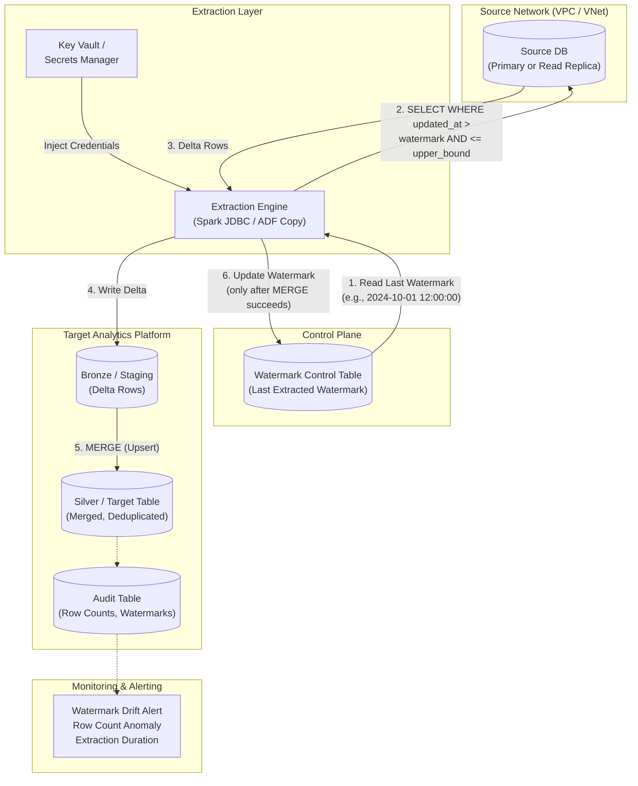

# Pattern 03: Incremental Batch (Watermark)

## 1. Pattern Overview

- **Pattern Name:** Incremental Batch (High-Watermark)
- **Pattern ID:** 03
- **Version:** 2.0
- **Objective:** Extract only new or modified records from a source database by querying a high-watermark column (typically `updated_at` timestamp or a monotonically increasing sequential `ID`), then MERGE the delta into the target table.
- **Applicable Sources:** Relational Databases (PostgreSQL, MySQL, SQL Server, Oracle) where a reliable watermark column exists and is indexed.
- **Applicable Targets:** Databricks Lakehouse (Delta Lake), Snowflake, Cloud Data Lake (ADLS/S3).
- **Typical Use Cases:**
  - Medium to large operational tables (10 GB – 1 TB+) with reliable `updated_at` or `modified_date` columns.
  - Systems where full snapshots (Pattern 02) are too expensive due to network egress and extraction time.
  - Batch/micro-batch SLAs (hourly to daily) where real-time CDC (Pattern 05/06) is not required or not available.
- **When to Use:**
  - Source application reliably updates a timestamp column on every `INSERT` and `UPDATE`.
  - Source uses soft deletes (e.g., `is_deleted = TRUE` updates the `updated_at` column).
  - Log-based CDC (Pattern 05/06) is not available, not approved, or not justified for this table's volume.
- **When NEVER to Use (Red Lines):**
  - **Source hard-deletes records**: This pattern **cannot detect hard deletes**. The target will silently retain orphaned rows. Use Pattern 02 (Full Snapshot) or Pattern 05 (CDC).
  - **`updated_at` column is not reliably updated**: If the application has code paths that modify rows without updating the timestamp, this pattern will silently miss those changes.
  - **`updated_at` column is not indexed**: Every extraction query will trigger a full table scan on the source, negating the efficiency gains of incremental extraction.
  - **Sub-minute latency requirement**: Use Pattern 05/06 (CDC).

---

## 2. Pre-Ingestion Profiling

Execute the following assessments **before** building the pipeline.

### 2.1 Watermark Column Validation

```sql
-- PostgreSQL: Is the watermark column indexed?
SELECT indexname, indexdef
FROM pg_indexes
WHERE tablename = 'orders' AND indexdef LIKE '%updated_at%';
-- If no result → CREATE INDEX idx_orders_updated_at ON orders(updated_at);
```

```sql
-- PostgreSQL: Verify the watermark is reliably updated
-- Check for rows modified AFTER a known date but with old updated_at
SELECT COUNT(*) AS suspicious_rows
FROM orders
WHERE updated_at < '2024-01-01'
  AND xmin::text::bigint > (SELECT MAX(xmin::text::bigint) - 10000 FROM orders);
-- If suspicious_rows > 0 → application is NOT reliably updating updated_at → Pattern is INVALID.
```

```sql
-- SQL Server: Is the watermark indexed?
SELECT i.name AS index_name, c.name AS column_name
FROM sys.indexes i
JOIN sys.index_columns ic ON i.object_id = ic.object_id AND i.index_id = ic.index_id
JOIN sys.columns c ON ic.object_id = c.object_id AND ic.column_id = c.column_id
WHERE OBJECT_NAME(i.object_id) = 'orders' AND c.name = 'updated_at';
```

```sql
-- All engines: Check for NULL watermarks (data quality)
SELECT COUNT(*) AS null_watermarks FROM orders WHERE updated_at IS NULL;
-- If null_watermarks > 0 → these rows will NEVER be captured by incremental extraction.
```

### 2.2 Volume Assessment

```sql
-- Estimate delta size per hour (guides extraction frequency)
SELECT 
    DATE_TRUNC('hour', updated_at) AS hour_bucket,
    COUNT(*) AS rows_changed,
    pg_size_pretty(SUM(pg_column_size(orders.*))::bigint) AS estimated_size
FROM orders
WHERE updated_at >= NOW() - INTERVAL '7 days'
GROUP BY 1
ORDER BY 1 DESC;
```

### 2.3 Critical Pre-Flight Checks

| Check | Target | Consequence of Failure |
|:---|:---|:---|
| Watermark column indexed | Index exists on `updated_at` or `id` | Full table scan on source every extraction cycle |
| Watermark reliably updated | Application updates column on every INSERT/UPDATE | Silent data loss (missed changes) |
| No NULL watermarks | 0 rows with NULL `updated_at` | Rows with NULL never extracted (orphaned in source) |
| Hard deletes assessed | Source uses soft deletes, OR hard deletes are acceptable to miss | Orphaned rows in target (silent data divergence) |
| Network path secured | Private Link / VNet | DB exposed to public internet |
| Read Replica available | For large tables (> 5 GB) | Extraction degrades primary OLTP performance |

---

## 3. Reference Architecture

### 3.1 End-to-End Architecture



---

## 4. End-to-End Data Flow

### Step 1 — Watermark Lookup
The extraction engine reads the last successful watermark from the Control Table:

```sql
SELECT last_watermark, last_upper_bound
FROM control.watermark_state
WHERE source_table = 'public.orders';
-- Result: last_watermark = '2024-10-01 12:00:00'
```

### Step 2 — Bounded Extraction
The engine executes a **bounded query** (with both lower AND upper bound) against the source:

```sql
SELECT *
FROM public.orders
WHERE updated_at > '2024-10-01 12:00:00'           -- Lower bound (exclusive)
  AND updated_at <= '2024-10-01 13:00:00'           -- Upper bound (inclusive)
ORDER BY updated_at ASC;
```

> **⚠️ WARNING:** Always use a **bounded extraction** (lower AND upper bound). An unbounded query (`WHERE updated_at > watermark`) risks capturing rows from in-flight transactions that haven't committed yet, leading to data inconsistency.

### Step 3 — Clock Skew Overlap (Critical)
To handle late-arriving data caused by source database clock skew, long-running transactions, or application-level delays, **overlap the lower bound** by a safety margin:

```sql
-- Overlap by 5 minutes to catch late-arriving records
SELECT *
FROM public.orders
WHERE updated_at > ('2024-10-01 12:00:00'::timestamp - INTERVAL '5 minutes')
  AND updated_at <= '2024-10-01 13:00:00';
```

This overlap means some rows will be extracted twice. The downstream **MERGE** (not INSERT) guarantees idempotent deduplication.

### Step 4 — Landing & MERGE
Delta records are written to a staging/Bronze table, then merged into the Silver target:

```sql
-- Databricks: MERGE upsert with deduplication
MERGE INTO catalog.silver.orders t
USING (
    SELECT * FROM (
        SELECT *,
               ROW_NUMBER() OVER (PARTITION BY order_id ORDER BY updated_at DESC) AS _rn
        FROM catalog.bronze.orders_delta
    ) WHERE _rn = 1
) s
ON t.order_id = s.order_id
WHEN MATCHED THEN UPDATE SET
    t.customer_id = s.customer_id,
    t.amount = s.amount,
    t.status = s.status,
    t.updated_at = s.updated_at
WHEN NOT MATCHED THEN INSERT
    (order_id, customer_id, amount, status, updated_at)
    VALUES (s.order_id, s.customer_id, s.amount, s.status, s.updated_at);
```

```sql
-- Snowflake: MERGE with QUALIFY deduplication
MERGE INTO silver.orders t
USING (
    SELECT *
    FROM staging.orders_delta
    QUALIFY ROW_NUMBER() OVER (PARTITION BY order_id ORDER BY updated_at DESC) = 1
) s
ON t.order_id = s.order_id
WHEN MATCHED THEN UPDATE SET
    t.customer_id = s.customer_id,
    t.amount = s.amount,
    t.status = s.status,
    t.updated_at = s.updated_at
WHEN NOT MATCHED THEN INSERT
    (order_id, customer_id, amount, status, updated_at)
    VALUES (s.order_id, s.customer_id, s.amount, s.status, s.updated_at);
```

### Step 5 — Watermark Checkpoint (Only After MERGE Succeeds)
```sql
-- Update watermark ONLY after successful MERGE
UPDATE control.watermark_state
SET last_watermark = '2024-10-01 13:00:00',
    last_run_ts = CURRENT_TIMESTAMP(),
    rows_extracted = 12450,
    status = 'SUCCESS'
WHERE source_table = 'public.orders';
```

> **🚨 CAUTION:** The watermark must be updated **after** the MERGE succeeds, never before. If the MERGE fails and the watermark was already advanced, the delta rows are lost permanently.

---

## 5. Insert / Update / Delete Handling

| Operation | Detection | Target Behavior |
|:---|:---|:---|
| **Inserts** | New rows have `updated_at` within extraction window | `WHEN NOT MATCHED THEN INSERT` |
| **Updates** | Modified rows have `updated_at` updated by application | `WHEN MATCHED THEN UPDATE SET ...` |
| **Soft Deletes** | Application sets `is_deleted = TRUE` and updates `updated_at` | Captured by watermark. Target reflects `is_deleted = TRUE`. |
| **Hard Deletes** | ❌ **CANNOT DETECT** | Row is physically removed from source. Target retains orphaned record indefinitely. |

### Hard Delete Mitigation Strategies

If the source hard-deletes records and Pattern 05/06 (CDC) is not available:

| Strategy | Mechanism | Cost | Frequency |
|:---|:---|:---|:---|
| **Periodic Full Reconciliation** | Weekly/monthly `EXCEPT` comparison between source and target to identify orphans | Medium (full table scan) | Weekly |
| **Hybrid: Incremental + Periodic Full Snapshot** | Run Pattern 03 daily. Run Pattern 02 (Full Snapshot) weekly to catch deletes. | Medium | Weekly |
| **Request Soft Deletes from Source Team** | Application marks `is_deleted = TRUE` instead of physical delete | Zero (app change) | N/A |

```sql
-- Periodic reconciliation: Find orphaned rows in target
SELECT t.order_id
FROM silver.orders t
LEFT JOIN source_db.public.orders s ON t.order_id = s.order_id
WHERE s.order_id IS NULL;
-- These rows were hard-deleted from source but still exist in target.
```

---

## 6. Initial vs. Incremental Load Strategy

### 6.1 Initial Load
The watermark is initialized at the epoch (`1900-01-01 00:00:00`). The first run behaves as a full snapshot.

For large tables (> 1 GB), the initial extraction must be **partitioned** to avoid JDBC timeouts and memory limits:

```python
# Spark JDBC: Partitioned initial load
df = (spark.read.format("jdbc")
    .option("url", "jdbc:postgresql://replica:5432/db")
    .option("dbtable", "public.orders")
    .option("user", dbutils.secrets.get("kv", "user"))
    .option("password", dbutils.secrets.get("kv", "pass"))
    .option("partitionColumn", "order_id")
    .option("lowerBound", "1")
    .option("upperBound", "50000000")
    .option("numPartitions", "16")       # 16 parallel JDBC connections
    .option("fetchsize", "10000")
    .load()
)
```

### 6.2 Steady-State Incremental
Subsequent runs use the watermark from the previous successful run. The extraction window is bounded by the current time (or a lagged upper bound for clock-skew safety).

---

## 7. Watermark Control Table

```sql
-- Control table DDL (Databricks or Snowflake)
CREATE TABLE IF NOT EXISTS control.watermark_state (
    source_schema       STRING      NOT NULL,
    source_table        STRING      NOT NULL,
    watermark_column    STRING      NOT NULL,   -- 'updated_at' or 'id'
    watermark_type      STRING      NOT NULL,   -- 'TIMESTAMP' or 'INTEGER'
    last_watermark      STRING      NOT NULL,   -- Stored as string for flexibility
    last_upper_bound    STRING,                 -- Upper bound of last extraction
    overlap_seconds     INT         DEFAULT 300, -- Clock skew overlap (5 min default)
    last_run_ts         TIMESTAMP,
    rows_extracted      BIGINT,
    status              STRING      NOT NULL,   -- SUCCESS | FAILED | RUNNING
    error_message       STRING,
    PRIMARY KEY (source_schema, source_table)
);

-- Initialize watermark for a new table
INSERT INTO control.watermark_state
    (source_schema, source_table, watermark_column, watermark_type, last_watermark, status)
VALUES
    ('public', 'orders', 'updated_at', 'TIMESTAMP', '1900-01-01 00:00:00', 'INITIALIZED');
```

---

## 8. Target-Side Optimization

### 8.1 Databricks (Delta Lake)

```sql
-- Enable Deletion Vectors for efficient UPDATE operations
ALTER TABLE catalog.silver.orders
SET TBLPROPERTIES ('delta.enableDeletionVectors' = true);

-- Liquid Clustering on MERGE key + common filter
ALTER TABLE catalog.silver.orders
CLUSTER BY (order_id);

-- Compact small files after MERGE (run daily)
OPTIMIZE catalog.silver.orders;
```

### 8.2 Snowflake

```sql
-- Cluster on MERGE key for efficient micro-partition pruning
ALTER TABLE silver.orders CLUSTER BY (order_id);

-- Monitor clustering depth (lower = better)
SELECT SYSTEM$CLUSTERING_INFORMATION('silver.orders', '(order_id)');
```

> **ℹ️ NOTE:** Without clustering on the MERGE key, every MERGE operation scans the entire target table. On a 1 TB target, this turns a 30-second MERGE into a 30-minute full table scan.

---

## 9. AWS & Azure Implementation Reference

### 9.1 AWS

| Component | Service | Configuration |
|:---|:---|:---|
| **Source** | RDS / Aurora Read Replica | Read-only endpoint. Connection pooling via RDS Proxy if high concurrency. |
| **Extraction** | Glue / EMR (Spark JDBC) | JDBC partitioning on numeric PK. `fetchsize = 10000`. |
| **Secrets** | AWS Secrets Manager | DB credentials. Rotated every 90 days. |
| **Networking** | VPC Peering / PrivateLink | Extraction ↔ RDS: Same VPC. No public endpoints. |
| **Orchestration** | Step Functions / MWAA | Schedule: hourly/daily. Include watermark read → extract → merge → watermark update steps. |
| **Monitoring** | CloudWatch | Custom metrics: extraction_duration, rows_extracted, watermark_lag. |

### 9.2 Azure

| Component | Service | Configuration |
|:---|:---|:---|
| **Source** | Azure SQL / PostgreSQL Read Replica | Read-only endpoint. |
| **Extraction** | ADF Copy Activity (incremental mode) / Databricks JDBC | ADF: Use `$lastModified` system variable for watermark. |
| **Secrets** | Azure Key Vault | DB credentials via Managed Identity. |
| **Networking** | VNet Service Endpoints / Private Link | ADF ↔ Azure DB: Private Endpoint. |
| **Orchestration** | ADF Pipelines (Tumbling Window Trigger) | Tumbling window inherently handles watermark-based scheduling. |
| **Monitoring** | Azure Monitor + ADF metrics | Pipeline duration, rows copied, failure alerts. |

---

## 10. Security & Governance

### 10.1 Mandatory Security Controls

| Control | Implementation | Non-Compliance Consequence |
|:---|:---|:---|
| **Network Isolation** | Extraction engine connects to source DB via Private Link / VNet only. | ARB rejection. DB exposed to public internet. |
| **Encryption at Rest** | Target tables: Platform-managed encryption. Staging: SSE-KMS / CMK. | Regulatory violation. |
| **Encryption in Transit** | JDBC: TLS 1.2+. `sslmode=verify-full` (PostgreSQL). | Credential interception. |
| **Secrets Management** | All DB credentials in Key Vault / Secrets Manager. Zero hardcoded. | Security violation. |
| **Least-Privilege IAM** | Extraction role: `SELECT` on source tables only. No DDL, no DML. | Blast radius amplification. |
| **PII Masking** | Mask/hash PII columns during Bronze→Silver MERGE transformation. | PII exposure in analytics. |

---

## 11. Reliability, Resumability & Failure Recovery

### 11.1 Failure Scenarios & Recovery Playbook

| Failure Scenario | Impact | Recovery Procedure |
|:---|:---|:---|
| **Extraction fails** (network, timeout) | No delta rows written. Watermark NOT advanced. | Re-run pipeline. Same watermark → same extraction (idempotent). |
| **MERGE fails** (constraint violation, OOM) | Delta rows in Bronze but not in Silver. Watermark NOT advanced. | Fix root cause (schema mismatch, data skew). Re-run. Watermark-based extraction re-fetches same delta. MERGE deduplicates. |
| **Watermark advanced but MERGE failed** | ❌ **Data loss.** Delta rows permanently skipped. | **NEVER advance watermark before MERGE completes.** If this happens: manually reset watermark to pre-failure value. |
| **Clock skew causes missed rows** | Rows with `updated_at` slightly older than watermark are missed. | Configure overlap: `WHERE updated_at > (watermark - INTERVAL '5 minutes')`. MERGE handles duplicates. |
| **Source `updated_at` not updated for modified rows** | Rows silently missed (never extracted). | **Pattern is structurally invalid.** Escalate to source team or migrate to Pattern 05 (CDC). |

### 11.2 Idempotency Guarantees

```
┌─────────────────────────────────────────────────────────┐
│                   IDEMPOTENCY MODEL                      │
├──────────────┬──────────────────────────────────────────┤
│  Layer       │  Guarantee                               │
├──────────────┼──────────────────────────────────────────┤
│  Extraction  │  Deterministic: same watermark range     │
│              │  always produces same delta (assuming     │
│              │  source is stable).                       │
├──────────────┼──────────────────────────────────────────┤
│  Bronze      │  May contain overlapping rows (from      │
│              │  clock-skew overlap window). By design.   │
├──────────────┼──────────────────────────────────────────┤
│  Silver MERGE│  MERGE on PK deduplicates. Re-running    │
│              │  the same delta produces identical result.│
│              │  THIS IS THE IDEMPOTENCY BOUNDARY.        │
└──────────────┴──────────────────────────────────────────┘
```

---

## 12. Observability & Monitoring

### 12.1 Mandatory Alerts

| Metric | Threshold | Alert Severity | Action |
|:---|:---|:---|:---|
| **Watermark age** (time since last successful extraction) | > 2× scheduled interval | 🔴 P1 CRITICAL | Pipeline stuck or failing silently. Check orchestrator logs. |
| **Rows extracted** | 0 rows for > 3 consecutive runs | 🟡 P2 WARNING | Source may be idle, or watermark query is returning empty set. Verify watermark value. |
| **Row count anomaly** | Rows extracted > 5× or < 0.1× historical average | 🟡 P2 WARNING | Possible bulk update at source, or extraction window misconfiguration. |
| **Extraction duration** | > 2× historical average | 🟡 P2 WARNING | Source DB under load, missing index, or network degradation. |
| **MERGE failure** | Any failure | 🔴 P1 CRITICAL | Watermark NOT advanced. Fix root cause and re-run. |
| **Source index health** | Index on `updated_at` dropped or corrupted | 🔴 P1 CRITICAL | Extraction causes full table scan on source. Recreate index immediately. |

---

## 13. Cost Model

### 13.1 Cost Components

| Component | Cost Driver | Optimization Lever |
|:---|:---|:---|
| **Source DB Load** | JDBC connections × query duration | Use Read Replica. Ensure `updated_at` is indexed. |
| **Extraction Compute** | Spark cluster hours / ADF DIU-hours | Right-size cluster to delta volume. Use spot instances. |
| **Network Egress** | Delta rows transferred per extraction | Bounded queries minimize data transferred. Column projection (`SELECT needed_cols_only`). |
| **MERGE Compute** | Target table scan during MERGE | Liquid Clustering / Snowflake Clustering on PK minimizes scan. |
| **Control Table** | Negligible | — |

### 13.2 Efficiency vs. Pattern 02

| Metric | Pattern 02 (Full Snapshot) | Pattern 03 (Incremental) |
|:---|:---|:---|
| Data transferred per run | Entire table (e.g., 10 GB) | Only changed rows (e.g., 100 MB) |
| Source DB I/O per run | Full table scan | Index scan on `updated_at` |
| Target write per run | Full overwrite | MERGE (touches only changed rows) |
| Hard delete detection | ✅ Yes | ❌ No |

---

## 14. Constraints & Red Lines

| # | Red Line | Consequence | Mitigation |
|:---|:---|:---|:---|
| 1 | **Hard Deletes in Source** | Target silently retains orphaned rows that no longer exist in source. Data divergence grows over time. | Use Pattern 02 or 05 instead. Or implement periodic full reconciliation (§5). |
| 2 | **Unindexed Watermark Column** | Every extraction executes a full table scan on the source, negating all efficiency gains and degrading DB performance. | `CREATE INDEX` on `updated_at`. Monitor index health. |
| 3 | **Unreliable `updated_at`** | Rows modified without updating the timestamp are permanently missed. Silent data loss. | Validate with source team. If unreliable → pattern is INVALID. |
| 4 | **Watermark Advanced Before MERGE** | Delta rows are permanently skipped if MERGE fails after watermark was updated. | **NEVER** update watermark before MERGE completes successfully. |
| 5 | **Unbounded Extraction (No Upper Bound)** | Captures uncommitted in-flight transactions. Data inconsistency. | Always use bounded extraction: `WHERE updated_at > lower AND updated_at <= upper`. |
| 6 | **NULL Watermark Values** | Rows with `NULL` updated_at are never captured by any extraction run. | Ensure source populates `updated_at` with `DEFAULT CURRENT_TIMESTAMP`. Backfill existing NULLs. |

---

## 15. Trade-Offs

| Decision | Option A | Option B | Trade-Off Analysis |
|:---|:---|:---|:---|
| **Watermark Column** | `updated_at` (Timestamp) | `id` (Sequential Integer) | `updated_at` captures inserts AND updates but is vulnerable to clock skew and app bugs. `id` is faster and immutable but cannot detect row updates (only new inserts). **Use `updated_at` unless the table is append-only.** |
| **Extract Bound** | Unbounded (`> WM`) | Bounded (`> WM AND <= CurrentTime`) | Bounded ensures consistency and prevents capturing in-flight transactions. Unbounded is simpler but risks data quality issues. **Always use bounded.** |
| **Clock Skew Handling** | No overlap | 5-minute overlap | No overlap risks missing late-arriving rows. Overlap causes some re-extraction but MERGE deduplicates safely. **Default to 5-minute overlap.** |
| **Large Table Strategy** | Single JDBC connection | Partitioned parallel extraction | Single connection is simple but slow for large deltas. Partitioned extraction requires a numeric partition column but is 4–16× faster. **Partition for tables > 1 GB.** |
| **Delete Handling** | Accept orphaned rows | Periodic full reconciliation | Accepting orphans is zero-cost but causes data divergence. Reconciliation adds a weekly full-scan cost but keeps data accurate. **Reconcile weekly if business requires delete accuracy.** |

---

## 16. Pattern Selection Checklist

> This checklist must be completed and submitted to the Architecture Review Board before pipeline provisioning.

- [ ] Source table has a reliable `updated_at` or sequential `id` column (validated with source team).
- [ ] Watermark column is **indexed** on the source database (verified via `EXPLAIN`).
- [ ] No NULL values in watermark column (or backfill plan documented).
- [ ] Hard delete strategy documented: accepted, mitigated with reconciliation, or escalated to Pattern 05.
- [ ] Extraction uses **bounded query** (lower AND upper bound).
- [ ] Clock skew overlap configured (default: 5 minutes).
- [ ] Watermark control table created and initialized.
- [ ] Watermark update occurs **only after** successful MERGE (never before).
- [ ] MERGE uses `ROW_NUMBER()` deduplication on PK within micro-batch.
- [ ] Target table clustered on MERGE key (Liquid Clustering / Snowflake Clustering).
- [ ] Network connectivity secured via **Private Link / VNet** (no public internet).
- [ ] All credentials stored in **Key Vault / Secrets Manager**.
- [ ] Monitoring alerts configured: watermark age, row count anomaly, extraction duration, MERGE failure.
- [ ] Read Replica used for extraction (if table > 5 GB or source is under OLTP load).
- [ ] PII columns identified and masking strategy documented.
- [ ] Cost estimate reviewed (extraction compute + network egress + MERGE compute).
