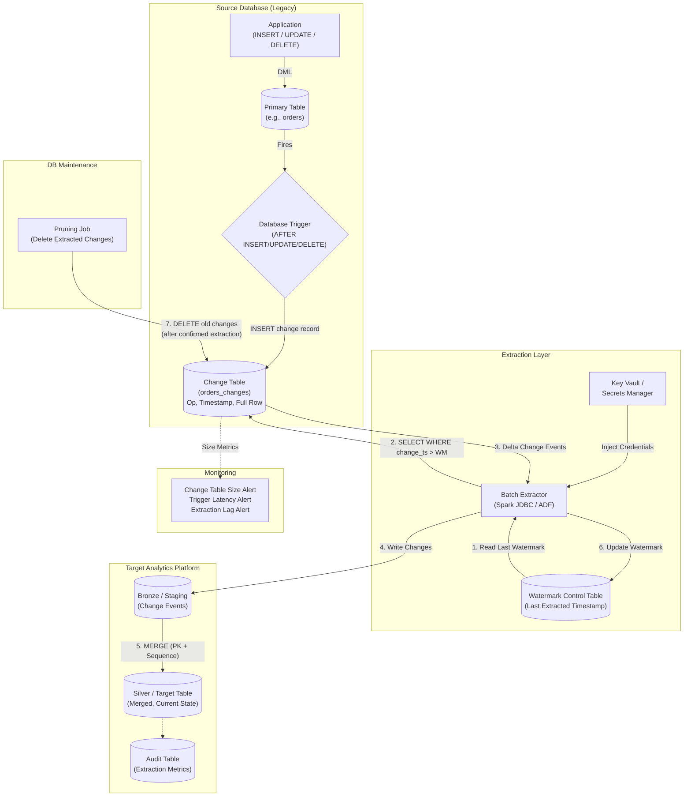

# Pattern 04: Trigger-Based Change Table

## 1. Pattern Overview

- **Pattern Name:** Trigger-Based Change Table
- **Pattern ID:** 04
- **Version:** 2.0
- **Objective:** Capture row-level inserts, updates, and hard deletes using database triggers that write to a shadow "change table" (audit table) within the same source database, enabling the data platform to extract only changed rows via watermark-based polling.
- **Applicable Sources:** Legacy Relational Databases (Oracle, SQL Server, older PostgreSQL, DB2, Sybase) where log-based CDC is blocked by policy, unsupported, or the DBA team refuses WAL/Binlog access.
- **Applicable Targets:** Databricks Lakehouse (Delta Lake), Snowflake, Cloud Data Lake (ADLS/S3).
- **Typical Use Cases:**
  - Legacy applications (15+ years old) where exact history and hard deletes must be tracked, but DBAs will not allow external tools to read transaction logs.
  - COTS (Commercial Off-The-Shelf) software where the vendor prohibits WAL-level access.
  - Compliance/audit requirements where a tamper-evident change log must exist within the source database itself.
- **When to Use:**
  - As a **last resort** for CDC when native log-based replication (Pattern 05/06) is impossible.
  - When the business requires hard delete capture AND history tracking, ruling out Pattern 03 (Incremental Batch).
  - When the source database is low-to-medium throughput (< 500 TPS on the tracked table).
- **When NEVER to Use (Red Lines):**
  - **High-throughput transactional systems (> 500 TPS on the tracked table)**: The double-write penalty of triggers will severely degrade primary database performance. Triggers execute synchronously within the application's transaction.
  - **Source DB CPU already > 70%**: Adding trigger overhead will push the database into saturation.
  - **Log-based CDC is available**: Triggers are always inferior to WAL/Binlog-based CDC in performance, reliability, and operational simplicity.
  - **Tables with high-frequency bulk operations**: A `DELETE FROM orders WHERE status = 'expired'` deleting 1 million rows fires the trigger 1 million times.

---

## 2. Pre-Ingestion Profiling

Execute the following assessments **before** implementing triggers.

### 2.1 Source DB Performance Assessment

```sql
-- PostgreSQL: Current TPS on the target table (approximate)
SELECT 
    relname,
    n_tup_ins AS inserts,
    n_tup_upd AS updates,
    n_tup_del AS deletes,
    (n_tup_ins + n_tup_upd + n_tup_del) AS total_dml
FROM pg_stat_user_tables
WHERE relname = 'orders';
-- Run twice, 60 seconds apart, and calculate delta to derive TPS.
```

```sql
-- SQL Server: Current write activity
SELECT 
    OBJECT_NAME(object_id) AS table_name,
    leaf_insert_count AS inserts,
    leaf_update_count AS updates,
    leaf_delete_count AS deletes
FROM sys.dm_db_index_operational_stats(DB_ID(), OBJECT_ID('dbo.orders'), NULL, NULL);
```

### 2.2 Write Amplification Assessment

| Check | Target | Consequence of Failure |
|:---|:---|:---|
| Source table TPS | < 500 TPS | > 500 TPS → trigger overhead causes application latency spikes |
| Source DB CPU utilization | < 70% baseline | > 70% → adding 2× write amplification pushes DB into saturation |
| IOPS headroom | ≥ 2× current peak IOPS | Change table writes double storage I/O |
| Change table storage | Sufficient for 7 days of changes (minimum) | Change table fills disk → primary DB crash |
| Application transaction duration | < 100ms average | Trigger adds 5–20ms per DML operation |

---

## 3. Reference Architecture

### 3.1 End-to-End Architecture



---

## 4. End-to-End Data Flow

### Step 1 — Source Event
The application executes DML (INSERT, UPDATE, DELETE) on the primary table.

### Step 2 — Trigger Execution
A database trigger fires synchronously within the same transaction and inserts a change record into the Change Table:

```sql
-- PostgreSQL: Trigger function
CREATE OR REPLACE FUNCTION trg_orders_change() RETURNS TRIGGER AS $$
BEGIN
    IF TG_OP = 'DELETE' THEN
        INSERT INTO orders_changes (
            change_id, order_id, operation, change_ts,
            -- Full before-image for deletes
            old_customer_id, old_amount, old_status
        ) VALUES (
            gen_random_uuid(), OLD.order_id, 'D', NOW(),
            OLD.customer_id, OLD.amount, OLD.status
        );
        RETURN OLD;
    ELSIF TG_OP = 'UPDATE' THEN
        INSERT INTO orders_changes (
            change_id, order_id, operation, change_ts,
            -- Full after-image for updates
            new_customer_id, new_amount, new_status
        ) VALUES (
            gen_random_uuid(), NEW.order_id, 'U', NOW(),
            NEW.customer_id, NEW.amount, NEW.status
        );
        RETURN NEW;
    ELSIF TG_OP = 'INSERT' THEN
        INSERT INTO orders_changes (
            change_id, order_id, operation, change_ts,
            new_customer_id, new_amount, new_status
        ) VALUES (
            gen_random_uuid(), NEW.order_id, 'I', NOW(),
            NEW.customer_id, NEW.amount, NEW.status
        );
        RETURN NEW;
    END IF;
END;
$$ LANGUAGE plpgsql;

-- Attach trigger
CREATE TRIGGER trg_orders_audit
    AFTER INSERT OR UPDATE OR DELETE ON orders
    FOR EACH ROW EXECUTE FUNCTION trg_orders_change();
```

```sql
-- SQL Server: Trigger
CREATE TRIGGER trg_orders_change ON dbo.orders
AFTER INSERT, UPDATE, DELETE
AS
BEGIN
    SET NOCOUNT ON;
    
    -- Inserts
    INSERT INTO dbo.orders_changes (order_id, operation, change_ts, customer_id, amount, status)
    SELECT i.order_id, 'I', GETDATE(), i.customer_id, i.amount, i.status
    FROM inserted i
    LEFT JOIN deleted d ON i.order_id = d.order_id
    WHERE d.order_id IS NULL;
    
    -- Updates
    INSERT INTO dbo.orders_changes (order_id, operation, change_ts, customer_id, amount, status)
    SELECT i.order_id, 'U', GETDATE(), i.customer_id, i.amount, i.status
    FROM inserted i
    JOIN deleted d ON i.order_id = d.order_id;
    
    -- Deletes
    INSERT INTO dbo.orders_changes (order_id, operation, change_ts, customer_id, amount, status)
    SELECT d.order_id, 'D', GETDATE(), d.customer_id, d.amount, d.status
    FROM deleted d
    LEFT JOIN inserted i ON d.order_id = i.order_id
    WHERE i.order_id IS NULL;
END;
```

### Step 3 — Change Table Schema

```sql
-- Change Table DDL (PostgreSQL)
CREATE TABLE orders_changes (
    change_id       UUID        PRIMARY KEY DEFAULT gen_random_uuid(),
    order_id        BIGINT      NOT NULL,       -- Source PK
    operation       CHAR(1)     NOT NULL,       -- 'I', 'U', 'D'
    change_ts       TIMESTAMP   NOT NULL DEFAULT NOW(),
    -- After-image columns (NULL for deletes)
    new_customer_id BIGINT,
    new_amount      DECIMAL(18,2),
    new_status      VARCHAR(50),
    -- Metadata
    extracted       BOOLEAN     DEFAULT FALSE,  -- Pruning flag
    extracted_ts    TIMESTAMP                    -- When extracted
);

-- CRITICAL: Index on change_ts for watermark extraction performance
CREATE INDEX idx_changes_ts ON orders_changes(change_ts);

-- CRITICAL: Index on extracted flag for pruning performance
CREATE INDEX idx_changes_extracted ON orders_changes(extracted) WHERE extracted = FALSE;
```

### Step 4 — Extraction
An ingestion tool queries the Change Table periodically using a watermark:

```sql
SELECT change_id, order_id, operation, change_ts,
       new_customer_id, new_amount, new_status
FROM orders_changes
WHERE change_ts > '2024-10-01 12:00:00'
  AND change_ts <= '2024-10-01 13:00:00'
ORDER BY change_ts ASC;
```

### Step 5 — Target MERGE

```sql
-- Databricks: MERGE with deduplication and delete handling
MERGE INTO catalog.silver.orders t
USING (
    SELECT * FROM (
        SELECT *,
               ROW_NUMBER() OVER (PARTITION BY order_id ORDER BY change_ts DESC) AS _rn
        FROM catalog.bronze.orders_changes
    ) WHERE _rn = 1
) s
ON t.order_id = s.order_id
WHEN MATCHED AND s.operation = 'D' THEN DELETE
WHEN MATCHED AND s.operation IN ('U', 'I') THEN UPDATE SET
    t.customer_id = s.new_customer_id,
    t.amount = s.new_amount,
    t.status = s.new_status,
    t.last_change_ts = s.change_ts
WHEN NOT MATCHED AND s.operation IN ('I', 'U') THEN INSERT
    (order_id, customer_id, amount, status, last_change_ts)
    VALUES (s.order_id, s.new_customer_id, s.new_amount, s.new_status, s.change_ts);
```

### Step 6 — Change Table Pruning
A maintenance job deletes old, successfully extracted records to prevent unbounded growth:

```sql
-- Mark extracted records
UPDATE orders_changes
SET extracted = TRUE, extracted_ts = NOW()
WHERE change_ts <= '2024-10-01 13:00:00'
  AND extracted = FALSE;

-- Prune records older than 7 days (safety buffer)
DELETE FROM orders_changes
WHERE extracted = TRUE
  AND extracted_ts < NOW() - INTERVAL '7 days';

-- Monitor change table size
SELECT pg_size_pretty(pg_total_relation_size('orders_changes')) AS change_table_size;
```

> **🚨 CAUTION:** Never delete records from the change table until the downstream MERGE has been confirmed successful AND the watermark has been advanced past those records. Premature pruning causes permanent data loss.

---

## 5. Insert / Update / Delete Handling

| Operation | Trigger Behavior | Target MERGE Behavior |
|:---|:---|:---|
| **Insert** | Trigger records `operation = 'I'` with full after-image | `WHEN NOT MATCHED THEN INSERT` |
| **Update** | Trigger records `operation = 'U'` with full after-image (optionally before-image) | `WHEN MATCHED THEN UPDATE SET ...` |
| **Delete** | Trigger records `operation = 'D'` with before-image (deleted row's data) | `WHEN MATCHED AND operation = 'D' THEN DELETE` (or soft-delete) |

> **ℹ️ NOTE:** This is the primary advantage of Pattern 04 over Pattern 03 (Incremental Batch). Pattern 04 **successfully captures hard deletes**, which Pattern 03 fundamentally cannot.

---

## 6. Schema Evolution Handling

> **⚠️ WARNING:** Schema evolution is the Achilles' heel of trigger-based CDC.

| Scenario | Impact | Mitigation |
|:---|:---|:---|
| **Column added to primary table** | Trigger and change table must be manually altered by DBA. New column NOT captured until trigger is updated. | Create a runbook: any DDL on tracked tables requires corresponding DDL on change table + trigger. |
| **Column renamed** | Trigger references old column name → trigger fails → application transactions fail. | Coordinate DDL changes with DBA. Test trigger in staging first. |
| **Column dropped** | If trigger references dropped column → trigger fails → application transactions fail. | Same as above. |
| **Column type changed** | Change table column may be incompatible → INSERT into change table fails → application transaction fails. | Widen change table columns preemptively (e.g., use `TEXT` for flexible storage). |

> **🔴 CRITICAL:** Because the trigger executes **within the application's transaction**, a trigger failure causes the **application's transaction to roll back**. A broken trigger is a **production application outage**, not just a data pipeline failure.

---

## 7. AWS & Azure Implementation Reference

### 7.1 AWS

| Component | Service | Configuration |
|:---|:---|:---|
| **Source** | RDS / EC2-hosted legacy DB | Triggers created by DBA. Change table on same instance. |
| **Extraction** | Glue / EMR (Spark JDBC) | JDBC read from change table via Read Replica (if available). |
| **Secrets** | AWS Secrets Manager | DB credentials. |
| **Networking** | VPC Peering / PrivateLink | Extraction engine ↔ DB: Same VPC. |
| **Orchestration** | Step Functions / MWAA | Hourly: Extract → MERGE → Watermark → Prune. |

### 7.2 Azure

| Component | Service | Configuration |
|:---|:---|:---|
| **Source** | Azure SQL / VM-hosted legacy DB | Triggers created by DBA. Change table on same instance. |
| **Extraction** | ADF Copy Activity / Databricks JDBC | Incremental copy with watermark. |
| **Secrets** | Azure Key Vault | DB credentials via Managed Identity. |
| **Networking** | VNet Service Endpoints / Private Link | ADF ↔ DB: Private Endpoint. |
| **Orchestration** | ADF Pipelines | Tumbling Window trigger for periodic extraction. |

---

## 8. Security & Governance

### 8.1 Mandatory Security Controls

| Control | Implementation | Non-Compliance Consequence |
|:---|:---|:---|
| **Network Isolation** | Extraction connects to DB via Private Link / VNet only. | ARB rejection. |
| **Encryption at Rest** | Change table inherits DB encryption. Target: platform encryption. | Regulatory violation. |
| **Encryption in Transit** | JDBC: TLS 1.2+. | Credential interception. |
| **Secrets Management** | All DB credentials in Key Vault / Secrets Manager. | Security violation. |
| **Least-Privilege** | Extraction role: `SELECT` on change table only. No access to primary table. | Blast radius amplification. |
| **Change Table Access** | Only the trigger function and extraction service should access the change table. Application users should NOT have direct access. | Audit trail tampering. |
| **PII Masking** | Mask PII in change table if feasible, or during Bronze→Silver transformation. | PII in analytics and in source change table. |

---

## 9. Reliability, Resumability & Failure Recovery

### 9.1 Failure Scenarios & Recovery Playbook

| Failure Scenario | Impact | Recovery Procedure |
|:---|:---|:---|
| **Trigger fails** | ❌ **Application transaction rolls back.** Production outage. | Emergency: Disable trigger (`ALTER TABLE orders DISABLE TRIGGER trg_orders_audit`). Fix trigger. Re-enable. Backfill missed changes via full snapshot comparison. |
| **Change table fills disk** | ❌ **Primary DB crash.** | Emergency: Prune old records. Add storage. Increase pruning frequency. |
| **Extraction fails** | Change table accumulates. No data loss. Watermark not advanced. | Re-run extraction. Idempotent (MERGE on PK handles duplicates). |
| **MERGE fails** | Change events in Bronze but not Silver. Watermark not advanced. | Fix root cause. Re-run. |
| **Pruning runs before extraction** | ❌ **Data loss.** Change records deleted before extraction. | Never prune records younger than 7 days. Only prune records with `extracted = TRUE`. |
| **DBA modifies primary table schema without updating trigger** | Trigger fails → production outage. | Enforce DDL change management process. All tracked-table DDL requires trigger update. |

### 9.2 Idempotency Guarantees

```
┌─────────────────────────────────────────────────────────┐
│                   IDEMPOTENCY MODEL                      │
├──────────────┬──────────────────────────────────────────┤
│  Layer       │  Guarantee                               │
├──────────────┼──────────────────────────────────────────┤
│  Trigger     │  Exactly-once: trigger fires within the  │
│              │  same ACID transaction as the DML.       │
├──────────────┼──────────────────────────────────────────┤
│  Change Table│  Append-only log. May contain multiple   │
│              │  events for the same PK within a batch.  │
├──────────────┼──────────────────────────────────────────┤
│  Silver MERGE│  MERGE with ROW_NUMBER() deduplication   │
│              │  on PK ensures latest state applied.     │
│              │  THIS IS THE IDEMPOTENCY BOUNDARY.        │
└──────────────┴──────────────────────────────────────────┘
```

---

## 10. Observability & Monitoring

### 10.1 Mandatory Alerts

| Metric | Threshold | Alert Severity | Action |
|:---|:---|:---|:---|
| **Change table size** | > 1 GB (or > 10M rows) | 🔴 P1 CRITICAL | Pruning failing or extraction lagging. Investigate immediately. Risk: DB disk exhaustion. |
| **Change table disk % of total** | > 20% of database disk | 🔴 P0 SEV-1 | Emergency prune. Add storage. |
| **Trigger execution time** | > 20ms average per trigger | 🟡 P2 WARNING | Trigger logic too complex. Optimize or simplify. |
| **Application transaction latency increase** | > 15% above baseline after trigger deployment | 🟡 P2 WARNING | Trigger overhead too high. Evaluate log-based CDC alternative. |
| **Extraction lag** (time since last successful extraction) | > 2× scheduled interval | 🔴 P1 CRITICAL | Pipeline stuck. Investigate. |
| **MERGE failure** | Any failure | 🔴 P1 CRITICAL | Fix root cause. Do NOT prune change table. |

---

## 11. Cost Model

### 11.1 Cost Components

| Component | Cost Driver | Optimization Lever |
|:---|:---|:---|
| **Source DB I/O (Write Amplification)** | 2× write I/O per DML operation (primary + change table) | Minimize tracked columns. Only capture after-image columns that are actually needed. |
| **Source DB Storage** | Change table size (grows until pruned) | Aggressive pruning schedule. Prune after confirmed extraction + 7-day safety buffer. |
| **Extraction Compute** | Spark cluster / ADF DIU-hours | Index on `change_ts`. Small delta → small compute. |
| **MERGE Compute** | Target table scan during MERGE | Cluster/Z-Order on MERGE key. |

### 11.2 Hidden Costs (Operational)

| Cost | Description |
|:---|:---|
| **DBA Overhead** | Every schema change on a tracked table requires manual trigger + change table update. This is a recurring operational burden. |
| **Risk Premium** | A broken trigger causes a production application outage, not just a data pipeline failure. The blast radius is much higher than log-based CDC. |
| **Testing Overhead** | Trigger changes must be tested against the full application regression suite, not just the data pipeline. |

---

## 12. Constraints & Red Lines

| # | Red Line | Consequence | Mitigation |
|:---|:---|:---|:---|
| 1 | **Source DB CPU > 70%** | Adding trigger write amplification pushes DB into saturation → application slowdown. | Profile DB before deploying triggers. If CPU > 70%, this pattern is **prohibited**. |
| 2 | **High TPS (> 500) on tracked table** | Trigger overhead per transaction × 500+ TPS = significant latency increase. | Use Pattern 05 (log-based CDC) instead. |
| 3 | **Schema evolution without trigger update** | Trigger references dropped/renamed column → trigger fails → **application outage**. | Enforce DDL change management. All tracked-table DDL requires trigger + change table DDL. |
| 4 | **Pruning failure / disabled** | Change table grows unbounded → DB disk exhaustion → **primary DB crash**. | Alert on change table size. Automate pruning with safety checks. |
| 5 | **Bulk DML on tracked table** | `DELETE FROM orders WHERE status = 'expired'` (1M rows) fires trigger 1M times → DB lockup. | Disable trigger before bulk operations. Backfill via snapshot comparison after. |
| 6 | **No extraction → no pruning** | If extraction pipeline is down, change table grows. If DBA prunes anyway → **data loss**. | Pruning must check `extracted = TRUE` flag. Never time-based pruning alone. |

---

## 13. Trade-Offs

| Decision | Option A | Option B | Trade-Off Analysis |
|:---|:---|:---|:---|
| **CDC Mechanism** | Trigger-Based (Pattern 04) | Log-Based (Pattern 05/06) | Triggers incur massive DB performance penalties and schema evolution risk but require zero external tools. Log-based is performant and low-overhead but requires DBA approval and external tools. **Always prefer log-based if available.** |
| **Change Table Payload** | Full Row State | Primary Key Only | Full row in change table uses more storage but enables self-contained extraction (no join back to primary). PK-only requires joining to primary during extraction, risking missing data if the row was already deleted between trigger fire and extraction. **Always store full row.** |
| **Delete Handling** | Physical DELETE on target | Soft Delete (`is_deleted` flag) | Physical delete simplifies queries but is irreversible. Soft delete preserves audit trail. **Default to soft delete for compliance-sensitive tables.** |
| **Pruning Strategy** | Time-based (delete > 7 days old) | Flag-based (delete WHERE extracted = TRUE) | Time-based risks deleting unextracted records if pipeline is down > 7 days. Flag-based is safer but requires extraction to mark records. **Use flag-based with time-based safety net.** |

---

## 14. Pattern Selection Checklist

> This checklist must be completed and submitted to the Architecture Review Board before pipeline provisioning.

- [ ] Log-based CDC (Pattern 05/06) confirmed **unavailable or prohibited** by DBA/vendor policy.
- [ ] Source table TPS profiled and confirmed **< 500 TPS**.
- [ ] Source DB CPU utilization confirmed **< 70%** at baseline.
- [ ] Storage IOPS headroom validated for 2× write amplification.
- [ ] Change table DDL created with `change_ts` index and `extracted` flag index.
- [ ] Trigger DDL tested in staging environment against full application regression suite.
- [ ] Trigger failure impact assessed: application transaction rollback is understood and accepted.
- [ ] Schema evolution runbook documented: all DDL on tracked tables requires trigger + change table update.
- [ ] Pruning job automated with safety checks (`extracted = TRUE`, minimum 7-day retention).
- [ ] Network connectivity secured via **Private Link / VNet** (no public internet).
- [ ] All credentials stored in **Key Vault / Secrets Manager**.
- [ ] Monitoring alerts configured: change table size, trigger latency, extraction lag, MERGE failure.
- [ ] PII columns identified and masking strategy documented.
- [ ] Bulk DML runbook documented: disable trigger → execute bulk DML → re-enable → snapshot reconciliation.
