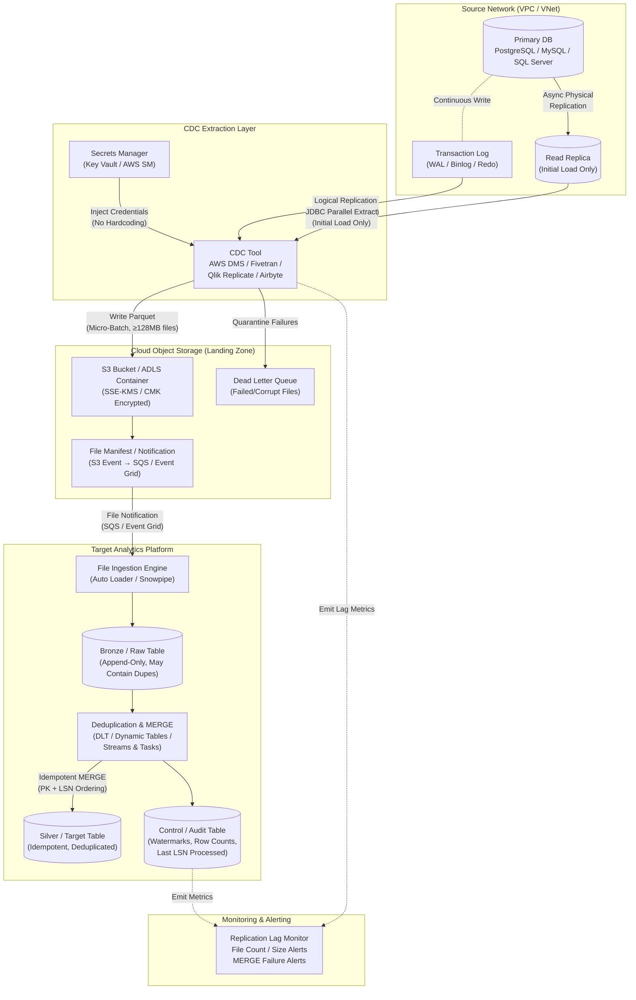
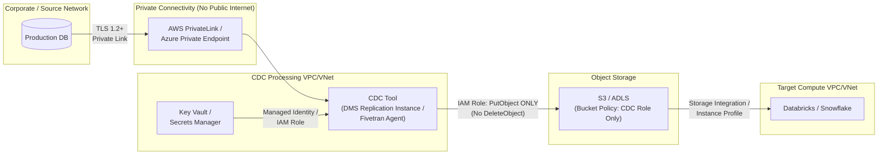
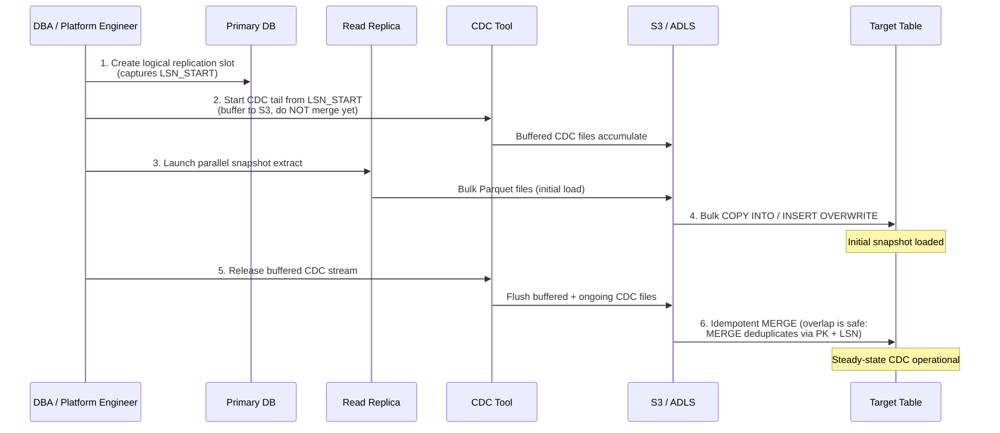

# Pattern 05: Log-Based CDC → Object Storage

## 1. Pattern Overview

- **Pattern Name:** Log-Based CDC to Cloud Object Storage
- **Pattern ID:** 05
- **Version:** 2.0
- **Objective:** Replicate transactional database changes by reading the database's Write-Ahead Log (WAL), Binary Log (Binlog), or Transaction Log and writing the CDC events directly to Cloud Object Storage (S3/ADLS Gen2) — without an intermediate event broker (Kafka) — for downstream ingestion via file-triggered engines (Auto Loader, Snowpipe).
- **Applicable Sources:** Relational Databases supporting logical replication: PostgreSQL (9.4+), MySQL (5.6+), SQL Server (2016+), Oracle (11g+ with LogMiner / XStream).
- **Applicable Targets:** Databricks Lakehouse (Delta Lake), Snowflake, Cloud Data Lake (raw Parquet/Iceberg on ADLS/S3).
- **Typical Use Cases:**
  - Target-state pattern for high-volume enterprise databases (100GB–10TB) where exact change history (including hard deletes) is required.
  - Production OLTP replication into analytics platforms with 1–15 minute acceptable latency.
  - Cost-optimized CDC where the operational burden and per-event cost of Kafka/Confluent/Event Hubs is not justified.
- **When to Use:**
  - The sole or primary consumer of the CDC stream is a Data Lake or Data Warehouse.
  - Business SLA permits 1–15 minute end-to-end latency (commit-to-queryable).
  - The data engineering team does not have a dedicated Kafka/streaming platform team.
- **When NEVER to Use (Red Lines):**
  - **Sub-second latency SLA**: Use Pattern 06 (CDC → Kafka → Target).
  - **Multiple independent real-time consumers** (e.g., microservices AND lakehouse both subscribing to the same event stream): Use Pattern 06.
  - **Source database does not support logical replication** (e.g., legacy Oracle Standard Edition without LogMiner): Use Pattern 04 (Trigger-Based Change Table) or Pattern 03 (Incremental Batch).
  - **Source DBA team prohibits WAL-level access**: Escalate or fallback to Pattern 04.

---

## 2. Pre-Ingestion Profiling

Execute the following assessments **before** provisioning any CDC infrastructure.

### 2.1 Database Engine Compatibility

| Database | Log Type | Prerequisite Configuration | Verification Query |
|:---|:---|:---|:---|
| **PostgreSQL** | WAL (Logical) | `wal_level = logical`, `max_replication_slots >= 1`, `max_wal_senders >= 1` | `SHOW wal_level;` |
| **MySQL** | Binlog | `binlog_format = ROW`, `binlog_row_image = FULL`, `log_slave_updates = ON` | `SHOW VARIABLES LIKE 'binlog_format';` |
| **SQL Server** | Transaction Log | Enable CDC: `EXEC sys.sp_cdc_enable_db;` per database, then per table | `SELECT is_cdc_enabled FROM sys.databases WHERE name = '<db>';` |
| **Oracle** | Redo / Archive Log | Enable supplemental logging: `ALTER DATABASE ADD SUPPLEMENTAL LOG DATA (ALL) COLUMNS;` | `SELECT SUPPLEMENTAL_LOG_DATA_ALL FROM V$DATABASE;` |

### 2.2 Volume & Velocity Assessment

```sql
-- PostgreSQL: WAL generation rate (run during peak hours)
SELECT pg_size_pretty(
    pg_wal_lsn_diff(pg_current_wal_lsn(), '0/0')
) AS total_wal_generated;

-- Check replication slot lag (bytes unconsumed)
SELECT slot_name, 
       pg_size_pretty(pg_wal_lsn_diff(pg_current_wal_lsn(), confirmed_flush_lsn)) AS slot_lag
FROM pg_replication_slots
WHERE slot_type = 'logical';
```

```sql
-- MySQL: Binlog generation rate
SHOW BINARY LOGS;
-- Compare file sizes over a known time window to derive MB/hour.

-- Check current binlog retention
SHOW VARIABLES LIKE 'binlog_expire_logs_seconds';
```

### 2.3 Critical Pre-Flight Checks

| Check | Target | Consequence of Failure |
|:---|:---|:---|
| WAL disk headroom on primary | ≥ 3× peak hourly WAL generation rate | Primary DB crash from disk exhaustion |
| `max_slot_wal_keep_size` (PG 13+) | Set to a bounded value (e.g., `100GB`) | Unbounded WAL retention if CDC tool goes offline |
| `binlog_expire_logs_seconds` (MySQL) | ≥ 2× maximum expected CDC downtime | Binlog pruned before CDC tool reconnects → data loss |
| Read Replica availability | Provisioned and replication lag < 1 min | Initial snapshot load saturates primary DB I/O |
| Network path (source → CDC tool) | Private Link / VNet peering | Production database exposed to public internet |

---

## 3. Reference Architecture

### 3.1 Detailed End-to-End Architecture



### 3.2 Networking & Security Boundary Diagram



---

## 4. End-to-End Data Flow

### Step 1 — Transaction Commit (Source)
A transaction commits on the primary database. The committed changes are durably written to the Write-Ahead Log (PostgreSQL), Binary Log (MySQL), or Transaction Log (SQL Server). Each change record is assigned a monotonically increasing sequence coordinate:
- **PostgreSQL:** Log Sequence Number (`LSN`) — e.g., `0/16B3748`
- **MySQL:** Binlog File + Position — e.g., `mysql-bin.000042:15738`
- **Oracle:** System Change Number (`SCN`)
- **SQL Server:** Log Sequence Number (`LSN`)

### Step 2 — Logical Replication (CDC Tool)
A managed CDC tool continuously reads the transaction log asynchronously via a logical replication connection:
- **PostgreSQL:** The CDC tool creates a logical replication slot using the `pgoutput` or `wal2json` output plugin. The slot tracks the consumer's confirmed flush LSN, preventing WAL truncation until the consumer acknowledges receipt.
- **MySQL:** The CDC tool connects as a binlog replica, reading row-level change events from the binary log.

> **⚠️ WARNING:** The CDC tool **MUST** connect via Private Link / VNet Service Endpoint. A CDC tool connected over the public internet to a production OLTP database is an architectural violation subject to immediate ARB escalation.

### Step 3 — Landing Zone Write (CDC → S3/ADLS)
The CDC tool batches change events and writes them to Cloud Object Storage in **Parquet format** (mandatory; see §7). Each file contains:

| Field | Source | Purpose |
|:---|:---|:---|
| `__op` | CDC tool metadata | Operation type: `I` (Insert), `U` (Update), `D` (Delete) |
| `__lsn` / `__scn` | Source database log coordinate | Monotonic sequence for ordering and deduplication |
| `__source_ts_ms` | Source database transaction commit timestamp | Audit trail (NOT for ordering — use LSN) |
| `__ingestion_ts` | CDC tool processing timestamp | Operational monitoring only |
| `<all_source_columns>` | Source row payload | After-image (and optionally before-image) of the row |

**File Naming Convention (recommended):**
```
s3://landing-zone/cdc/<schema>/<table>/year=YYYY/month=MM/day=DD/hour=HH/<table>_<lsn_start>_<lsn_end>.parquet
```

### Step 4 — File-Triggered Ingestion (Auto Loader / Snowpipe)
The target ingestion engine detects new files and appends their contents to a Bronze/Raw table:

- **Databricks Auto Loader:** Monitors the landing zone directory using either `directory listing` mode (polling) or `file notification` mode (S3 SQS / ADLS Event Grid). Appends all new files to a Delta Bronze table.
- **Snowflake Snowpipe:** Triggered via S3 SQS notification or Azure Event Grid. Executes `COPY INTO` against a staging/raw table.

> **ℹ️ IMPORTANT:** The Bronze table is **append-only** and **will contain duplicates** if the CDC tool re-delivers files after a crash/restart. The Bronze table is NOT the idempotency boundary. The Silver MERGE (Step 5) is the idempotency boundary.

### Step 5 — Idempotent MERGE to Silver/Target
A scheduled or triggered processing job reads unprocessed CDC events from Bronze, deduplicates them within the micro-batch, and executes an idempotent `MERGE` into the Silver/Target table. See §7 for engine-specific implementation.

---

## 5. Insert / Update / Delete Handling

| Operation | CDC Payload | Target MERGE Behavior |
|:---|:---|:---|
| **Insert** (`__op = 'I'`) | Full after-image of the new row | `WHEN NOT MATCHED THEN INSERT` |
| **Update** (`__op = 'U'`) | Full after-image (optionally before-image) | `WHEN MATCHED AND source.__lsn > target.__last_lsn THEN UPDATE SET ...` |
| **Delete** (`__op = 'D'`) | Primary key + delete marker | `WHEN MATCHED AND source.__op = 'D' THEN DELETE` — OR soft-delete: `UPDATE SET is_deleted = TRUE, deleted_at = source.__source_ts_ms` |

**Before-Image Capture:** Configure the CDC tool to capture `FULL` before-images (`binlog_row_image = FULL` for MySQL; default for PostgreSQL logical decoding). Before-images are required for:
- SCD Type 2 historical tracking (comparing old vs. new values)
- Regulatory audit trails
- Debugging data quality issues

---

## 6. Initial Load vs. Incremental Tail

### 6.1 The Cutover Sequence (Mission-Critical)



### 6.2 Key Principles

1. **Snapshot from Read Replica ONLY.** Never execute a multi-TB `SELECT *` against the primary production database. This causes I/O starvation, lock contention, and replication lag on downstream replicas.
2. **LSN Coordination is Non-Negotiable.** The replication slot must be created *before* the snapshot begins to ensure no transactions are lost in the gap between snapshot completion and CDC tail start.
3. **Overlap is Safe (by design).** Rows captured in both the snapshot and the CDC tail are resolved deterministically because the MERGE uses `source.__lsn > target.__last_lsn` — the CDC record with the higher LSN always wins.

---

## 7. Format Selection & Target-Side Optimization

### 7.1 File Format in Landing Zone

| Format | Verdict | Rationale |
|:---|:---|:---|
| **Parquet** | ✅ **Mandatory** | Columnar compression (Snappy/ZSTD), predicate pushdown, schema enforcement, 5–10× smaller than JSON |
| **JSON** | ❌ **Prohibited for production** | No compression, no predicate pushdown, schema-on-read causes silent type coercion, 10× storage cost |
| **Avro** | ⚠️ Acceptable alternative | Row-oriented (poor for analytics), but supports schema evolution natively. Use only if the CDC tool cannot produce Parquet. |

### 7.2 Target Engine: Databricks (Delta Lake)

**Recommended Stack:** Auto Loader → Bronze Delta Table → DLT `APPLY CHANGES INTO` → Silver Delta Table

```python
# Auto Loader: Bronze ingestion with schema evolution and rescue
(spark.readStream
    .format("cloudFiles")
    .option("cloudFiles.format", "parquet")
    .option("cloudFiles.schemaLocation", "/mnt/checkpoints/cdc_schema/orders")
    .option("cloudFiles.schemaEvolutionMode", "addNewColumns")  # Handle schema drift
    .option("cloudFiles.maxBytesPerTrigger", "256mb")           # Prevent OOM on file bursts
    .option("rescuedDataColumn", "_rescued_data")               # Quarantine unparseable fields
    .load("s3://landing-zone/cdc/public/orders/")
    .writeStream
    .format("delta")
    .option("checkpointLocation", "/mnt/checkpoints/cdc_bronze/orders")
    .option("mergeSchema", "true")
    .outputMode("append")
    .trigger(availableNow=True)  # Cost-effective micro-batch (no idle cluster)
    .toTable("catalog.bronze.orders_cdc_raw")
)
```

```sql
-- DLT: Silver processing with APPLY CHANGES INTO (handles dedup + out-of-order)
CREATE OR REFRESH STREAMING TABLE silver_orders;

APPLY CHANGES INTO LIVE.silver_orders
FROM STREAM(LIVE.bronze_orders_cdc_raw)
KEYS (order_id)                        -- Source primary key
SEQUENCE BY __lsn                      -- Monotonic ordering (NOT timestamp)
COLUMNS * EXCEPT (__lsn, __source_ts_ms, __ingestion_ts, _rescued_data)
STORED AS SCD TYPE 1                   -- Or SCD TYPE 2 for full history
;
```

**Delta UniForm:** If non-Databricks engines (Snowflake External Tables, Trino, Presto) must read the Silver table, enable UniForm to generate Iceberg-compatible metadata:

```sql
ALTER TABLE catalog.silver.orders
SET TBLPROPERTIES ('delta.universalFormat.enabledFormats' = 'iceberg');
```

**Compaction & Maintenance:**

```sql
-- Compact small files (run daily or after large CDC bursts)
OPTIMIZE catalog.silver.orders;

-- Enable Deletion Vectors to avoid full Parquet rewrites on UPDATE/DELETE
ALTER TABLE catalog.silver.orders
SET TBLPROPERTIES ('delta.enableDeletionVectors' = true);

-- Liquid Clustering (replaces static partitioning)
ALTER TABLE catalog.silver.orders
CLUSTER BY (order_id);
```

### 7.3 Target Engine: Snowflake

**Recommended Stack:** Snowpipe → Raw Staging Table → Dynamic Tables (or Streams & Tasks) → Target Table

```sql
-- Snowpipe: Auto-ingest from S3/ADLS
CREATE OR REPLACE PIPE cdc_orders_pipe
  AUTO_INGEST = TRUE
  AS
  COPY INTO raw.orders_cdc_staging
  FROM @cdc_stage/public/orders/
  FILE_FORMAT = (TYPE = 'PARQUET')
  MATCH_BY_COLUMN_NAME = CASE_INSENSITIVE
  ON_ERROR = 'SKIP_FILE';             -- Skip corrupt files; alert via PIPE_USAGE_HISTORY
```

```sql
-- Dynamic Table: Automatic incremental MERGE (Snowflake manages scheduling)
CREATE OR REPLACE DYNAMIC TABLE silver.orders
  TARGET_LAG = '5 minutes'            -- Maximum staleness SLA
  WAREHOUSE = WH_CDC_PROCESSING
AS
SELECT * FROM (
    SELECT *,
           ROW_NUMBER() OVER (
               PARTITION BY order_id 
               ORDER BY __lsn DESC
           ) AS _rn
    FROM raw.orders_cdc_staging
    WHERE __op != 'D'                 -- Exclude deletes from latest-state view
) WHERE _rn = 1;
```

```sql
-- Alternative: Manual MERGE via Streams & Tasks (for delete handling)
CREATE OR REPLACE STREAM orders_cdc_stream ON TABLE raw.orders_cdc_staging;

CREATE OR REPLACE TASK orders_cdc_merge_task
  WAREHOUSE = WH_CDC_PROCESSING
  SCHEDULE = '5 MINUTE'
  WHEN SYSTEM$STREAM_HAS_DATA('orders_cdc_stream')
AS
MERGE INTO silver.orders t
USING (
    SELECT * FROM (
        SELECT *,
               ROW_NUMBER() OVER (PARTITION BY order_id ORDER BY __lsn DESC) AS _rn
        FROM orders_cdc_stream
    ) WHERE _rn = 1
) s
ON t.order_id = s.order_id
WHEN MATCHED AND s.__op = 'D' THEN DELETE
WHEN MATCHED AND s.__lsn > t.__last_lsn THEN UPDATE SET
    t.customer_id = s.customer_id,
    t.order_total = s.order_total,
    t.updated_at = s.updated_at,
    t.__last_lsn = s.__lsn
WHEN NOT MATCHED AND s.__op != 'D' THEN INSERT
    (order_id, customer_id, order_total, updated_at, __last_lsn)
    VALUES (s.order_id, s.customer_id, s.order_total, s.updated_at, s.__lsn);
```

---

## 8. Schema Evolution Handling

Schema drift is inevitable in production OLTP systems. The CDC pipeline must handle it without manual intervention or silent data loss.

| Scenario | CDC Tool Behavior | Target-Side Handling |
|:---|:---|:---|
| **New column added** | Fivetran: Auto-adds. DMS: Requires task restart. Qlik: Configurable. | Auto Loader: `schemaEvolutionMode = addNewColumns`. Snowpipe: FAILS unless table is altered first. |
| **Column renamed** | Most tools: Treated as drop + add (data loss risk). | Monitor `_rescued_data` column for unexpected nulls. |
| **Column type widened** (e.g., `INT` → `BIGINT`) | Usually transparent. | Delta: `mergeSchema = true`. Snowflake: May require explicit `ALTER TABLE`. |
| **Column dropped** | CDC tool stops sending the column. | Auto Loader: Column becomes NULL. Snowpipe: No impact (MATCH_BY_COLUMN_NAME). |

> **🚨 CAUTION:** **DMS does not propagate DDL changes.** If the source schema changes while DMS is running, the replication task will either fail or silently drop the new columns. You MUST configure CloudWatch alerts on DMS task status and implement a runbook for task restart with `CdcStartPosition` set to the last committed LSN.

---

## 9. AWS & Azure Implementation Reference

### 9.1 AWS

| Component | Service | Configuration |
|:---|:---|:---|
| **CDC Tool** | AWS DMS (Replication Instance) | `r5.xlarge`+ in same VPC as RDS. Enable `BatchApplyEnabled` for throughput. |
| **Landing Zone** | S3 (with versioning + lifecycle) | Bucket policy: DMS replication instance role `PutObject` only. SSE-KMS encryption. |
| **File Notification** | S3 Event → SQS | Used by Auto Loader (`file notification` mode) or Snowpipe. |
| **Secrets** | AWS Secrets Manager | Source DB credentials. Rotated every 90 days. |
| **Networking** | VPC Peering + PrivateLink | DMS ↔ RDS: Same VPC. S3: VPC Gateway Endpoint. |
| **Monitoring** | CloudWatch + DMS Metrics | `CDCLatencyTarget`, `CDCIncomingChanges`, replication task state. |

### 9.2 Azure

| Component | Service | Configuration |
|:---|:---|:---|
| **CDC Tool** | Azure Data Factory (CDC connector) / Fivetran / Qlik on ACI | Managed VNet integration for private connectivity. |
| **Landing Zone** | ADLS Gen2 (hierarchical namespace) | Storage firewall: Allow CDC tool managed identity only. CMK encryption. |
| **File Notification** | ADLS Event Grid → Storage Queue | Used by Auto Loader or Snowpipe. |
| **Secrets** | Azure Key Vault | Source DB credentials via Managed Identity. |
| **Networking** | VNet Service Endpoints + Private Link | ADF ↔ Azure DB: Private Endpoint. ADLS: VNet firewall rules. |
| **Monitoring** | Azure Monitor + ADF pipeline metrics | CDC activity run durations, rows read/written, error counts. |

---

## 10. Security & Governance

### 10.1 Mandatory Security Controls

| Control | Implementation | Non-Compliance Consequence |
|:---|:---|:---|
| **Network Isolation** | CDC tool connects to source DB via Private Link / VNet only. No public IP. | ARB rejection. Security incident. |
| **Encryption at Rest** | S3: SSE-KMS with customer-managed key. ADLS: CMK. | Regulatory violation (GDPR, HIPAA, SOC2). |
| **Encryption in Transit** | JDBC connections use TLS 1.2+. Verify `sslmode=verify-full` (PostgreSQL). | Credential interception risk. |
| **Secrets Management** | All credentials in Key Vault / Secrets Manager. Zero hardcoded secrets. | Security violation, credential rotation impossible. |
| **Least-Privilege IAM** | CDC tool: `SELECT`, `REPLICATION` on source. `PutObject` on landing zone. No `DeleteObject`. | Blast radius amplification if compromised. |
| **PII Masking** | Apply column-level hashing/tokenization at Bronze→Silver transformation. Use Fivetran column blocking or DMS expression transforms. | PII exposure in analytics layer. |
| **Audit Logging** | Enable S3 access logs / ADLS diagnostic logs. Track who reads landing zone data. | Compliance audit failure. |

### 10.2 RBAC Model

```
Source DB:
  └─ Service Principal / IAM Role: "cdc-replicator"
       ├─ GRANT SELECT ON <cdc_tables> TO cdc_replicator;
       ├─ GRANT rds_replication TO cdc_replicator;  -- (AWS RDS)
       └─ ALTER ROLE cdc_replicator WITH REPLICATION; -- (PostgreSQL)

Landing Zone (S3/ADLS):
  └─ IAM Policy: "cdc-landing-writer"
       ├─ s3:PutObject → arn:aws:s3:::landing-zone/cdc/*
       ├─ s3:ListBucket → arn:aws:s3:::landing-zone  (prefix: cdc/)
       └─ DENY s3:DeleteObject  (explicit deny)

Target Platform:
  └─ Storage Integration (Snowflake) / Instance Profile (Databricks)
       ├─ s3:GetObject → arn:aws:s3:::landing-zone/cdc/*
       └─ s3:ListBucket → arn:aws:s3:::landing-zone
```

---

## 11. Reliability, Resumability & Failure Recovery

### 11.1 Failure Scenarios & Recovery Playbook

| Failure Scenario | Impact | Recovery Procedure |
|:---|:---|:---|
| **CDC tool crashes mid-batch** | Partial Parquet file may be written to S3/ADLS | CDC tool resumes from last committed LSN checkpoint. Auto Loader/Snowpipe will ingest the re-delivered file — duplicates in Bronze are resolved by Silver MERGE. |
| **CDC tool offline for extended period** | WAL/Binlog accumulates on primary DB | **PostgreSQL:** `max_slot_wal_keep_size` caps retention → slot invalidated → requires re-snapshot. **MySQL:** `binlog_expire_logs_seconds` prunes old binlogs → data loss → requires re-snapshot. |
| **Corrupt Parquet file in landing zone** | Auto Loader: Batch fails. Snowpipe: File skipped or statement aborted. | Auto Loader: Configure `badRecordsPath` to quarantine. Snowpipe: `ON_ERROR = 'SKIP_FILE'` + monitor `COPY_HISTORY` for skipped files. Move corrupt file to DLQ for investigation. |
| **Source schema changes (DDL)** | New columns missing in target. Type mismatches. | Auto Loader: `schemaEvolutionMode = addNewColumns`. Snowpipe: Requires manual `ALTER TABLE` on staging table. DMS: Requires task restart with `CdcStartPosition`. |
| **Target MERGE fails (e.g., constraint violation)** | CDC events accumulate in Bronze without being applied to Silver | MERGE must be wrapped in retry logic with exponential backoff. On persistent failure: alert, pause CDC, investigate root cause in Bronze table. |
| **S3/ADLS bucket accidentally deleted** | All landing zone data lost | S3 versioning + cross-region replication. ADLS soft delete + geo-redundant storage (GRS). CDC tool can replay from replication slot if WAL is still retained. |

### 11.2 Idempotency Guarantees

```
┌─────────────────────────────────────────────────────────┐
│                   IDEMPOTENCY MODEL                      │
├──────────────┬──────────────────────────────────────────┤
│  Layer       │  Guarantee                               │
├──────────────┼──────────────────────────────────────────┤
│  CDC Tool    │  At-least-once delivery (may re-deliver  │
│              │  files on crash/restart)                  │
├──────────────┼──────────────────────────────────────────┤
│  Bronze      │  Append-only. WILL contain duplicates.   │
│              │  This is BY DESIGN.                       │
├──────────────┼──────────────────────────────────────────┤
│  Silver MERGE│  EXACTLY-ONCE semantics via idempotent   │
│              │  MERGE with PK + LSN ordering.           │
│              │  THIS IS THE IDEMPOTENCY BOUNDARY.       │
└──────────────┴──────────────────────────────────────────┘
```

The MERGE statement achieves exactly-once semantics because:
1. **Deduplication within micro-batch:** `ROW_NUMBER() OVER (PARTITION BY pk ORDER BY __lsn DESC) = 1` selects only the latest event per key.
2. **Guard against stale replay:** `WHEN MATCHED AND source.__lsn > target.__last_lsn` prevents an older re-delivered event from overwriting a newer state.

---

## 12. Observability & Monitoring

### 12.1 Mandatory Alerts

| Metric | Threshold | Alert Severity | Action |
|:---|:---|:---|:---|
| **Replication slot WAL lag (PG)** | > 10GB | 🔴 P1 CRITICAL | Investigate CDC tool health. Risk: primary disk exhaustion. |
| **Replication slot WAL lag (PG)** | > 50GB | 🔴 P0 SEV-1 | Drop replication slot to protect primary. Plan re-snapshot. |
| **CDC tool replication latency** | > 15 minutes | 🟡 P2 WARNING | Check CDC tool compute resources, network throughput. |
| **Landing zone file count/hour** | > 1000 files/hour | 🟡 P2 WARNING | Small file problem. Increase CDC tool batch interval. |
| **Landing zone average file size** | < 10MB | 🟡 P2 WARNING | Increase `batchSize` / flush interval on CDC tool. |
| **Auto Loader / Snowpipe failures** | Any failure | 🔴 P1 CRITICAL | Check `badRecordsPath` or `COPY_HISTORY`. Investigate schema drift or corrupt files. |
| **Silver MERGE failure** | Any failure | 🔴 P1 CRITICAL | Pause downstream consumers. Investigate constraint violations in Bronze. |
| **Bronze-to-Silver processing lag** | > 30 minutes | 🟡 P2 WARNING | Scale up MERGE compute. Check for data skew on MERGE key. |

### 12.2 Control / Audit Table Schema

```sql
CREATE TABLE IF NOT EXISTS control.cdc_pipeline_audit (
    pipeline_id         STRING      NOT NULL,
    source_schema       STRING      NOT NULL,
    source_table        STRING      NOT NULL,
    batch_id            STRING      NOT NULL,   -- UUID per MERGE execution
    batch_start_ts      TIMESTAMP   NOT NULL,
    batch_end_ts        TIMESTAMP,
    files_processed     INT,
    rows_inserted       BIGINT,
    rows_updated        BIGINT,
    rows_deleted        BIGINT,
    rows_deduplicated   BIGINT,                 -- Duplicates removed within batch
    min_lsn_processed   STRING,
    max_lsn_processed   STRING,
    status              STRING      NOT NULL,   -- RUNNING | SUCCESS | FAILED
    error_message       STRING,
    PRIMARY KEY (pipeline_id, batch_id)
);
```

---

## 13. Cost Model

### 13.1 Cost Components

| Component | Cost Driver | Optimization Lever |
|:---|:---|:---|
| **CDC Tool (Managed)** | Per-row pricing (Fivetran MAR), or instance-hours (DMS) | Reduce MAR by excluding low-value tables. Right-size DMS instance. |
| **Object Storage** | Storage volume ($/GB/month) + PUT requests ($/1000) | Parquet compression (ZSTD). Larger batch sizes = fewer PUT requests. Lifecycle policy to archive/delete old CDC files after target MERGE. |
| **Ingestion Compute** | Auto Loader cluster hours / Snowpipe credits | `trigger(availableNow=True)` avoids idle cluster cost. Snowpipe is serverless (pay-per-file). |
| **MERGE Compute** | DLT pipeline cluster hours / Snowflake warehouse credits | Liquid Clustering reduces MERGE scan cost. Schedule MERGE only when Bronze has new data (`WHEN SYSTEM$STREAM_HAS_DATA`). |
| **Network Egress** | Cross-region/cross-cloud data transfer | Co-locate CDC tool, landing zone, and target in the same region. |

### 13.2 Cost Comparison: Pattern 05 vs. Pattern 06

| Component | Pattern 05 (CDC → S3) | Pattern 06 (CDC → Kafka) |
|:---|:---|:---|
| Event Broker | **$0** (S3/ADLS is the buffer) | $500–$5,000+/month (MSK/Confluent/Event Hubs) |
| 24/7 Streaming Compute | **Not required** (micro-batch) | Required (Spark Structured Streaming cluster) |
| Total Monthly (Typical) | **$200–$2,000** | **$2,000–$15,000+** |

> Pattern 05 is typically **5–10× cheaper** than Pattern 06 for single-consumer CDC pipelines. The cost savings come from eliminating the Kafka broker and replacing 24/7 streaming compute with on-demand micro-batch processing.

---

## 14. Constraints & Red Lines

| # | Red Line | Consequence | Mitigation |
|:---|:---|:---|:---|
| 1 | **Primary DB Disk Exhaustion** | If the CDC tool goes offline, the database cannot truncate the WAL/Binlog. The primary DB disk fills and the production database **crashes**. | Set `max_slot_wal_keep_size` (PG). Set `binlog_expire_logs_seconds` (MySQL). Alert at 75% disk utilization. |
| 2 | **Small File Proliferation** | Flushing to S3/ADLS every 5 seconds creates thousands of 10KB files. This destroys downstream query performance (file listing overhead, metadata bloat). | Set CDC tool flush interval ≥ 60 seconds AND ≥ 128MB per file. Run `OPTIMIZE` (Delta) daily. |
| 3 | **Public Internet Connectivity** | CDC tool connecting to production DB over the public internet. | **Absolute prohibition.** Use Private Link / VNet Service Endpoints. |
| 4 | **Hardcoded Credentials** | Database passwords in CDC tool config files, environment variables, or source control. | Store ALL credentials in Key Vault / Secrets Manager. Use Managed Identity where possible. |
| 5 | **Ordering by Processing Timestamp** | Using the CDC tool's clock (`__ingestion_ts`) instead of the source DB's LSN for MERGE ordering. Clock skew causes silent data corruption (older record overwrites newer). | **Always** use `__lsn` / `__scn` for `SEQUENCE BY` and MERGE ordering. |
| 6 | **No Dead Letter Queue** | Corrupt files silently dropped with no alerting. | Configure `badRecordsPath` (Auto Loader) or `ON_ERROR = 'SKIP_FILE'` + `COPY_HISTORY` monitoring (Snowpipe). Route failures to a DLQ S3 prefix with SNS alerting. |

---

## 15. Trade-Offs

| Decision | Option A | Option B | Trade-Off Analysis |
|:---|:---|:---|:---|
| **Middleware** | Direct to S3/ADLS (Pattern 05) | Through Kafka (Pattern 06) | S3/ADLS is 5–10× cheaper and eliminates Kafka operational burden. Kafka provides sub-second latency and fan-out to multiple independent consumers. **Choose Pattern 05 unless you have a hard sub-second SLA or multiple consumers.** |
| **CDC Tool** | Managed (Fivetran / DMS / Qlik) | Open Source (Debezium → S3 Sink) | Managed tools handle initial load synchronization, schema mapping, and auto-scaling out of the box but cost $1K–$10K+/month. Debezium is free but requires engineering investment for the S3 Sink Connector, initial load orchestration, and monitoring. |
| **Target Format** | Delta Lake | Apache Iceberg | Delta Lake is native to Databricks with superior DML performance and DLT integration. Iceberg is vendor-neutral and natively supported by Snowflake, Trino, and Spark. **If multi-engine access is required, use Delta UniForm or write Iceberg natively.** |
| **Delete Handling** | Physical DELETE | Soft Delete (`is_deleted` flag) | Physical deletes reduce storage cost and simplify queries but are irreversible. Soft deletes preserve audit history and enable point-in-time recovery but require `WHERE is_deleted = FALSE` predicates on all downstream queries. |
| **Bronze Table Retention** | Retain indefinitely | Lifecycle-delete after 30–90 days | Indefinite retention enables replay from any point in time but costs storage. Lifecycle deletion saves cost but prevents replaying old CDC events if the Silver table is corrupted. **Retain 90 days minimum for disaster recovery.** |

---

## 16. Pattern Selection Checklist

> This checklist must be completed and submitted to the Architecture Review Board before pipeline provisioning.

- [ ] Sub-second streaming latency is **strictly NOT required** (confirmed with business stakeholders).
- [ ] Source database engine supports logical replication (verified via §2.1 queries).
- [ ] `wal_level = logical` (PostgreSQL) or `binlog_format = ROW` (MySQL) confirmed.
- [ ] `max_slot_wal_keep_size` (PG 13+) or `binlog_expire_logs_seconds` (MySQL) configured with bounded value.
- [ ] Replication slot disk monitoring alert configured (threshold: 75% disk utilization).
- [ ] Read Replica provisioned for initial historical load (never snapshot from primary).
- [ ] CDC tool connects via **Private Link / VNet Service Endpoint** (no public internet).
- [ ] All credentials stored in **Key Vault / Secrets Manager** (zero hardcoded secrets).
- [ ] Landing zone IAM policy restricts CDC tool to `PutObject` only (no `DeleteObject`).
- [ ] Landing zone encrypted with customer-managed key (SSE-KMS / CMK).
- [ ] CDC tool configured for optimal batch size (target: ≥ 128MB files, flush interval ≥ 60s).
- [ ] File format is **Parquet** (JSON prohibited for production pipelines).
- [ ] Auto Loader `schemaEvolutionMode` configured (Databricks) or DDL monitoring in place (Snowflake).
- [ ] Silver MERGE uses source `__lsn` / `__scn` for ordering (NOT processing timestamp).
- [ ] Dead Letter Queue / `badRecordsPath` configured for corrupt file handling.
- [ ] Control/audit table captures per-batch row counts, LSN watermarks, and status.
- [ ] Monitoring alerts configured per §12.1 thresholds.
- [ ] PII columns identified and masking strategy documented for Bronze → Silver transformation.
- [ ] Cost estimate reviewed and approved (compute + storage + CDC tool licensing).