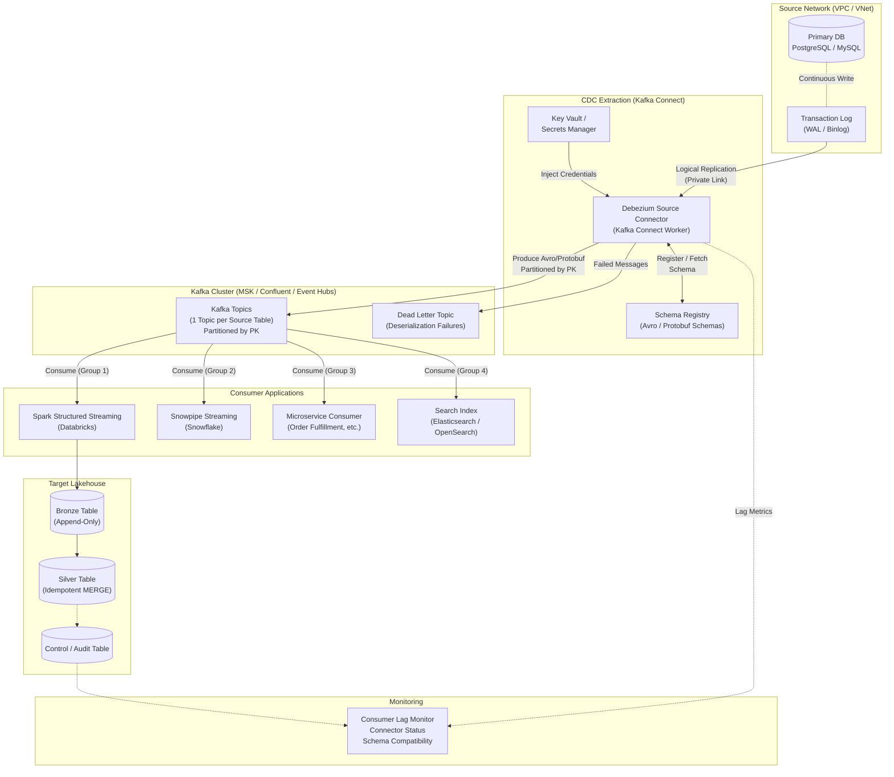
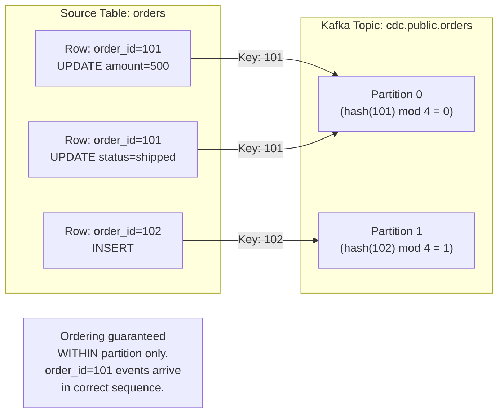

# Pattern 06: Log-Based CDC → Kafka → Target

## 1. Pattern Overview

- **Pattern Name:** Log-Based CDC to Kafka (Event Mesh)
- **Pattern ID:** 06
- **Version:** 2.0
- **Objective:** Extract transactional database changes via the Write-Ahead Log (WAL) / Binary Log (Binlog) and publish them immediately to a distributed event streaming platform (Apache Kafka / Confluent / Amazon MSK / Azure Event Hubs) for sub-second latency delivery and multi-consumer fan-out.
- **Applicable Sources:** Relational Databases supporting logical replication: PostgreSQL (9.4+), MySQL (5.6+), SQL Server (2016+), Oracle (11g+ with LogMiner / XStream).
- **Applicable Targets:** Databricks Lakehouse (Delta Lake), Snowflake, Microservices, Real-Time Dashboards, Search Indices (Elasticsearch), Caches (Redis).
- **Typical Use Cases:**
  - "Enterprise Nervous System" — database changes must instantly trigger downstream application logic AND be ingested into the Data Lakehouse simultaneously.
  - Real-time fraud detection, inventory sync, order fulfillment, recommendation engine updates.
  - Multi-subscriber architectures where 3+ independent consumers need the same CDC events.
- **When to Use:**
  - Sub-second or sub-minute latency is a hard business SLA.
  - Multiple independent downstream systems (not just the Data Warehouse) must react to the same database events.
  - The organization has a dedicated streaming platform team capable of operating Kafka/Confluent/MSK.
- **When NEVER to Use (Red Lines):**
  - **Sole consumer is a Data Lake/Warehouse**: Do NOT introduce Kafka's operational complexity and cost. Use Pattern 05 (CDC → Object Storage) — it is 5–10× cheaper.
  - **No platform team to operate Kafka**: Kafka, Schema Registry, Kafka Connect, and KRaft/Zookeeper require 24/7 operational expertise.
  - **Source database does not support logical replication**: Use Pattern 04 (Trigger-Based) or Pattern 03 (Incremental).

---

## 2. Pre-Ingestion Profiling

### 2.1 Source Database Assessment

Identical to Pattern 05, §2.1 — verify `wal_level = logical` (PostgreSQL), `binlog_format = ROW` (MySQL), etc.

### 2.2 Kafka Sizing

| Assessment | Target | Impact |
|:---|:---|:---|
| **WAL generation rate (MB/sec)** | Measured during peak hours | Determines Kafka broker throughput, partition count, and retention budget |
| **Peak TPS per table** | Measured via DB stats | Each TPS = 1 Kafka message. Dictates partition count for ordering guarantees |
| **Payload strategy** | Full row vs. PK-only | Full row (strongly recommended) decouples consumers from source DB. PK-only requires consumer to query source — defeats CDC purpose |
| **Number of consumers** | Enumerate all subscribing systems | Determines Kafka consumer group count and partition replication factor |
| **Retention policy** | 7 days (recommended minimum) | If ANY consumer goes down longer than retention → permanent data loss |

### 2.3 Critical Pre-Flight Checks

| Check | Target | Consequence of Failure |
|:---|:---|:---|
| Kafka cluster provisioned and load-tested | Throughput ≥ 2× peak WAL rate | Back-pressure from Kafka → Debezium lag → WAL accumulation → DB crash |
| Schema Registry deployed | Confluent Schema Registry or AWS Glue Schema Registry | No schema enforcement → consumers break on schema evolution |
| Kafka Connect cluster sized | Workers ≥ source connector throughput | Under-provisioned → replication lag |
| `max_slot_wal_keep_size` (PG 13+) | Bounded value (e.g., `100GB`) | Unbounded WAL retention if Debezium goes offline |
| Network path (source → Kafka) | Private Link / VNet peering | Production DB exposed to public internet |

---

## 3. Reference Architecture

### 3.1 Detailed End-to-End Architecture



### 3.2 Kafka Partitioning Strategy



---

## 4. End-to-End Data Flow

### Step 1 — Transaction Commit (Source)
Identical to Pattern 05, §4 Step 1. Transaction commits, WAL/Binlog records change with monotonic LSN/SCN.

### Step 2 — Debezium / Kafka Connect Extraction
A Kafka Connect source connector (typically Debezium) continuously reads the WAL and converts row changes into standardized event payloads:

```json
{
  "schema": { ... },
  "payload": {
    "before": { "order_id": 101, "amount": 400, "status": "pending" },
    "after":  { "order_id": 101, "amount": 500, "status": "pending" },
    "source": {
      "version": "2.5.0",
      "connector": "postgresql",
      "db": "production",
      "schema": "public",
      "table": "orders",
      "lsn": 234567890,
      "ts_ms": 1697126400000
    },
    "op": "u",
    "ts_ms": 1697126400050
  }
}
```

**Debezium Connector Configuration (PostgreSQL):**
```json
{
  "name": "cdc-postgresql-orders",
  "config": {
    "connector.class": "io.debezium.connector.postgresql.PostgresConnector",
    "database.hostname": "primary-db.internal",
    "database.port": "5432",
    "database.user": "${secretManager:db-cdc-user}",
    "database.password": "${secretManager:db-cdc-pass}",
    "database.dbname": "production",
    "database.server.name": "prod-pg",
    "plugin.name": "pgoutput",
    "slot.name": "debezium_slot",
    "publication.name": "dbz_publication",
    "table.include.list": "public.orders,public.customers",
    "key.converter": "io.confluent.connect.avro.AvroConverter",
    "key.converter.schema.registry.url": "http://schema-registry:8081",
    "value.converter": "io.confluent.connect.avro.AvroConverter",
    "value.converter.schema.registry.url": "http://schema-registry:8081",
    "tombstones.on.delete": "true",
    "snapshot.mode": "initial",
    "heartbeat.interval.ms": "10000",
    "slot.drop.on.stop": "false",
    "decimal.handling.mode": "double",
    "transforms": "route",
    "transforms.route.type": "org.apache.kafka.connect.transforms.RegexRouter",
    "transforms.route.regex": "prod-pg.public.(.*)",
    "transforms.route.replacement": "cdc.public.$1"
  }
}
```

### Step 3 — Kafka Publish
Events are published to Kafka topics, strictly partitioned by the source table's **Primary Key** to guarantee per-row ordering:

> **🚨 CAUTION:** Kafka guarantees message ordering **only within a partition**. If you partition by a non-PK field (e.g., `customer_region`), updates for the same row may land in different partitions and be processed out of order, causing **silent data corruption** on the target.

### Step 4 — Streaming Consumption
Multiple independent consumer groups read from the same Kafka topic simultaneously:

| Consumer | Engine | Use Case |
|:---|:---|:---|
| **Lakehouse Ingestion** | Spark Structured Streaming / Snowpipe Streaming | Populate Delta/Snowflake tables |
| **Microservice** | Spring Kafka / Custom consumer | Trigger order fulfillment, send notifications |
| **Search Index** | Kafka Connect Elasticsearch Sink | Update search indices in real-time |
| **Cache** | Kafka Connect Redis Sink | Update application caches |

### Step 5 — Target MERGE (Lakehouse)
The streaming consumer processes events in micro-batches, deduplicates within the batch, and executes an idempotent MERGE. See §7 for implementation details.

---

## 5. Insert / Update / Delete Handling

| Operation | Debezium Payload | Target MERGE |
|:---|:---|:---|
| **Insert** (`op: c`) | `before: null`, `after: {full_row}` | `WHEN NOT MATCHED THEN INSERT` |
| **Update** (`op: u`) | `before: {old_row}`, `after: {new_row}` | `WHEN MATCHED AND source.lsn > target.__last_lsn THEN UPDATE` |
| **Delete** (`op: d`) | `before: {deleted_row}`, `after: null` + tombstone record | `WHEN MATCHED THEN DELETE` (or soft-delete) |
| **Snapshot** (`op: r`) | `before: null`, `after: {full_row}` (initial load) | `WHEN NOT MATCHED THEN INSERT` |

**Tombstone Records:** Debezium produces a "tombstone" message (key = deleted row's PK, value = `null`) after the delete event. This enables Kafka log compaction to eventually remove the key entirely, keeping the compacted topic size bounded.

---

## 6. Schema Evolution & Schema Registry

### 6.1 Why a Schema Registry is Mandatory

Without a Schema Registry, a source column change (e.g., adding a `discount_pct` column) will either:
- **Break all consumers** (if using strict deserialization)
- **Silently drop the new column** (if using lenient deserialization)

The Schema Registry enforces **compatibility rules** across schema versions:

| Compatibility | Rule | Use Case |
|:---|:---|:---|
| **BACKWARD** | New schema can read old data | Consumer upgrades before producer |
| **FORWARD** | Old schema can read new data | Producer upgrades before consumer |
| **FULL** | Both backward and forward | **Recommended for CDC topics** |

### 6.2 Serialization Format Decision

| Format | Schema Enforcement | Compression | Human Readable | Recommended |
|:---|:---|:---|:---|:---|
| **Avro** | ✅ Strict (Schema Registry) | ✅ High (binary) | ❌ No | ✅ **Enterprise Standard** |
| **Protobuf** | ✅ Strict (Schema Registry) | ✅ High (binary) | ❌ No | ✅ Good (microservice interop) |
| **JSON** | ❌ None (schema-on-read) | ❌ Low (text) | ✅ Yes | ❌ Prototyping only |
| **JSON Schema** | 🟡 Optional (Schema Registry) | ❌ Low (text) | ✅ Yes | 🟡 Acceptable |

---

## 7. Target-Side Optimization

### 7.1 Databricks (Spark Structured Streaming → Delta Lake)

```python
# Spark Structured Streaming: Kafka → Bronze Delta Table
from pyspark.sql.functions import col, from_avro, current_timestamp

kafka_df = (spark.readStream
    .format("kafka")
    .option("kafka.bootstrap.servers", "kafka-broker:9092")
    .option("subscribe", "cdc.public.orders")
    .option("startingOffsets", "latest")
    .option("kafka.security.protocol", "SASL_SSL")
    .option("kafka.sasl.mechanism", "PLAIN")
    .option("kafka.sasl.jaas.config",
            f'org.apache.kafka.common.security.plain.PlainLoginModule required '
            f'username="{dbutils.secrets.get("kv","kafka-user")}" '
            f'password="{dbutils.secrets.get("kv","kafka-pass")}";')
    .option("maxOffsetsPerTrigger", "100000")  # Back-pressure control
    .load()
)

# Parse Avro payload (requires Schema Registry)
parsed_df = (kafka_df
    .select(
        col("key").cast("string").alias("_kafka_key"),
        from_avro(col("value"), "cdc.public.orders-value").alias("payload"),
        col("offset").alias("_kafka_offset"),
        col("partition").alias("_kafka_partition"),
        col("timestamp").alias("_kafka_ts")
    )
    .select("_kafka_key", "_kafka_offset", "_kafka_partition", "_kafka_ts",
            "payload.after.*", "payload.op", "payload.source.lsn")
)

# Write to Bronze
(parsed_df.writeStream
    .format("delta")
    .option("checkpointLocation", "/mnt/checkpoints/cdc_kafka/orders")
    .option("mergeSchema", "true")
    .outputMode("append")
    .trigger(availableNow=True)  # Or processingTime="10 seconds" for continuous
    .toTable("catalog.bronze.orders_cdc_kafka")
)
```

```sql
-- DLT: Silver processing with APPLY CHANGES INTO
CREATE OR REFRESH STREAMING TABLE silver_orders;

APPLY CHANGES INTO LIVE.silver_orders
FROM STREAM(LIVE.bronze_orders_cdc_kafka)
KEYS (order_id)
SEQUENCE BY lsn                         -- Source LSN for ordering
COLUMNS * EXCEPT (lsn, op, _kafka_key, _kafka_offset, _kafka_partition, _kafka_ts)
STORED AS SCD TYPE 1
;
```

**Cost Optimization — `trigger(availableNow=True)` vs. Continuous:**
| Mode | Latency | Cost | Use Case |
|:---|:---|:---|:---|
| `processingTime="10 seconds"` | ~10 seconds | 💰💰💰 24/7 cluster | Hard real-time SLA |
| `trigger(availableNow=True)` | Minutes (scheduled) | 💰 On-demand only | Near-real-time (most cases) |

### 7.2 Snowflake (Snowpipe Streaming)

```sql
-- Snowpipe Streaming: Direct Kafka → Snowflake (no staging bucket)
-- Configuration is via the Snowflake Kafka Connector (not SQL DDL)
-- The connector writes directly into Snowflake micro-partitions via API.
```

**Snowflake Kafka Connector Configuration:**
```json
{
  "name": "snowflake-cdc-orders",
  "config": {
    "connector.class": "com.snowflake.kafka.connector.SnowflakeSinkConnector",
    "tasks.max": "4",
    "topics": "cdc.public.orders",
    "snowflake.url.name": "org-account.snowflakecomputing.com",
    "snowflake.user.name": "${secretManager:sf-user}",
    "snowflake.private.key": "${secretManager:sf-private-key}",
    "snowflake.database.name": "RAW",
    "snowflake.schema.name": "CDC",
    "snowflake.role.name": "CDC_INGESTION_ROLE",
    "snowflake.ingestion.method": "SNOWPIPE_STREAMING",
    "buffer.count.records": "10000",
    "buffer.flush.time": "10",
    "buffer.size.bytes": "67108864",
    "key.converter": "io.confluent.connect.avro.AvroConverter",
    "value.converter": "io.confluent.connect.avro.AvroConverter",
    "key.converter.schema.registry.url": "http://schema-registry:8081",
    "value.converter.schema.registry.url": "http://schema-registry:8081"
  }
}
```

```sql
-- Silver processing: Streams & Tasks MERGE
CREATE OR REPLACE STREAM orders_cdc_stream ON TABLE raw.cdc.orders;

CREATE OR REPLACE TASK orders_merge_task
  WAREHOUSE = WH_CDC_STREAMING
  SCHEDULE = '1 MINUTE'
  WHEN SYSTEM$STREAM_HAS_DATA('orders_cdc_stream')
AS
MERGE INTO silver.orders t
USING (
    SELECT * FROM (
        SELECT *, ROW_NUMBER() OVER (PARTITION BY order_id ORDER BY lsn DESC) AS _rn
        FROM orders_cdc_stream
    ) WHERE _rn = 1
) s
ON t.order_id = s.order_id
WHEN MATCHED AND s.op = 'd' THEN DELETE
WHEN MATCHED AND s.lsn > t.__last_lsn THEN UPDATE SET
    t.customer_id = s.customer_id,
    t.amount = s.amount,
    t.status = s.status,
    t.__last_lsn = s.lsn
WHEN NOT MATCHED AND s.op != 'd' THEN INSERT
    (order_id, customer_id, amount, status, __last_lsn)
    VALUES (s.order_id, s.customer_id, s.amount, s.status, s.lsn);
```

**Delta UniForm:** If Snowflake needs to read Delta tables produced by Databricks, or vice versa:
```sql
-- Databricks: Enable UniForm for cross-engine compatibility
ALTER TABLE catalog.silver.orders
SET TBLPROPERTIES ('delta.universalFormat.enabledFormats' = 'iceberg');
```

---

## 8. Initial Load & Historical Backfill

### 8.1 Debezium Snapshot Modes

| Mode | Behavior | Use Case |
|:---|:---|:---|
| `initial` | Full snapshot first, then stream CDC tail | New connector deployment (default) |
| `initial_only` | Snapshot only, no streaming | One-time migration |
| `no_data` | Stream only, skip snapshot | Connector restart from known offset |
| `when_needed` | Snapshot if no offset/slot found | Disaster recovery |

### 8.2 Backfill + Real-Time Overlap Strategy

When running a historical backfill alongside a live CDC stream:

1. Start the Debezium connector with `snapshot.mode = initial`.
2. Debezium produces snapshot records (`op: r`) followed by CDC records (`op: c/u/d`).
3. The target `MERGE` is idempotent — overlapping records from the snapshot and CDC tail resolve deterministically via `SEQUENCE BY lsn`.

---

## 9. AWS & Azure Implementation Reference

### 9.1 AWS

| Component | Service | Configuration |
|:---|:---|:---|
| **Kafka Broker** | Amazon MSK (Managed Kafka) | `kafka.m5.xlarge`+. TLS encryption. SASL/SCRAM authentication. |
| **CDC Connector** | Kafka Connect on ECS/EKS | Debezium PostgreSQL connector. Mount Secrets Manager for DB creds. |
| **Schema Registry** | Confluent Schema Registry on ECS, or AWS Glue Schema Registry | Avro compatibility mode: `FULL`. |
| **Secrets** | AWS Secrets Manager | DB credentials, Kafka SASL credentials. Rotated every 90 days. |
| **Networking** | VPC Peering + PrivateLink | Debezium ↔ RDS: Same VPC. MSK: VPC-internal only. |
| **Monitoring** | CloudWatch + MSK Metrics | `ConsumerLag`, `MessagesInPerSec`, `UnderReplicatedPartitions`. |

### 9.2 Azure

| Component | Service | Configuration |
|:---|:---|:---|
| **Kafka Broker** | Azure Event Hubs (Kafka API) or Confluent Cloud | Event Hubs: Premium tier for Kafka protocol support. |
| **CDC Connector** | Debezium on Azure Container Instances / AKS | Managed Identity for Key Vault access. |
| **Schema Registry** | Confluent Schema Registry or Azure Schema Registry (Event Hubs) | Avro compatibility mode: `FULL`. |
| **Secrets** | Azure Key Vault | DB credentials via Managed Identity. |
| **Networking** | VNet Service Endpoints + Private Link | Event Hubs: VNet integration. DB: Private Endpoint. |
| **Monitoring** | Azure Monitor + Event Hubs metrics | Consumer lag, throughput, errors. |

---

## 10. Security & Governance

### 10.1 Mandatory Security Controls

| Control | Implementation | Non-Compliance Consequence |
|:---|:---|:---|
| **Kafka Encryption in Transit** | TLS 1.2+ for all broker connections. `security.protocol = SSL` or `SASL_SSL`. | Data interception on the wire. |
| **Kafka Authentication** | SASL/SCRAM or mTLS. Never `PLAINTEXT`. | Unauthorized topic access. |
| **Kafka Authorization** | ACLs: Debezium can `WRITE` to CDC topics only. Consumers can `READ` only. | Unauthorized data access or topic pollution. |
| **Source DB Network** | Debezium connects via Private Link / VNet. No public internet. | DB exposed to public internet. |
| **Secrets Management** | All credentials (DB, Kafka, Schema Registry) in Key Vault / Secrets Manager. | Credential rotation impossible. |
| **PII in Topics** | Apply column masking in Debezium transforms or at Bronze→Silver layer. | PII exposed to all Kafka consumers. |
| **Topic Retention** | Set retention ≥ maximum expected consumer downtime. Alert if any consumer lag exceeds 50% of retention. | Consumer goes down > retention → permanent data loss. |

### 10.2 RBAC Model

```
Debezium Connector:
  └─ Kafka ACLs:
       ├─ WRITE → cdc.public.* (CDC topics)
       ├─ WRITE → __debezium.* (internal topics)
       └─ READ  → (none — producer only)

Lakehouse Consumer (Spark):
  └─ Kafka ACLs:
       ├─ READ  → cdc.public.* (CDC topics)
       └─ GROUP → consumer-group-lakehouse

Microservice Consumer:
  └─ Kafka ACLs:
       ├─ READ  → cdc.public.orders (specific topic only)
       └─ GROUP → consumer-group-order-fulfillment
```

---

## 11. Reliability, Resumability & Failure Recovery

### 11.1 Failure Scenarios & Recovery Playbook

| Failure Scenario | Impact | Recovery Procedure |
|:---|:---|:---|
| **Debezium connector crashes** | WAL accumulates on source DB. No new messages in Kafka. | Debezium auto-restarts via Kafka Connect. Resumes from last committed offset. If slot invalidated → re-snapshot (`snapshot.mode = when_needed`). |
| **Kafka broker failure** | Depends on replication factor. RF=3 → no data loss. | Kafka auto-rebalances partitions. No action needed if RF ≥ 3. |
| **Consumer goes down > retention period** | ❌ **Permanent data loss.** Messages aged out. | Re-create consumer from scratch. Trigger Debezium re-snapshot for affected tables. |
| **Schema incompatible change** | Schema Registry rejects new schema. Debezium blocks. | Fix schema compatibility. Use `FULL` compatibility to prevent breaking changes. |
| **Poison message (deserialization failure)** | Consumer crashes or skips message | Configure DLQ topic. Route failed messages to dead letter queue for investigation. |
| **WAL disk exhaustion on source** | ❌ **Primary DB crash.** | Set `max_slot_wal_keep_size`. Alert at 75% disk. Drop slot if emergency. |

### 11.2 Ordering & Exactly-Once Guarantees

| Layer | Guarantee | Mechanism |
|:---|:---|:---|
| **Debezium → Kafka** | At-least-once | Debezium commits WAL offset after Kafka ACK. May re-deliver on crash. |
| **Kafka** | Ordering within partition | Partition by PK ensures per-row ordering. |
| **Kafka → Spark** | Exactly-once (with checkpointing) | Spark checkpoints Kafka offsets + Delta transaction atomically. |
| **Kafka → Snowpipe Streaming** | Exactly-once | Snowflake Kafka Connector tracks offsets internally. |
| **Target MERGE** | Idempotent | `MERGE` with `lsn > __last_lsn` guard prevents stale overwrites. |

---

## 12. Observability & Monitoring

### 12.1 Mandatory Alerts

| Metric | Threshold | Alert Severity | Action |
|:---|:---|:---|:---|
| **Consumer lag (messages)** | > 100,000 messages | 🟡 P2 WARNING | Scale consumer. Check processing throughput. |
| **Consumer lag (time)** | > 50% of Kafka retention period | 🔴 P0 SEV-1 | **EMERGENCY.** Consumer will lose data if lag exceeds retention. Scale immediately. |
| **Debezium connector status** | `FAILED` or `UNASSIGNED` | 🔴 P1 CRITICAL | Restart connector. Check DB connectivity and WAL slot health. |
| **Replication slot WAL lag (PG)** | > 10 GB | 🔴 P1 CRITICAL | Debezium lagging. Scale Connect workers. Risk: DB disk exhaustion. |
| **Schema Registry errors** | Any compatibility rejection | 🟡 P2 WARNING | Source schema changed incompatibly. Coordinate with source team. |
| **Kafka under-replicated partitions** | > 0 | 🔴 P1 CRITICAL | Broker failure. Kafka ops team must investigate. |
| **Target MERGE failure** | Any failure | 🔴 P1 CRITICAL | Check Silver table constraints. Investigate Bronze data quality. |
| **DLQ topic message count** | > 0 | 🟡 P2 WARNING | Deserialization failures. Investigate poison messages. |

---

## 13. Cost Model

### 13.1 Cost Components

| Component | Cost Driver | Optimization Lever |
|:---|:---|:---|
| **Kafka Cluster** | Broker instance hours + storage (retention) | Right-size brokers. Reduce retention to minimum safe period. Use tiered storage (Confluent) for cold data. |
| **Kafka Connect** | Worker instance hours | Scale workers to match source TPS. Use spot/preemptible for non-critical. |
| **Schema Registry** | Instance hours (self-hosted) or API calls (managed) | Minimal cost. Single instance sufficient for most deployments. |
| **Streaming Compute** | 24/7 Spark cluster or Snowpipe Streaming credits | `trigger(availableNow=True)` for non-real-time consumers (60–80% savings). |
| **Network Egress** | Cross-region Kafka traffic | Co-locate all components in same region/VPC. |

### 13.2 Cost Comparison: Pattern 06 vs. Pattern 05

| Component | Pattern 05 (CDC → S3) | Pattern 06 (CDC → Kafka) |
|:---|:---|:---|
| Event Broker | **$0** (S3/ADLS is the buffer) | **$500–$5,000+/month** (MSK/Confluent/Event Hubs) |
| 24/7 Streaming Compute | **Not required** (micro-batch) | **$1,000–$5,000+/month** (Spark Streaming cluster) |
| CDC Connector | DMS/Fivetran (managed) | Debezium + Kafka Connect (self-managed) or Confluent (managed) |
| Operational Team | 0.5 FTE | **1–2 FTE** (Kafka platform team) |
| **Total Monthly (Typical)** | **$200–$2,000** | **$2,000–$15,000+** |

> Pattern 06 is only justified when multiple consumers need real-time data OR sub-second latency is a hard SLA. For single-consumer lakehouse ingestion, Pattern 05 saves 5–10×.

---

## 14. Constraints & Red Lines

| # | Red Line | Consequence | Mitigation |
|:---|:---|:---|:---|
| 1 | **Over-Engineering** | Operating Kafka, KRaft, Schema Registry, and Connect requires a dedicated platform team. Do NOT default to this for standard ETL. | Validate that Pattern 05 (direct to S3) is insufficient before selecting Pattern 06. |
| 2 | **Retention < Max Consumer Downtime** | If a consumer goes down for 4 days and retention is 3 days → **permanent data loss**. | Set retention ≥ 2× maximum expected downtime. Alert when consumer lag exceeds 50% of retention. |
| 3 | **Non-PK Partitioning** | Partitioning by non-PK field → out-of-order events per row → **silent data corruption**. | **Always** partition Kafka topics by source table Primary Key. |
| 4 | **No Schema Registry** | Source schema changes break all consumers simultaneously. | Schema Registry with `FULL` compatibility is mandatory. |
| 5 | **WAL Disk Exhaustion** | Debezium offline → WAL accumulates → **primary DB crash**. | `max_slot_wal_keep_size` (PG). Alert at 75% disk. |
| 6 | **JSON Serialization in Production** | 3–5× more network bandwidth, no schema enforcement. | **Avro or Protobuf only** for production CDC topics. |

---

## 15. Trade-Offs

| Decision | Option A | Option B | Trade-Off Analysis |
|:---|:---|:---|:---|
| **Serialization** | Avro / Protobuf | JSON | Avro/Protobuf requires Schema Registry but is 3–5× more compressed and strictly typed. JSON is human-readable but lacks enforcement. **Avro is the enterprise standard.** |
| **CDC Tool** | Debezium (Log-Based) | JDBC Source Connector | JDBC polling causes DB CPU overhead, misses hard deletes, and has high latency. Debezium reads logs natively. **Always Debezium for CDC.** |
| **Kafka vs. Event Hubs** | Apache Kafka (MSK/Confluent) | Azure Event Hubs (Kafka API) | Event Hubs eliminates Kafka operational burden (no ZooKeeper/KRaft) but has Kafka API compatibility gaps and partition limits. **Use Event Hubs for Azure-native shops without a Kafka platform team.** |
| **Consumer Execution** | 24/7 Continuous | Scheduled Micro-Batch | Continuous provides true real-time but costs 3–5× more. Micro-batch satisfies most SLAs. **Default to micro-batch unless hard real-time SLA.** |
| **Snowflake Ingestion** | Snowpipe Streaming (direct) | Kafka → S3 → Snowpipe (staged) | Snowpipe Streaming is sub-second and exactly-once but tightly coupled to Snowflake. Staged is more portable. **Snowpipe Streaming for Snowflake-committed shops.** |

---

## 16. Pattern Selection Checklist

> This checklist must be completed and submitted to the Architecture Review Board before pipeline provisioning.

- [ ] Confirmed **multiple consumers** require the data, **OR** latency SLA is **< 1 minute**.
- [ ] Pattern 05 (CDC → S3) confirmed **insufficient** for business requirements.
- [ ] Kafka platform team identified and capacity allocated (1–2 FTE for operations).
- [ ] Kafka cluster provisioned and load-tested against 2× peak WAL generation rate.
- [ ] Schema Registry deployed with **FULL** compatibility mode for CDC topics.
- [ ] Debezium connector configured with `slot.drop.on.stop = false` and `heartbeat.interval.ms`.
- [ ] Kafka topics partitioned by **source Primary Key** (ordering guarantee).
- [ ] Kafka retention policy ≥ 2× maximum expected consumer downtime.
- [ ] Dead Letter Topic configured for deserialization failures.
- [ ] Serialization format is **Avro or Protobuf** (JSON prohibited for production).
- [ ] Source DB `max_slot_wal_keep_size` or `binlog_expire_logs_seconds` configured.
- [ ] All credentials in **Key Vault / Secrets Manager** (DB, Kafka SASL, Schema Registry).
- [ ] Kafka ACLs configured: connector `WRITE` only, consumers `READ` only.
- [ ] Network connectivity: Private Link / VNet for DB→Debezium and Debezium→Kafka.
- [ ] Consumer lag monitoring and alerting configured (threshold: 50% of retention).
- [ ] 24/7 streaming compute costs reviewed and approved by business stakeholders.
- [ ] Target MERGE uses source `lsn` for ordering (NOT Kafka offset or processing timestamp).
- [ ] PII columns identified and masking strategy documented (Debezium transforms or Silver layer).