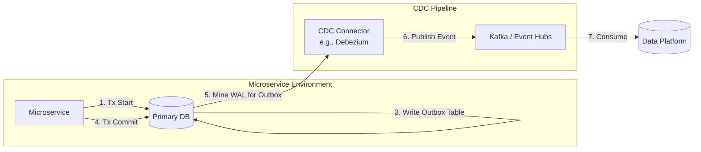

# Pattern 07: Transactional Outbox

## 1. Pattern Overview
- **Pattern Name:** Transactional Outbox
- **Pattern ID:** 07
- **Objective:** Reliably publish semantic application events to the data platform without the "dual-write" bug (where an app writes to the DB successfully but fails to publish to Kafka, or vice versa).
- **Applicable Sources:** Microservices (Java, .NET, Node.js, Python) backed by Relational Databases.
- **Applicable Targets:** Kafka, Databricks, Snowflake.
- **Typical Use Cases:** Domain-Driven Design (DDD) architectures where the data platform needs high-quality semantic events (e.g., `OrderPlaced`, `CustomerUpgraded`) rather than raw physical database row changes.
- **When to Use:** When you need guaranteed exactly-once delivery of business events, and the application development team is willing and able to adopt the pattern.
- **When NOT to Use:** When you do not have control over the application source code (e.g., COTS software) or when the application uses a NoSQL database without multi-document ACID transactions.

## 2. Pre-Ingestion Profiling
- **Application Capability:** Can the application framework support local ACID transactions spanning multiple tables? (If using an ORM like Entity Framework or Hibernate, this is usually straightforward).
- **Storage Overhead:** The outbox table temporarily doubles the write I/O for the application. Validate that the DB storage can handle this before asynchronous pruning occurs.

## 3. Reference Architecture

## 4. End-to-End Data Flow
1. **Local Transaction:** The application updates its domain tables (e.g., `Orders`) and inserts a JSON payload into the `Outbox` table within a single ACID transaction.
2. **Commit:** If either write fails, the entire transaction rolls back. No partial states.
3. **Log Mining:** A CDC tool (like Debezium) monitors the WAL *only* for the `Outbox` table, ignoring the physical domain tables.
4. **Publishing:** The CDC tool publishes the Outbox payload to Kafka.
5. **Consumption:** The data platform (Spark/Snowpipe) consumes the semantic event.
6. **Pruning:** A background worker in the microservice asynchronously deletes published records from the Outbox table to prevent bloat.

## 5. Insert / Update / Delete Handling
Unlike pure DB CDC (Pattern 06) which tracks raw physical rows, this pattern tracks *semantic events*. 
- A physical `INSERT` into the `Users` table becomes a `UserCreated` event payload.
- A physical `UPDATE` to the `Users` table (e.g., setting `is_active = false`) becomes a `UserDeactivated` event (equivalent to a logical delete).
- The target data platform processes these events chronologically to construct the current dimensional state or fact tables.

## 6. Target-Side Optimization (Databricks / Snowflake)
- **Databricks:** Use Structured Streaming to append the raw Outbox JSON payloads into a Bronze table. Then use Delta Live Tables to unpack the JSON and route different event types (e.g., `UserCreated` vs `OrderPlaced`) into their respective Silver tables using `APPLY CHANGES INTO`.
- **Snowflake:** Land the JSON payloads into a single staging table using a `VARIANT` column. Use Snowflake Dynamic Tables to parse the JSON and project the semantic events into structured tables.

## 7. Reliability, Resumability, and Failure Handling
- **Guaranteed Delivery:** Because the domain write and the outbox write are wrapped in a single database transaction, the event is guaranteed to be recorded if the business action succeeds.
- **Idempotency:** Kafka provides at-least-once delivery. The downstream ingestion engine must handle potential duplicate Outbox events by deduplicating on a unique `event_id` generated by the microservice.

## 8. Constraints & Red Lines
- **Red Line 1 - Pruning Failure:** If the asynchronous background pruning task fails (or is never built), the outbox table will grow infinitely, degrading primary database performance.
- **Red Line 2 - Unordered Processing:** If the downstream data platform processes outbox events out of order, the reconstructed state will be corrupted. Kafka partitions must be keyed by the aggregate root ID (e.g., `order_id`).

## 9. Trade-Offs

| Decision | Option A | Option B | Trade-Off |
|---|---|---|---|
| Extraction Method | Log-Based CDC (Debezium) | Polling Worker (SELECT) | Log-based is highly performant and near real-time. Polling is easier to build (no Kafka/Debezium needed) but introduces latency and heavy DB read overhead. |
| DB Technology | RDBMS (PostgreSQL, SQL Server) | NoSQL (MongoDB, DynamoDB) | RDBMS makes this pattern trivial via ACID transactions. NoSQL requires complex two-phase commits or native streams (e.g., DynamoDB Streams). |

## 10. Pattern Selection Checklist
- [ ] Application engineering team committed to writing outbox records in the same transaction.
- [ ] Automated pruning mechanism designed and tested.
- [ ] Kafka Partition Keys properly mapped to the domain aggregate ID.
- [ ] Downstream idempotency guaranteed (handling at-least-once delivery duplicates via unique event IDs).