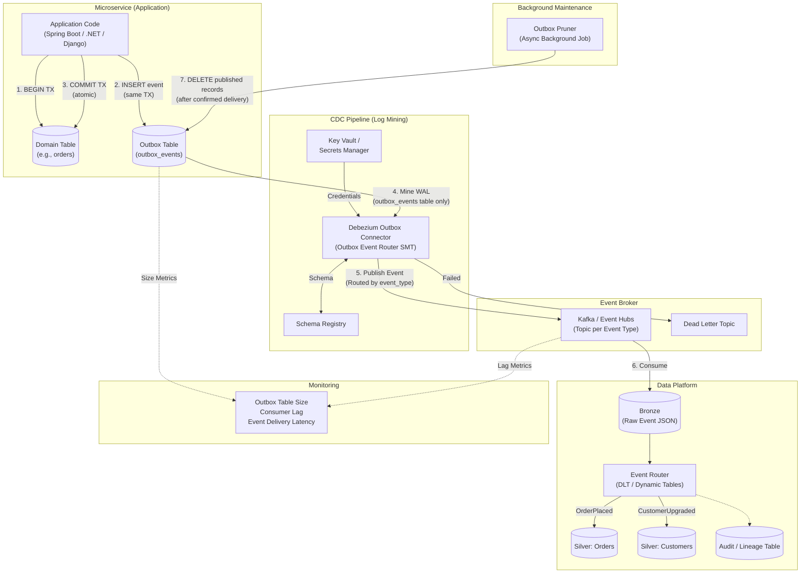
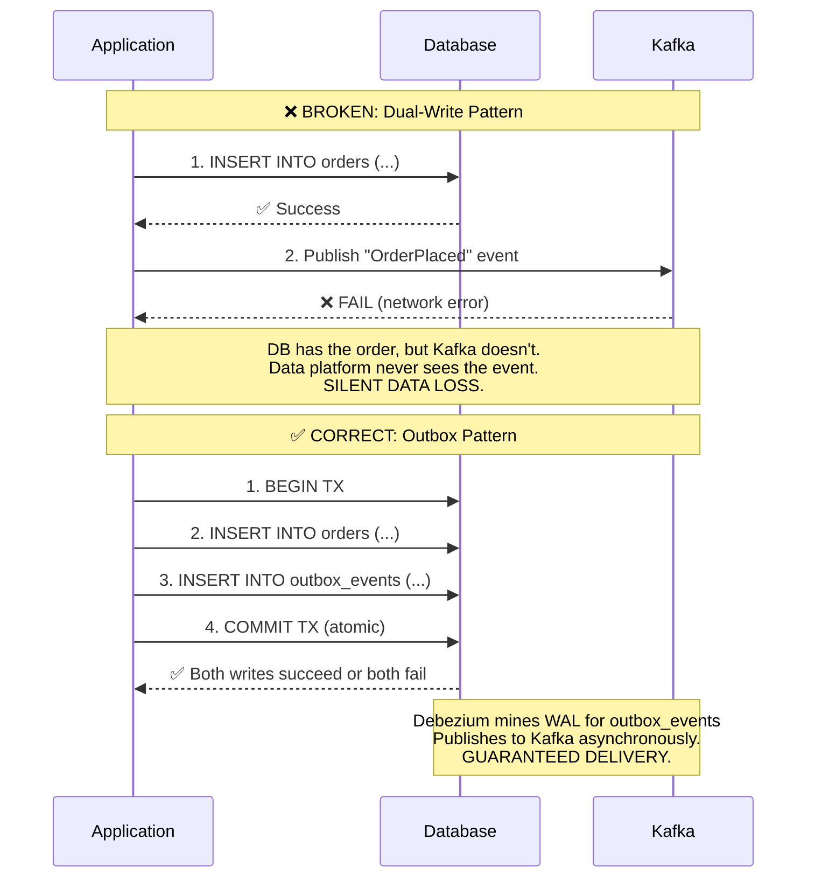

# Pattern 07: Transactional Outbox

## 1. Pattern Overview

- **Pattern Name:** Transactional Outbox
- **Pattern ID:** 07
- **Version:** 2.0
- **Objective:** Reliably publish semantic business events from microservices to the data platform without the "dual-write" bug — where an application writes to its database successfully but fails to publish to the event broker, or vice versa — by embedding the event in the same ACID transaction as the domain state change.
- **Applicable Sources:** Microservices (Java/Spring Boot, .NET, Node.js, Python/Django) backed by Relational Databases (PostgreSQL, MySQL, SQL Server).
- **Applicable Targets:** Kafka / Event Hubs (primary), then Databricks, Snowflake, Data Lake (via Kafka consumers).
- **Typical Use Cases:**
  - Domain-Driven Design (DDD) architectures where the data platform needs high-quality semantic events (e.g., `OrderPlaced`, `CustomerUpgraded`, `PaymentProcessed`) rather than raw physical row changes.
  - Event-driven architectures where guaranteed delivery is a hard requirement.
  - Replacing fragile dual-write patterns in existing microservices.
- **When to Use:**
  - You need **guaranteed exactly-once delivery** of business events from the application to the data platform.
  - The application development team is willing and able to adopt the outbox pattern in their codebase.
  - You want **semantic events** (business-meaningful) rather than raw CDC row changes.
- **When NEVER to Use (Red Lines):**
  - **No control over application source code** (e.g., COTS/SaaS software): Use Pattern 05/06 (raw CDC).
  - **NoSQL database without multi-document ACID transactions** (e.g., DynamoDB, Cassandra without LWT): The outbox pattern requires single-transaction atomicity across domain table + outbox table.
  - **Application team unwilling to maintain outbox writes**: The pattern adds application code complexity. If the team won't maintain it, use raw CDC.

---

## 2. Pre-Ingestion Profiling

### 2.1 Application Capability Assessment

| Check | Requirement | Consequence of Failure |
|:---|:---|:---|
| **ACID transaction support** | Database supports multi-table ACID transactions | Without atomicity, outbox write can succeed while domain write fails (or vice versa) |
| **ORM compatibility** | Application ORM (Hibernate, Entity Framework, SQLAlchemy) supports multi-table transactions | Custom transaction management required |
| **Outbox write I/O overhead** | DB can handle 2× write amplification (domain + outbox) | Application latency increase |
| **JSON payload generation** | Application can serialize domain events to JSON/Avro at transaction time | Custom serialization logic needed |
| **Event idempotency key** | Application generates a unique `event_id` (UUID) per outbox record | Downstream deduplication impossible without unique key |

### 2.2 Event Design Principles

| Principle | Guidance |
|:---|:---|
| **Semantic naming** | Name events by business action: `OrderPlaced`, `CustomerUpgraded` — NOT `INSERT_INTO_ORDERS` |
| **Self-contained payload** | Each event must contain all data needed by consumers. Do NOT require consumers to call back to the source API. |
| **Aggregate root key** | The Kafka partition key must be the domain aggregate root ID (e.g., `order_id`), not a random UUID |
| **Schema versioning** | Include `event_version` field. Consumers must handle multiple versions. |

---

## 3. Reference Architecture

### 3.1 Detailed End-to-End Architecture



### 3.2 Dual-Write Bug — Why Outbox Exists



---

## 4. End-to-End Data Flow

### Step 1 — Application Transaction
The application updates its domain tables AND inserts a JSON event payload into the `outbox_events` table within a **single ACID transaction**:

```java
// Java / Spring Boot example
@Transactional
public void placeOrder(OrderRequest request) {
    // 1. Domain write
    Order order = orderRepository.save(new Order(request));
    
    // 2. Outbox write (same transaction)
    OutboxEvent event = OutboxEvent.builder()
        .eventId(UUID.randomUUID())
        .aggregateType("Order")
        .aggregateId(order.getId().toString())
        .eventType("OrderPlaced")
        .eventVersion(1)
        .payload(objectMapper.writeValueAsString(new OrderPlacedEvent(
            order.getId(), order.getCustomerId(), 
            order.getAmount(), order.getStatus()
        )))
        .createdAt(Instant.now())
        .build();
    outboxRepository.save(event);
}
// If either save() fails → entire transaction rolls back. No partial state.
```

### Step 2 — Outbox Table Schema

```sql
-- Outbox Table DDL (PostgreSQL)
CREATE TABLE outbox_events (
    event_id        UUID        PRIMARY KEY DEFAULT gen_random_uuid(),
    aggregate_type  VARCHAR(100) NOT NULL,   -- 'Order', 'Customer', 'Payment'
    aggregate_id    VARCHAR(255) NOT NULL,   -- Domain entity ID (Kafka partition key)
    event_type      VARCHAR(100) NOT NULL,   -- 'OrderPlaced', 'CustomerUpgraded'
    event_version   INT         NOT NULL DEFAULT 1,
    payload         JSONB       NOT NULL,    -- Serialized event data
    created_at      TIMESTAMP   NOT NULL DEFAULT NOW(),
    published       BOOLEAN     DEFAULT FALSE,  -- Pruning flag
    published_at    TIMESTAMP                    -- When Debezium published it
);

-- Index for Debezium WAL mining (no direct query needed — WAL-based)
-- Index for pruning job
CREATE INDEX idx_outbox_published ON outbox_events(published) WHERE published = FALSE;
```

### Step 3 — Debezium Log Mining (Outbox Table Only)
Debezium monitors the WAL but **only** captures changes to the `outbox_events` table, ignoring all domain tables. This is critical: the data platform receives **semantic events**, not raw row changes.

**Debezium Outbox Event Router Configuration:**
```json
{
  "name": "outbox-connector",
  "config": {
    "connector.class": "io.debezium.connector.postgresql.PostgresConnector",
    "database.hostname": "app-db.internal",
    "database.port": "5432",
    "database.user": "${secretManager:db-cdc-user}",
    "database.password": "${secretManager:db-cdc-pass}",
    "database.dbname": "orderservice",
    "table.include.list": "public.outbox_events",
    "tombstones.on.delete": "false",
    "transforms": "outbox",
    "transforms.outbox.type": "io.debezium.transforms.outbox.EventRouter",
    "transforms.outbox.table.fields.additional.placement": "event_type:header:eventType",
    "transforms.outbox.table.field.event.id": "event_id",
    "transforms.outbox.table.field.event.key": "aggregate_id",
    "transforms.outbox.table.field.event.payload": "payload",
    "transforms.outbox.table.field.event.timestamp": "created_at",
    "transforms.outbox.route.by.field": "aggregate_type",
    "transforms.outbox.route.topic.replacement": "events.${routedByValue}"
  }
}
```

This routes events to Kafka topics by `aggregate_type`:
- `OrderPlaced` → `events.Order`
- `CustomerUpgraded` → `events.Customer`
- `PaymentProcessed` → `events.Payment`

### Step 4 — Kafka Publishing
Events are published with `aggregate_id` as the Kafka message key, ensuring per-aggregate ordering.

### Step 5 — Data Platform Consumption

### Step 6 — Outbox Pruning
A background job in the microservice asynchronously deletes published records:

```sql
-- Mark records as published (called by Debezium heartbeat or application callback)
UPDATE outbox_events
SET published = TRUE, published_at = NOW()
WHERE published = FALSE
  AND created_at < NOW() - INTERVAL '5 minutes';  -- Safety: wait 5 min for Debezium to process

-- Prune old published records (run hourly)
DELETE FROM outbox_events
WHERE published = TRUE
  AND published_at < NOW() - INTERVAL '7 days';

-- Monitor outbox table size
SELECT COUNT(*) AS pending_events FROM outbox_events WHERE published = FALSE;
SELECT pg_size_pretty(pg_total_relation_size('outbox_events')) AS outbox_size;
```

> **🚨 CAUTION:** Never prune unpublished records. If the pruning job deletes records before Debezium has read the WAL entry, those events are **permanently lost**.

---

## 5. Event vs. Raw CDC — Semantic Difference

Unlike Pattern 05/06 which captures raw physical row changes, Pattern 07 captures **semantic business events**:

| Aspect | Raw CDC (P05/P06) | Outbox Events (P07) |
|:---|:---|:---|
| **Content** | Physical row state: `{customer_id: 42, is_active: false}` | Semantic event: `{eventType: "CustomerDeactivated", customerId: 42, reason: "payment_overdue"}` |
| **Schema** | Mirrors source table schema (tightly coupled) | Application-controlled event schema (decoupled) |
| **History** | Every column change is captured | Only meaningful business state transitions |
| **Consumer Knowledge** | Consumer must understand source DB schema | Consumer works with business-domain contracts |
| **Data Quality** | Raw data, may include internal implementation details | Curated, business-meaningful payloads |

---

## 6. Target-Side Processing

### 6.1 Databricks (Structured Streaming → Event Routing)

```python
# Bronze: Ingest all outbox events from Kafka
(spark.readStream
    .format("kafka")
    .option("kafka.bootstrap.servers", "kafka:9092")
    .option("subscribePattern", "events\\..*")  # All event topics
    .option("startingOffsets", "latest")
    .load()
    .selectExpr(
        "topic AS _event_topic",
        "CAST(key AS STRING) AS aggregate_id",
        "CAST(value AS STRING) AS payload_json",
        "timestamp AS _kafka_ts",
        "offset AS _kafka_offset"
    )
    .writeStream
    .format("delta")
    .option("checkpointLocation", "/mnt/checkpoints/outbox_bronze")
    .option("mergeSchema", "true")
    .outputMode("append")
    .trigger(availableNow=True)
    .toTable("catalog.bronze.outbox_events_raw")
)
```

```sql
-- DLT: Route events to typed Silver tables
CREATE OR REFRESH STREAMING TABLE silver_orders
AS SELECT 
    aggregate_id AS order_id,
    payload_json:orderId::BIGINT AS order_id_typed,
    payload_json:customerId::BIGINT AS customer_id,
    payload_json:amount::DECIMAL(18,2) AS amount,
    payload_json:status::STRING AS status,
    _kafka_ts AS event_timestamp
FROM STREAM(LIVE.outbox_events_raw)
WHERE _event_topic = 'events.Order';

CREATE OR REFRESH STREAMING TABLE silver_customers
AS SELECT 
    aggregate_id AS customer_id,
    payload_json:name::STRING AS name,
    payload_json:email::STRING AS email,
    payload_json:tier::STRING AS tier,
    _kafka_ts AS event_timestamp
FROM STREAM(LIVE.outbox_events_raw)
WHERE _event_topic = 'events.Customer';
```

### 6.2 Snowflake (JSON → VARIANT → Dynamic Tables)

```sql
-- Staging: Land JSON payloads into VARIANT column
CREATE TABLE raw.outbox_events (
    event_topic     STRING,
    aggregate_id    STRING,
    payload         VARIANT,
    kafka_ts        TIMESTAMP_NTZ,
    _load_ts        TIMESTAMP_NTZ DEFAULT CURRENT_TIMESTAMP()
);

-- Dynamic Table: Parse Order events
CREATE OR REPLACE DYNAMIC TABLE silver.orders
  TARGET_LAG = '5 minutes'
  WAREHOUSE = WH_OUTBOX_PROCESSING
AS
SELECT 
    aggregate_id AS order_id,
    payload:orderId::NUMBER AS order_id_typed,
    payload:customerId::NUMBER AS customer_id,
    payload:amount::DECIMAL(18,2) AS amount,
    payload:status::STRING AS status,
    kafka_ts AS event_timestamp
FROM raw.outbox_events
WHERE event_topic = 'events.Order'
QUALIFY ROW_NUMBER() OVER (PARTITION BY aggregate_id ORDER BY kafka_ts DESC) = 1;
```

---

## 7. AWS & Azure Implementation Reference

### 7.1 AWS

| Component | Service | Configuration |
|:---|:---|:---|
| **Microservice DB** | RDS / Aurora PostgreSQL | `wal_level = logical` for Debezium access to outbox table. |
| **CDC Connector** | Debezium on ECS/EKS (Kafka Connect) | Outbox Event Router SMT. Mount Secrets Manager. |
| **Event Broker** | Amazon MSK | SASL/SCRAM auth. TLS encryption. |
| **Secrets** | AWS Secrets Manager | DB creds, Kafka SASL creds. |
| **Networking** | VPC-internal only | Microservice, DB, Debezium, MSK: same VPC. |

### 7.2 Azure

| Component | Service | Configuration |
|:---|:---|:---|
| **Microservice DB** | Azure Database for PostgreSQL | Logical replication enabled. |
| **CDC Connector** | Debezium on AKS / ACI | Managed Identity for Key Vault. |
| **Event Broker** | Azure Event Hubs (Kafka API) | Premium tier for Kafka compatibility. |
| **Secrets** | Azure Key Vault | DB creds via Managed Identity. |
| **Networking** | VNet Service Endpoints | All components in same VNet. |

---

## 8. Security & Governance

### 8.1 Mandatory Security Controls

| Control | Implementation | Non-Compliance Consequence |
|:---|:---|:---|
| **Network Isolation** | Debezium ↔ DB: Private Link / VNet. Kafka: VPC-internal only. | DB or event stream exposed to public internet. |
| **Kafka Encryption** | TLS 1.2+ for all broker connections. | Data interception. |
| **Kafka Authentication** | SASL/SCRAM or mTLS. | Unauthorized topic access. |
| **Secrets Management** | All credentials in Key Vault / Secrets Manager. | Credential rotation impossible. |
| **PII in Events** | Application must NOT include raw PII in outbox payloads unless encrypted/tokenized. | PII exposure to all Kafka consumers and the data platform. |
| **Event Payload Governance** | Event schemas versioned and registered in Schema Registry. | Breaking changes crash all consumers. |

---

## 9. Reliability, Resumability & Failure Recovery

### 9.1 Failure Scenarios & Recovery Playbook

| Failure Scenario | Impact | Recovery Procedure |
|:---|:---|:---|
| **Application transaction fails** | Both domain write AND outbox write roll back. No partial state. | ✅ This is the design intent. No action needed. |
| **Debezium connector crashes** | Outbox records accumulate. Events delayed but not lost. | Debezium restarts from last committed WAL offset. Events delivered in order. |
| **Pruning job runs before Debezium processes** | ❌ **Events permanently lost.** | Never prune records younger than 2× Debezium's maximum lag. Use `published = TRUE` flag check. |
| **Outbox table fills disk** | ❌ **Application DB crash.** | Alert on outbox table size. Fix pruning job. Add storage. |
| **Kafka consumer goes down > retention** | ❌ **Permanent event loss for that consumer.** | Re-process from source (if outbox records still exist) or accept data gap. |
| **Duplicate events delivered** (Debezium at-least-once) | Duplicate records in target | Consumer deduplicates on `event_id` (UUID generated by application). |

### 9.2 Idempotency Model

```
┌─────────────────────────────────────────────────────────┐
│                   IDEMPOTENCY MODEL                      │
├──────────────┬──────────────────────────────────────────┤
│  Layer       │  Guarantee                               │
├──────────────┼──────────────────────────────────────────┤
│  Application │  Exactly-once: outbox write is in the    │
│              │  same ACID transaction as domain write.  │
├──────────────┼──────────────────────────────────────────┤
│  Debezium    │  At-least-once: may re-deliver events    │
│              │  on connector restart.                   │
├──────────────┼──────────────────────────────────────────┤
│  Kafka       │  At-least-once delivery to consumers.    │
├──────────────┼──────────────────────────────────────────┤
│  Data Platform│ Deduplicate on event_id (UUID).         │
│              │  THIS IS THE IDEMPOTENCY BOUNDARY.        │
└──────────────┴──────────────────────────────────────────┘
```

---

## 10. Observability & Monitoring

| Metric | Threshold | Alert Severity | Action |
|:---|:---|:---|:---|
| **Outbox table size** | > 100K unpublished records | 🔴 P1 CRITICAL | Debezium lagging or failed. Investigate connector status. |
| **Outbox table disk usage** | > 1 GB | 🟡 P2 WARNING | Pruning job delayed. Check pruning schedule. |
| **Debezium connector status** | `FAILED` | 🔴 P1 CRITICAL | Restart connector. Check DB connectivity. |
| **Event delivery latency** (outbox `created_at` → Kafka publish) | > 30 seconds | 🟡 P2 WARNING | Debezium lagging. Scale Connect workers. |
| **Consumer lag** | > 50% of Kafka retention | 🔴 P0 SEV-1 | Scale consumer. Risk of permanent event loss. |
| **Duplicate events in Bronze** (same `event_id`) | > 1% of events | 🟡 P2 WARNING | Debezium re-delivery rate too high. Check connector stability. |

---

## 11. Cost Model

| Component | Cost Driver | Optimization Lever |
|:---|:---|:---|
| **Application DB I/O** | 2× write amplification (domain + outbox) | Minimize outbox payload size. Only include fields consumers need. |
| **Debezium / Kafka Connect** | Worker instance hours | Scale workers to match outbox write rate. |
| **Kafka Cluster** | Broker hours + storage (retention) | Right-size. Reduce retention to minimum safe period. |
| **Data Platform Compute** | Streaming cluster / Dynamic Table warehouse | `trigger(availableNow=True)` for non-real-time consumers. |

---

## 12. Constraints & Red Lines

| # | Red Line | Consequence | Mitigation |
|:---|:---|:---|:---|
| 1 | **Pruning failure** | Outbox table grows unbounded → application DB disk exhaustion → **production outage**. | Automated pruning with monitoring. Alert on table size. |
| 2 | **Unordered processing** | Processing outbox events out of order → reconstructed state is corrupted. | Kafka partitions keyed by `aggregate_id`. Consumers process per-partition in order. |
| 3 | **No event_id deduplication** | Duplicate events from Debezium at-least-once delivery → duplicate records in target. | Application MUST generate unique `event_id` (UUID). Target deduplicates on this key. |
| 4 | **PII in event payloads** | All Kafka consumers (including non-data-platform systems) see raw PII. | Application must mask/tokenize PII before writing to outbox. |
| 5 | **NoSQL without ACID** | Outbox write can succeed while domain write fails (or vice versa) → dual-write bug not solved. | Pattern requires multi-table ACID transactions. Use only with RDBMS. |

---

## 13. Trade-Offs

| Decision | Option A | Option B | Trade-Off Analysis |
|:---|:---|:---|:---|
| **Extraction Method** | Log-Based CDC (Debezium) | Polling Worker (`SELECT ... WHERE published = FALSE`) | Debezium is near-real-time and low-overhead. Polling adds DB read load and introduces latency. **Debezium is strongly preferred.** |
| **Event Schema** | Strict (Avro + Schema Registry) | Flexible (JSON) | Avro provides enforcement and evolution. JSON is easier for application devs but breaks consumers on changes. **Avro for enterprise.** |
| **Pruning Strategy** | Time-based (delete > 7 days) | Flag-based (`published = TRUE`) | Time-based risks deleting unpublished records. Flag-based is safer. **Use flag-based with time-based safety net.** |
| **DB Technology** | RDBMS (PostgreSQL, SQL Server) | NoSQL (MongoDB, DynamoDB) | RDBMS makes outbox trivial via ACID. NoSQL requires complex two-phase commits or native streams (DynamoDB Streams). **RDBMS strongly preferred.** |
| **Semantic vs. Raw** | Outbox (semantic events) | Raw CDC (Pattern 05/06) | Outbox gives the data platform clean, business-meaningful events but requires application team cooperation. Raw CDC requires no app changes but delivers low-level row mutations. **Outbox if you control the app; raw CDC for COTS/legacy.** |

---

## 14. Pattern Selection Checklist

> This checklist must be completed and submitted to the Architecture Review Board before pipeline provisioning.

- [ ] Application engineering team committed to implementing outbox writes in the same transaction.
- [ ] Source database supports multi-table ACID transactions (RDBMS confirmed).
- [ ] Outbox table DDL created with `event_id` (UUID), `aggregate_type`, `aggregate_id`, `event_type`, `payload`.
- [ ] Application generates unique `event_id` per event (for downstream deduplication).
- [ ] Event payloads are self-contained (consumers do NOT call back to source API).
- [ ] PII assessed: outbox payloads do NOT contain unmasked PII.
- [ ] Debezium Outbox Event Router SMT configured and tested.
- [ ] Kafka topics routed by `aggregate_type`. Partitioned by `aggregate_id`.
- [ ] Schema Registry deployed with compatibility rules for event schemas.
- [ ] Automated pruning job implemented with `published` flag check and 7-day retention buffer.
- [ ] Pruning job monitoring: alert on outbox table size > 100K unpublished records.
- [ ] Downstream consumers deduplicate on `event_id`.
- [ ] All credentials in **Key Vault / Secrets Manager**.
- [ ] Network connectivity: Private Link / VNet for DB ↔ Debezium ↔ Kafka.
- [ ] Consumer lag monitoring configured (threshold: 50% of Kafka retention).