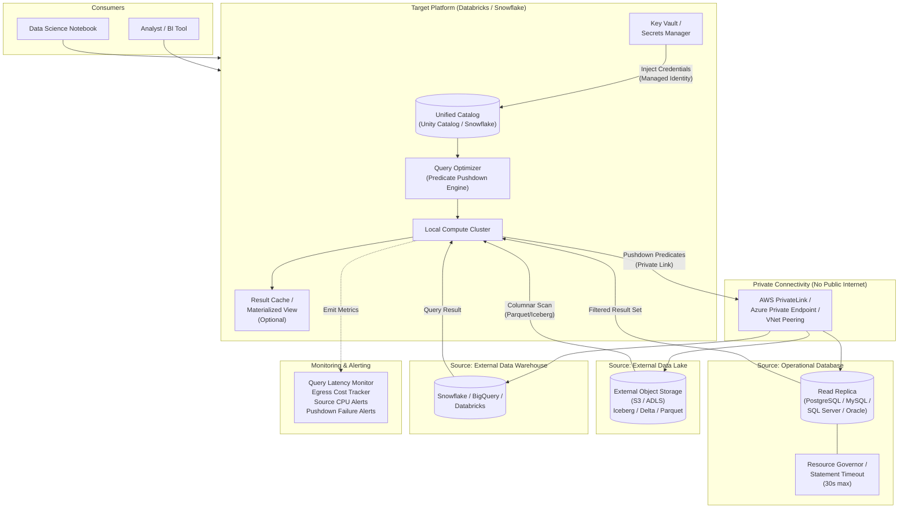
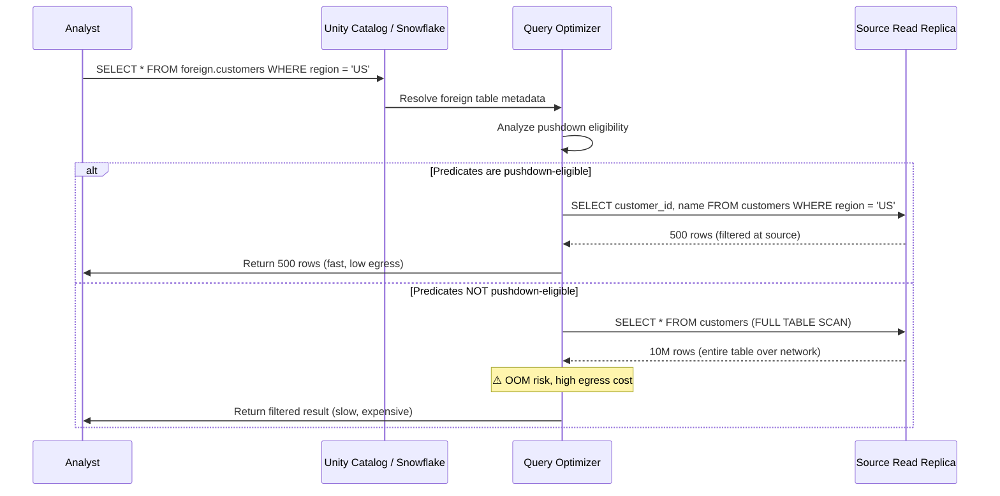

# Pattern 08: Lakehouse Federation (Zero-Copy)

## 1. Pattern Overview

- **Pattern Name:** Lakehouse Federation (Zero-Copy / Query Virtualization)
- **Pattern ID:** 08
- **Version:** 2.0
- **Objective:** Query data residing in external operational databases, external data warehouses, or cross-cloud object storage directly from the target platform without physical data movement or ingestion pipelines.
- **Applicable Sources:** PostgreSQL, MySQL, SQL Server, Oracle, Snowflake (from Databricks), Databricks (from Snowflake), Google BigQuery, external object storage (Apache Iceberg, Delta Lake on S3/ADLS).
- **Applicable Targets:** Databricks (Unity Catalog Lakehouse Federation), Snowflake (External Tables / Apache Iceberg Tables via External Volumes).
- **Typical Use Cases:**
  - Rapid prototyping and data exploration of new source systems before committing to physical ingestion pipelines.
  - Low-frequency ad-hoc analytical queries (< 50 queries/day) against operational databases.
  - Regulatory isolation (data residency laws where data cannot physically leave a specific VPC/region/jurisdiction).
  - Low-churn dimensional joins where small lookup tables reside in an external system.
  - Cross-platform interoperability: Databricks reading Snowflake tables, or vice versa, without ETL.
- **When to Use:**
  - The engineering and infrastructure cost of building and maintaining a physical ETL pipeline exceeds the query-time compute cost.
  - Exploring new data assets before committing to permanent storage.
  - Regulatory or contractual constraints prohibit physical data replication.
  - Read-only access to external data for enrichment joins (small dimension tables).
- **When NEVER to Use (Red Lines):**
  - **High-concurrency BI dashboards** (hundreds of concurrent users hitting the federated source): Use Pattern 02 (Full Snapshot) or Pattern 05 (CDC) to materialize data locally.
  - **Massive fact-to-fact table joins** across federated and local tables: The entire remote fact table is pulled across the network → OOM crashes and egress bills.
  - **Primary production OLTP databases** as direct federation targets: A single unindexed analytical query can lock tables or exhaust connection pools, causing a production outage. Always use a **Read Replica**.
  - **Sub-second query latency SLA**: Network round-trips and source engine limitations make sub-second responses unreliable.

---

## 2. Pre-Ingestion Profiling

### 2.1 Source System Assessment

Execute the following assessments **before** establishing any federated connection.

| Assessment | Target | Impact |
|:---|:---|:---|
| **Source Compute Headroom** | < 30% CPU utilization headroom during peak hours | Federated queries add analytical read load on top of OLTP traffic |
| **Read Replica Availability** | Provisioned and replication lag < 1 min | Federation MUST target a read replica, never the primary |
| **Query Pushdown Support** | Test critical filter predicates against the federation driver | Non-pushdown queries pull the ENTIRE table across the network |
| **Network Bandwidth** | Measured available bandwidth between source and target | Determines maximum practical result set size per query |
| **Egress Cost Profile** | Calculated per-query and monthly egress cost | Cross-region or cross-cloud egress can generate $1,000+/month bills |
| **Connection Limits** | Source DB `max_connections` with headroom for federation | Federated queries consume source DB connection pool |

### 2.2 Pushdown Verification Queries

```sql
-- Databricks: Verify pushdown is occurring (check query plan)
EXPLAIN EXTENDED
SELECT customer_id, customer_name
FROM foreign_catalog.public.customers
WHERE region = 'US-EAST'
  AND created_at > '2024-01-01';

-- Look for "PushedFilters" in the physical plan output.
-- If filters are NOT pushed down, the entire table is scanned remotely.
```

```sql
-- Snowflake: Check External Table scan statistics
SELECT *
FROM TABLE(INFORMATION_SCHEMA.EXTERNAL_TABLE_FILE_REGISTRATION_HISTORY(
    TABLE_NAME => 'EXT_CUSTOMERS',
    START_TIME => DATEADD('hour', -1, CURRENT_TIMESTAMP())
));
```

### 2.3 Critical Pre-Flight Checks

| Check | Target | Consequence of Failure |
|:---|:---|:---|
| Read Replica provisioned | Dedicated replica isolated from write traffic | Production OLTP outage from analytical query load |
| Statement timeout on source | `statement_timeout = 30000` (30s) for federated users | Runaway queries exhaust source DB resources |
| Connection pool limits | Reserved pool for federated connections (e.g., max 10) | Federation consumes all connections → OLTP blocked |
| Network path secured | Private Link / VNet peering | Source database exposed to public internet |
| Egress cost approved | Monthly egress budget reviewed by stakeholders | Unexpected $5,000+ cloud bills |

---

## 3. Reference Architecture

### 3.1 Detailed End-to-End Architecture



### 3.2 Pushdown Execution Model



---

## 4. End-to-End Data Flow

### Step 1 — Catalog Registration
A Platform Engineer defines a foreign connection or external catalog, mapping remote tables to local virtual schemas within the governance layer (Unity Catalog or Snowflake).

### Step 2 — Query Compilation
An end user runs a query joining a local table with the remote federated table. The query is submitted to the local query optimizer.

### Step 3 — Predicate Pushdown & Optimization
The platform optimizer translates the query AST, pushing down `WHERE` clauses, column projections, `LIMIT`, and simple aggregates into the source engine's native SQL dialect. Functions that cannot be translated are evaluated locally after data retrieval.

> [!WARNING]
> If a query contains non-pushdown functions (e.g., custom UDFs, complex regex, or window functions), the engine may pull the **entire source table** across the network before filtering. This causes driver OOM crashes and high egress bills. **Always verify pushdown via `EXPLAIN`.**

### Step 4 — Data Transit
The filtered subset of records is returned over the network (secured via Private Link or VNet Peering) to the target platform compute cluster.

### Step 5 — Final Evaluation
The local engine executes the remaining complex operations (e.g., joins against local tables, window functions, aggregations) on the locally received result set.

---

## 5. Ingestion Mode

- **Zero-Copy / Virtualization:** No persistent storage footprint is created in the target system. The source remains the system of record.
- **Optional Target Caching:** Temporary caching of query results via materialized views or result-set caches where supported:
  - **Databricks:** `CREATE MATERIALIZED VIEW` on top of federated tables (refreshed on schedule).
  - **Snowflake:** Automatic result cache (24-hour TTL) + `CREATE MATERIALIZED VIEW` (manual refresh).

> [!TIP]
> If the same federated query is executed more than 5× per hour, consider materializing the result as a view or table. The compute + storage cost of materialization is almost always cheaper than repeated cross-network queries.

---

## 6. Insert / Update / Delete Handling

- **Real-Time Consistency:** Because queries read directly from the source system, all inserts, updates, and hard deletes are reflected immediately (subject to read replica lag).
- **Isolation:** Read-committed isolation depends on the underlying source database transaction model.
- **No Write-Back:** Federation is strictly read-only. The target platform cannot INSERT, UPDATE, or DELETE records on the source via federation.

---

## 7. Format Selection Decision Matrix (For External Lake Targets)

| Capability | Delta Lake | Apache Iceberg | Apache Hudi |
|:---|:---|:---|:---|
| Databricks Unity Catalog Read | ✅ Native (Excellent) | ✅ Excellent | 🟡 Good |
| Snowflake Native Integration | 🟡 Good (via UniForm) | ✅ Native (Excellent) | ❌ Low |
| Cross-Engine Pushdown | 🟡 Good | ✅ Excellent | 🟡 Medium |
| Multi-Cloud Interoperability | ✅ High | ✅ Excellent | 🟡 Medium |
| Time Travel / Snapshot Reads | ✅ Yes | ✅ Yes | ✅ Yes |
| **Recommendation** | Databricks-native shops | Multi-engine / Snowflake shops | Avoid for federation |

> [!IMPORTANT]
> If both Databricks and Snowflake need to read the same external data lake tables, use **Apache Iceberg** as the open format, or enable **Delta UniForm** to generate Iceberg-compatible metadata alongside Delta transaction logs.

---

## 8. Target-Side Implementation

### 8.1 Databricks — Unity Catalog Lakehouse Federation

```sql
-- Step 1: Create a foreign connection to the source database
CREATE CONNECTION pg_production_connection
TYPE POSTGRESQL
OPTIONS (
    host 'read-replica.internal.company.com',
    port '5432',
    user secret('kv-scope', 'pg-federation-user'),
    password secret('kv-scope', 'pg-federation-pass')
);

-- Step 2: Create a foreign catalog mapping
CREATE FOREIGN CATALOG pg_production
USING CONNECTION pg_production_connection
OPTIONS (database 'production');

-- Step 3: Query the federated table directly
SELECT c.customer_id, c.customer_name, o.order_total
FROM pg_production.public.customers c
JOIN catalog.silver.orders o ON c.customer_id = o.customer_id
WHERE c.region = 'US-EAST'
  AND o.order_date > '2024-01-01';
```

```sql
-- Step 4: Materialize frequently-accessed federated data
CREATE MATERIALIZED VIEW catalog.gold.mv_us_customers
AS
SELECT customer_id, customer_name, email, region, created_at
FROM pg_production.public.customers
WHERE region IN ('US-EAST', 'US-WEST');

-- Refresh schedule (Databricks Workflows or DLT)
REFRESH MATERIALIZED VIEW catalog.gold.mv_us_customers;
```

```sql
-- Apply governance on federated tables (row/column filters)
ALTER TABLE pg_production.public.customers
SET ROW FILTER pii_row_filter ON (customer_id);

-- Column masking for PII
ALTER TABLE pg_production.public.customers
ALTER COLUMN email SET MASK mask_email;
```

### 8.2 Databricks — External Tables (Iceberg / Delta on Object Storage)

```sql
-- Read external Iceberg tables from S3/ADLS
CREATE TABLE catalog.external.ext_transactions
USING ICEBERG
LOCATION 's3://partner-data-lake/iceberg/transactions/'
OPTIONS (
    'catalog-impl' = 'org.apache.iceberg.aws.glue.GlueCatalog',
    'warehouse' = 's3://partner-data-lake/iceberg/'
);

-- Query with time travel
SELECT * FROM catalog.external.ext_transactions
VERSION AS OF 1697126400000;
```

### 8.3 Snowflake — External Tables & Iceberg Tables

```sql
-- Step 1: Create an external volume pointing to S3/ADLS
CREATE OR REPLACE EXTERNAL VOLUME ext_vol_partner_lake
  STORAGE_LOCATIONS = (
    (
      NAME = 'partner-s3'
      STORAGE_BASE_URL = 's3://partner-data-lake/iceberg/'
      STORAGE_PROVIDER = 'S3'
      STORAGE_AWS_ROLE_ARN = 'arn:aws:iam::123456789012:role/snowflake-ext-access'
      STORAGE_AWS_EXTERNAL_ID = 'snowflake_ext_id'
    )
  );

-- Step 2: Create an Iceberg table (Snowflake-managed catalog)
CREATE OR REPLACE ICEBERG TABLE external_db.public.ext_transactions
  EXTERNAL_VOLUME = 'ext_vol_partner_lake'
  CATALOG = 'SNOWFLAKE'
  BASE_LOCATION = 'transactions/';

-- Step 3: Create an External Table (for raw Parquet/CSV)
CREATE OR REPLACE EXTERNAL TABLE external_db.public.ext_raw_events (
    event_id VARCHAR AS (VALUE:event_id::VARCHAR),
    event_type VARCHAR AS (VALUE:event_type::VARCHAR),
    event_ts TIMESTAMP AS (VALUE:event_ts::TIMESTAMP),
    payload VARIANT AS (VALUE:payload)
)
WITH LOCATION = @ext_stage/events/
FILE_FORMAT = (TYPE = 'PARQUET')
AUTO_REFRESH = TRUE;
```

```sql
-- Step 4: Query with pushdown verification
SELECT event_type, COUNT(*) AS event_count
FROM external_db.public.ext_raw_events
WHERE event_ts > DATEADD('day', -7, CURRENT_TIMESTAMP())
GROUP BY event_type;

-- Verify scan efficiency
SELECT *
FROM TABLE(INFORMATION_SCHEMA.EXTERNAL_TABLE_FILES(
    TABLE_NAME => 'EXT_RAW_EVENTS'
));
```

---

## 9. AWS and Azure Implementation Reference

### 9.1 AWS

| Component | Service | Configuration |
|:---|:---|:---|
| **Source Database** | RDS / Aurora Read Replica | Dedicated replica with `max_connections` reserved for federation |
| **Network** | AWS PrivateLink / VPC Peering | Federation compute ↔ source DB: Private connectivity only |
| **External Storage** | S3 (Iceberg/Delta) | Bucket policy: target platform IAM role `GetObject` + `ListBucket` only |
| **Secrets** | AWS Secrets Manager | Source DB credentials. Rotated every 90 days |
| **Catalog** | AWS Glue Data Catalog | Iceberg table registration for cross-engine discovery |
| **Monitoring** | CloudWatch | RDS CPU, connection count, query duration, S3 GET request count |

### 9.2 Azure

| Component | Service | Configuration |
|:---|:---|:---|
| **Source Database** | Azure Database Read Replica | Resource Governor: limit federation queries to 30% CPU |
| **Network** | Azure Private Link / VNet Service Endpoints | Private connectivity only. No public IP exposure |
| **External Storage** | ADLS Gen2 (Iceberg/Delta) | Storage firewall: allow target platform Managed Identity only |
| **Secrets** | Azure Key Vault | Source DB credentials via Managed Identity |
| **Catalog** | Unity Catalog / Snowflake catalog | Federated catalog registration |
| **Monitoring** | Azure Monitor + Log Analytics | DB DTU/vCore usage, query execution time, egress bytes |

---

## 10. Security & Governance

### 10.1 Mandatory Security Controls

| Control | Implementation | Non-Compliance Consequence |
|:---|:---|:---|
| **Network Isolation** | Federation targets source DB via Private Link / VNet only. No public IP. | ARB rejection. Security incident. |
| **Read Replica Only** | Federation NEVER targets a primary OLTP database. Dedicated read replica required. | Production database outage. |
| **Least-Privilege IAM** | Federation service principal: `SELECT` only on approved schemas/tables. No DDL. No DML. | Blast radius amplification if compromised. |
| **Credential Management** | All connection credentials in Key Vault / Secrets Manager. Zero hardcoded secrets. | Credential rotation impossible. |
| **Source Resource Governance** | `statement_timeout = 30000` (30s) on source. Connection pool limits for federation users. | Runaway queries exhaust source resources. |
| **PII Governance** | Apply row filters and column masks in Unity Catalog / Snowflake on federated tables. | PII exposed to unauthorized analysts. |
| **Audit Logging** | Enable query audit logs on both source and target platforms. Track who queries what. | Compliance audit failure. |

### 10.2 RBAC Model

```
Source Database (Read Replica):
  └─ Service Principal: "federation-reader"
       ├─ GRANT SELECT ON schema.approved_tables TO federation_reader;
       ├─ SET statement_timeout = 30000;    -- 30 second max
       └─ SET max_connections = 10;         -- Connection pool limit

Target Platform (Databricks):
  └─ Unity Catalog:
       ├─ GRANT USE CATALOG ON pg_production TO data_analysts;
       ├─ GRANT SELECT ON pg_production.public.customers TO data_analysts;
       ├─ ROW FILTER pii_row_filter ON customers (customer_id);
       └─ COLUMN MASK mask_email ON customers.email;

Target Platform (Snowflake):
  └─ Role: "FEDERATION_READER"
       ├─ GRANT SELECT ON external_db.public.ext_transactions TO FEDERATION_READER;
       └─ GRANT USAGE ON EXTERNAL VOLUME ext_vol_partner_lake TO FEDERATION_READER;
```

---

## 11. Reliability, Resumability & Failure Recovery

### 11.1 Failure Scenarios & Recovery Playbook

| Failure Scenario | Impact | Recovery Procedure |
|:---|:---|:---|
| **Source database read replica offline** | All federated queries fail immediately with connection errors | Target platform surfaces error to user. Monitor replica health. Automatic recovery when replica is back online. No data loss (no state to lose). |
| **Source database under heavy load** | Federated queries timeout (30s limit) or return slow results | Auto-failover: return cached/materialized result if available. Alert source DBA team. Throttle federation queries via connection pool limits. |
| **Network partition (Private Link failure)** | Federated queries fail with timeout errors | Retry with exponential backoff (max 3 retries). Fallback to materialized view if configured. Alert networking team. |
| **Non-pushdown query (full table pull)** | OOM crash on target compute. Massive egress bill. | Configure `spark.sql.federation.maxRows` limit (Databricks). Monitor query plan for missing pushdown. Kill runaway queries via `statement_timeout` on source. |
| **Source schema change (DDL)** | Federated queries may fail or return unexpected columns | Unity Catalog: Foreign catalog metadata refreshes on next query. Snowflake External Tables: `ALTER EXTERNAL TABLE ... REFRESH`. Alert data platform team. |
| **Credential expiry / rotation** | Connection failures to source | Secrets Manager auto-rotation. Monitor for authentication failures. Federation reconnects with new credentials automatically. |
| **Egress cost spike** | Unexpected cloud bill | Set egress budget alerts (CloudWatch / Azure Monitor). Throttle or block federation queries when budget threshold reached. |

### 11.2 Availability Model

```
┌─────────────────────────────────────────────────────────┐
│              FEDERATION AVAILABILITY MODEL                │
├──────────────┬──────────────────────────────────────────┤
│  Component   │  Failure Impact                           │
├──────────────┼──────────────────────────────────────────┤
│  Source DB   │  Federation queries fail immediately.     │
│  (Replica)   │  No stale data served. Fail-fast.         │
├──────────────┼──────────────────────────────────────────┤
│  Network     │  Timeout errors. Retry with backoff.      │
│              │  Fallback to materialized views.          │
├──────────────┼──────────────────────────────────────────┤
│  Target      │  Only local compute affected.             │
│  Platform    │  Source is unimpacted.                     │
├──────────────┼──────────────────────────────────────────┤
│  KEY POINT   │  Federation has NO persistent state to    │
│              │  corrupt. Recovery = reconnect.           │
│              │  No replay, no dedup, no WAL management.  │
└──────────────┴──────────────────────────────────────────┘
```

> [!NOTE]
> Unlike CDC-based patterns (P05, P06), federation has no persistent state to recover. There is no checkpoint, no WAL, no replication slot. If the connection fails, the query fails. When the connection recovers, the next query succeeds. This simplicity is federation's primary operational advantage.

---

## 12. Observability & Monitoring

### 12.1 Mandatory Alerts

| Metric | Threshold | Alert Severity | Action |
|:---|:---|:---|:---|
| **Source replica CPU utilization** | > 70% during federation queries | 🟡 P2 WARNING | Throttle federation queries. Investigate query patterns. |
| **Source replica CPU utilization** | > 90% | 🔴 P1 CRITICAL | Kill active federation queries. Block new federation requests until load subsides. |
| **Federated query latency (p95)** | > 30 seconds | 🟡 P2 WARNING | Check pushdown effectiveness. Review query plans. |
| **Federated query failure rate** | > 5% of queries in 15-minute window | 🔴 P1 CRITICAL | Check source DB health, network connectivity, credential validity. |
| **Network egress (daily)** | > 80% of approved monthly budget | 🟡 P2 WARNING | Review top queries by data volume. Consider materializing heavy queries. |
| **Network egress (daily)** | > approved monthly budget | 🔴 P0 SEV-1 | **Block federation queries.** Escalate to cost governance. |
| **Source connection pool exhaustion** | > 80% of reserved connections | 🟡 P2 WARNING | Queue or throttle new federation queries. |
| **Pushdown failure detected** | Any full-table scan on federated table | 🟡 P2 WARNING | Review query. Rewrite to use pushdown-eligible predicates. |
| **Materialized view staleness** | > SLA refresh interval | 🟡 P2 WARNING | Trigger refresh. Check refresh job health. |

### 12.2 Query Audit & Performance Tracking

```sql
-- Databricks: Query audit log for federation queries
-- (Available via Unity Catalog system tables)
SELECT
    user_name,
    statement_type,
    source_catalog,
    execution_time_ms,
    rows_returned,
    bytes_scanned
FROM system.access.audit
WHERE source_catalog LIKE 'foreign_%'
  AND event_date > CURRENT_DATE() - INTERVAL 7 DAYS
ORDER BY execution_time_ms DESC
LIMIT 20;
```

```sql
-- Snowflake: External table access history
SELECT
    query_id,
    user_name,
    execution_time / 1000 AS exec_seconds,
    bytes_scanned,
    rows_produced,
    query_text
FROM SNOWFLAKE.ACCOUNT_USAGE.QUERY_HISTORY
WHERE query_text ILIKE '%external_db%'
  AND start_time > DATEADD('day', -7, CURRENT_TIMESTAMP())
ORDER BY bytes_scanned DESC
LIMIT 20;
```

---

## 13. Cost Model

### 13.1 Cost Components

| Component | Cost Driver | Optimization Lever |
|:---|:---|:---|
| **Target Compute** | Cluster/warehouse hours for executing federated queries | Right-size compute. Use serverless/spot for ad-hoc federation queries. |
| **Network Egress** | Bytes transferred from source to target per query ($/GB) | Maximize predicate pushdown to minimize bytes transferred. Co-locate in same region. |
| **Source Compute Overhead** | Additional CPU/memory load on source read replica | Enforce `statement_timeout`. Limit concurrent federation connections. |
| **Materialized Views** | Storage + refresh compute for cached federation results | Only materialize queries executed > 5×/hour. Set appropriate refresh intervals. |
| **External Storage Reads** | S3 GET / ADLS Read requests for external tables | Use columnar formats (Parquet/Iceberg) for predicate pushdown and column pruning. |

### 13.2 Cost Comparison: Federation vs. Physical Replication

| Dimension | Pattern 08 (Federation) | Pattern 02/05 (Physical Replication) |
|:---|:---|:---|
| **Storage Cost** | **$0** (no data copied) | $50–$500+/month (depending on volume) |
| **ETL Pipeline** | **$0** (no pipeline to build/maintain) | $200–$2,000/month (compute + orchestration) |
| **Per-Query Egress** | **$0.01–$1.00 per query** (variable) | **$0** (data is local) |
| **Query Performance** | Variable (100ms–30s depending on source) | Consistent sub-second (optimized columnar) |
| **Break-Even Point** | **< 50 queries/day** → Federation wins | **> 50 queries/day** → Physical wins |
| **Operational Burden** | Near-zero (no state, no monitoring, no recovery) | Medium (pipeline monitoring, failure recovery) |

> [!TIP]
> **Rule of Thumb:** If a federated table is queried **more than 50 times per day**, the cumulative egress cost and query latency will exceed the cost of a simple materialization pipeline (Pattern 02 or Pattern 05). At that point, materialize the data locally and retire the federation connection.

### 13.3 Egress Cost Reference

| Cloud Provider | Same Region | Cross-Region | Cross-Cloud |
|:---|:---|:---|:---|
| **AWS** | $0.00/GB | $0.01–$0.02/GB | $0.09/GB |
| **Azure** | $0.00/GB | $0.01–$0.02/GB | $0.087/GB |
| **GCP** | $0.00/GB | $0.01/GB | $0.08–$0.12/GB |

---

## 14. Constraints & Red Lines

| # | Red Line | Consequence | Mitigation |
|:---|:---|:---|:---|
| 1 | **Primary Production Database Access** | A single unindexed analytical query can lock tables, exhaust connection pools, or saturate I/O — causing a **production OLTP outage**. | **Absolute prohibition.** Federation targets Read Replicas ONLY. Enforce via IAM: federation service principal has zero access to primary. |
| 2 | **Missing Predicate Pushdown** | Non-pushdown queries pull the **entire source table** across the network → OOM crash on target compute, massive egress bill. | Always verify pushdown via `EXPLAIN`. Set `statement_timeout` on source. Configure `maxRows` limit on target. |
| 3 | **Unbounded Egress Costs** | Cross-region/cross-cloud queries can silently generate thousands of dollars in egress fees. | Set egress budget alerts. Block queries when monthly budget exceeded. Co-locate federation compute with source. |
| 4 | **High-Concurrency BI Dashboards** | 100+ concurrent users hitting a federated source overwhelms the source DB and results in timeouts for all users. | Materialize (Pattern 02/05) any federated table serving BI dashboards. |
| 5 | **Stale Materialized Views** | Analysts assume materialized views reflect real-time data when refresh has failed. | Monitor materialized view refresh health. Display `last_refreshed_at` metadata. |

---

## 15. Trade-Offs

| Decision | Option A (Lakehouse Federation) | Option B (Physical Replication P02/P05) | Trade-Off Analysis |
|:---|:---|:---|:---|
| **Storage & Maintenance** | Zero ETL pipeline code, zero target storage cost | Continuous ETL pipelines, dual storage costs | Federation is instant to deploy and costs nothing to store, but incurs network and source compute overhead on every query execution. |
| **Query Performance** | Variable latency (100ms–30s, dependent on source engine and network) | Sub-second optimized columnar queries | Physical replication optimizes data into Parquet/Delta for high-speed querying. Federation is bound by source row-store performance. |
| **Data Freshness** | Real-time (reads live source, subject to replica lag) | Near-real-time (minutes for CDC, hours for batch) | Federation provides the freshest possible view. Physical replication always has some lag. |
| **Operational Complexity** | Near-zero (no state, no checkpoints, no recovery) | Medium-High (pipeline monitoring, failure recovery, schema evolution) | Federation's simplicity is its strongest operational advantage. |
| **Scalability** | Limited by source system capacity | Unlimited (local columnar storage) | Federation does not scale beyond the source system's read capacity. |

---

## 16. Pattern Selection Checklist

> [!NOTE]
> This checklist must be completed and submitted to the Architecture Review Board before establishing federated connections.

- [ ] Source database **read replica** confirmed and isolated from production write traffic.
- [ ] Read-only service principal provisioned with **least-privilege** permissions (`SELECT` only on approved tables).
- [ ] Network connectivity secured through **Private Link / VNet peering** (no public internet).
- [ ] `statement_timeout` enforced on source database for federated users (max 30 seconds).
- [ ] Connection pool limits configured for federation users (max 10 concurrent connections).
- [ ] All credentials stored in **Key Vault / Secrets Manager** (zero hardcoded secrets).
- [ ] Query patterns reviewed to confirm **predicate pushdown** is supported (verified via `EXPLAIN`).
- [ ] Network **egress cost profile** reviewed and approved for target query frequency.
- [ ] Monthly egress budget approved by business stakeholders and alerting configured.
- [ ] Source database CPU monitoring configured with alert at **70% utilization**.
- [ ] Row-level and column-level security policies applied to federated tables (PII masking).
- [ ] Materialization plan documented for any federated table queried **> 50 times/day**.
- [ ] Break-even analysis completed: federation vs. physical replication cost comparison.
- [ ] Audit logging enabled on both source and target platforms for compliance.
- [ ] Fallback plan documented: what happens if the source system is unavailable?