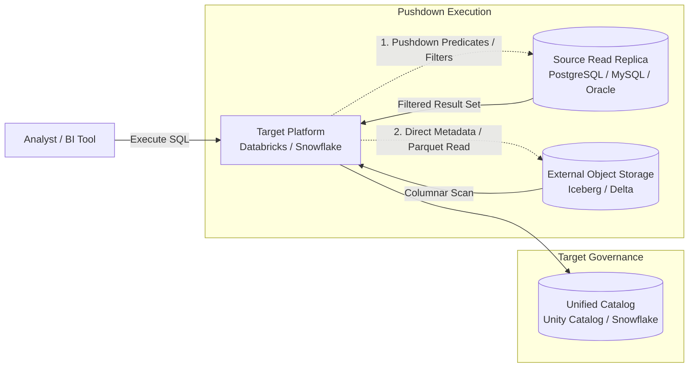

# Pattern 08: Lakehouse Federation (Zero-Copy)

## 1. Pattern Overview
- **Pattern Name:** Lakehouse Federation (Zero-Copy / Query Virtualization)
- **Pattern ID:** 08
- **Objective:** Query data residing in external operational databases, external data warehouses, or cross-cloud object storage directly from the target platform without physical data movement or ingestion pipelines.
- **Applicable Sources:** PostgreSQL, MySQL, SQL Server, Oracle, Snowflake (from Databricks), Databricks (from Snowflake), Google BigQuery, external object storage (Apache Iceberg, Delta Lake).
- **Applicable Targets:** Databricks (Unity Catalog Lakehouse Federation), Snowflake (External Tables / Apache Iceberg Tables via External Volumes).
- **Typical Use Cases:** Rapid prototyping, low-frequency ad-hoc exploration, regulatory isolation (data residency laws where data cannot physically leave a specific VPC/region), and low-churn dimensional joins.
- **When to Use:** When the engineering and infrastructure cost of building and maintaining a physical ETL pipeline exceeds the query-time compute cost, or when exploring new data assets before committing to permanent storage.
- **When NOT to Use:** For high-concurrency BI dashboards (hundreds of concurrent users), massive fact-to-fact table joins, or operational production databases where unindexed analytical queries can cause system lockups.

## 2. Pre-Ingestion Profiling
Before establishing federated connections, validate the source system's resource boundaries:
- **Source Compute Headroom:** Can the source database tolerate analytical read spikes without impacting transactional operations (OLTP)?
- **Query Pushdown Support:** Does the target platform’s federation driver support pushing down your required filters, projections, and aggregation functions to the source engine?
- **Network Bandwidth & Egress Costs:** How much data is transferred per query across cloud regions or availability zones? Inter-cloud or inter-region egress can result in significant unplanned costs.

## 3. Reference Architecture

## 4. End-to-End Data Flow
1. **Catalog Registration:** A Platform Engineer defines a foreign connection or external catalog mapping remote tables to local virtual schemas.
2. **Query Compilation:** An end user runs a query joining a local table with the remote federated table.
3. **Predicate Pushdown & Optimization:** The platform optimizer translates the query AST, pushing down `WHERE` clauses, column projections, and simple aggregates into the source engine's native SQL dialect.
4. **Data Transit:** The filtered subset of records is returned over the network (secured via PrivateLink or VNet Peering) to the target platform compute cluster.
5. **Final Evaluation:** The local engine executes the remaining complex operations (e.g., joins against local tables, window functions) in memory.

## 5. Ingestion Mode
- **Zero-Copy / Virtualization:** No persistent storage footprint is created in the target system. 
- **Optional Target Caching:** Temporary caching of query results via materialized views or result-set caches where supported.

## 6. Insert / Update / Delete Handling
- **Real-Time Consistency:** Because queries read directly from the source system, all inserts, updates, and hard deletes are reflected immediately.
- **Isolation:** Read-committed isolation depends on the underlying source database transaction model.

## 7. Format Selection Decision Matrix (For External Lake Targets)

| Capability | Delta Lake | Apache Iceberg | Apache Hudi |
|---|---|---|---|
| Databricks Unity Catalog Read | Native (Excellent) | Excellent | Good |
| Snowflake Native Integration | Good (via UniForm) | Native (Excellent) | Low |
| Cross-Engine Pushdown | Good | Excellent | Medium |
| Multi-Cloud Interoperability | High | Excellent | Medium |

## 8. Target-Specific Considerations
- **Databricks:**
  - Leverage **Unity Catalog Lakehouse Federation**. Create a `FOREIGN CATALOG` mapping directly to PostgreSQL, MySQL, Snowflake, or BigQuery.
  - Apply row and column masking policies in Unity Catalog directly on top of the federated tables.
  - Utilize materialized views (`CREATE MATERIALIZED VIEW`) on top of federated sources if repeated queries begin slowing down downstream reporting.
- **Snowflake:**
  - Utilize **External Tables** or **Apache Iceberg Tables** pointing to customer-managed external storage (S3/ADLS).
  - Use Snowflake's external volume credentials and object-level access controls.
  - Use Snowpark or external network access rules to enforce private egress connections.

## 9. AWS and Azure Considerations
- **Network Boundaries:** Do NOT expose source database ports to the public internet. Use **AWS PrivateLink**, **Azure Private Link**, or cross-cloud transit gateways.
- **Cross-Region Egress:** If Databricks is in `us-east-1` and the source database is in `eu-west-1`, every query will incur cross-region data transfer fees and network latency. Locate federation compute in the same cloud region as the source when possible.

## 10. Security & Governance
- **Credential Storage:** Store database connection credentials exclusively in enterprise secret vaults (Azure Key Vault, AWS Secrets Manager, Databricks Secret Scopes).
- **Service Principals:** Use service accounts with read-only permissions on the source database. Never use individual user credentials or administrative accounts.
- **Source-Level Resource Governance:** Configure statement timeouts (e.g., PostgreSQL `statement_timeout = 30000`) and resource groups on the source database to kill runaway federated queries.

## 11. Constraints & Red Lines
- **Red Line 1 - Primary Production Database Access:** Never point a federated connection directly to an active primary OLTP database. Always configure federation against a **dedicated Read Replica**. A single unindexed analytical query can lock tables or exhaust database connections, causing a production outage.
- **Red Line 2 - Missing Predicate Pushdown:** If a query contains non-pushdown functions (e.g., custom UDFs or complex regex), the engine may pull the *entire source table* across the network into memory before filtering, resulting in driver OOM (Out of Memory) crashes and high cloud egress bills.

## 12. Trade-Offs

| Decision | Option A (Lakehouse Federation) | Option B (Physical Replication P03/P05) | Trade-Off |
|---|---|---|---|
| Storage & Maintenance | Zero ETL pipeline code, zero target storage cost | Continuous ETL pipelines, dual storage costs | Federation is fast to deploy and costs nothing to store, but incurs network and source compute overhead during every query execution. |
| Query Performance | Variable latency (dependent on source DB and network) | Sub-second optimized columnar queries | Physical replication optimizes data into Parquet/Delta formats for high-speed querying, whereas federation is bound by source row-store performance. |

## 13. Pattern Selection Checklist
- [ ] Source database read replica confirmed and isolated from production write traffic.
- [ ] Read-only service principal provisioned with least-privilege permissions.
- [ ] Network connectivity secured through private endpoints/VNet peering.
- [ ] Statement timeouts enforced on source database for federated users.
- [ ] Query patterns reviewed to confirm predicate pushdown is supported.
- [ ] Network egress cost profile reviewed and approved for target query frequency.