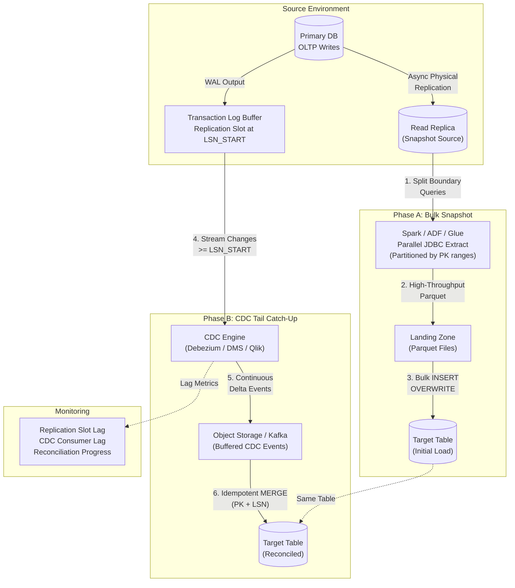
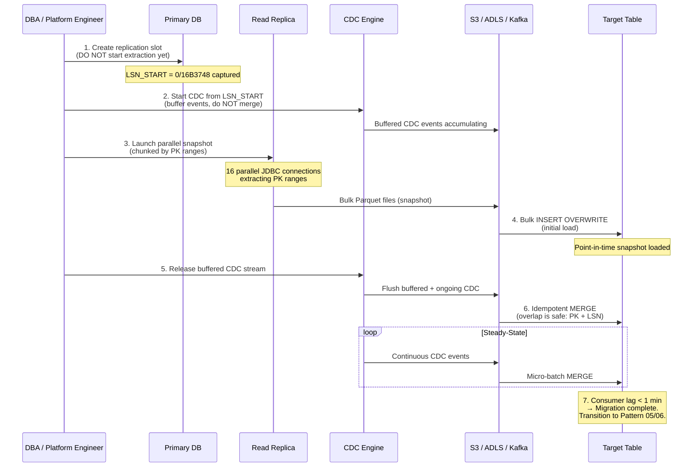

# Pattern 09: Hybrid: Bulk Snapshot + CDC Tail

## 1. Pattern Overview

- **Pattern Name:** Hybrid: Bulk Snapshot + CDC Tail
- **Pattern ID:** 09
- **Version:** 2.0
- **Objective:** Ingest or migrate massive operational tables (10 TB+ to PB scale) into the target platform with zero source downtime by combining a parallelized historical snapshot from a Read Replica with continuous transaction log (WAL/Binlog) tailing, then performing an idempotent reconciliation to seamlessly transition into steady-state CDC.
- **Applicable Sources:** High-volume Relational Databases: PostgreSQL, Oracle, SQL Server, MySQL.
- **Applicable Targets:** Databricks Lakehouse (Delta Lake), Snowflake, Cloud Data Lake (ADLS/S3).
- **Typical Use Cases:**
  - Large-scale cloud migrations (on-premises → cloud, cross-cloud).
  - Modernization cutovers from legacy data warehouses (Teradata, Netezza, Exadata) to lakehouse.
  - Initial loads for mission-critical production OLTP databases where maintenance windows are impossible.
  - Multi-TB tables where Pattern 02 (Full Snapshot) would take days and require downtime.
- **When to Use:**
  - Tables are too large for a standard batch window (Pattern 02).
  - Transaction volume is continuous — the pipeline must transition seamlessly into ongoing CDC (Pattern 05/06) without data gaps.
  - Zero-downtime is a hard requirement.
- **When NEVER to Use (Red Lines):**
  - **Small-to-medium tables (< 100 GB)**: Pattern 02 (Full Snapshot) or Pattern 05 (CDC with `snapshot.mode = initial`) handles this natively.
  - **Source database does not support LSN/SCN tracking**: Without monotonic log coordinates, reconciliation between snapshot and CDC tail is impossible.
  - **No Read Replica available**: Running a multi-day full scan against the primary production database is prohibited.

---

## 2. Pre-Ingestion Profiling

Execute on the source database to establish baseline boundaries.

### 2.1 Log Sequence Coordinate Support

| Database | Coordinate | Verification Query |
|:---|:---|:---|
| **PostgreSQL** | Log Sequence Number (LSN) | `SELECT pg_current_wal_lsn();` → e.g., `0/16B3748` |
| **Oracle** | System Change Number (SCN) | `SELECT DBMS_FLASHBACK.GET_SYSTEM_CHANGE_NUMBER FROM DUAL;` |
| **MySQL** | Binlog File + Position | `SHOW MASTER STATUS;` → `mysql-bin.000042`, Position `15738` |
| **SQL Server** | Log Sequence Number (LSN) | `SELECT MAX([Current LSN]) FROM fn_dblog(NULL, NULL);` |

### 2.2 Capacity Assessment

```sql
-- PostgreSQL: WAL generation rate (GB/hour during peak)
SELECT 
    pg_size_pretty(
        pg_wal_lsn_diff(pg_current_wal_lsn(), confirmed_flush_lsn)
    ) AS current_slot_lag,
    slot_name
FROM pg_replication_slots
WHERE slot_type = 'logical';
```

### 2.3 Critical Pre-Flight Checks

| Check | Target | Consequence of Failure |
|:---|:---|:---|
| **LSN/SCN tracking verified** | Source engine exposes monotonic log coordinates | Cannot reconcile snapshot boundary with CDC tail |
| **Read Replica provisioned** | Same region, I/O optimized, replication lag < 1 min | Snapshot saturates primary → production outage |
| **WAL disk headroom** | ≥ snapshot_duration × hourly_WAL_rate | WAL fills during snapshot → primary DB crash |
| **`max_slot_wal_keep_size` (PG 13+)** | Bounded (e.g., `500GB` for multi-day snapshots) | Unbounded WAL retention |
| **Read Replica storage** | ≥ source table size × 1.5 (for snapshot I/O buffer) | Replica disk exhaustion during extraction |
| **Network bandwidth** | ≥ table_size / target_SLA_hours | Snapshot exceeds acceptable migration window |
| **Primary key / indexed column** | Numeric PK or indexed column for parallel chunking | Cannot parallelize extraction → days-long single-threaded scan |

---

## 3. Reference Architecture

### 3.1 Two-Phase Architecture



### 3.2 LSN Coordination Sequence



---

## 4. End-to-End Data Flow

### Step 1 — Coordination Point (LSN_START)
Create a logical replication slot on the Primary database **without starting extraction yet**. Capture the exact Log Sequence Number:

```sql
-- PostgreSQL: Create replication slot and capture LSN
SELECT pg_create_logical_replication_slot('migration_slot', 'pgoutput');
SELECT pg_current_wal_lsn() AS lsn_start;
-- Result: lsn_start = '0/16B3748'
-- SAVE THIS VALUE. It is the reconciliation boundary.
```

### Step 2 — Buffer CDC Tail
Start the CDC capture process immediately from `LSN_START`. Buffer incoming change events into object storage or Kafka. **Do NOT merge into the target yet.**

### Step 3 — Partitioned Bulk Extract
Launch a distributed extraction job against the **Read Replica**. Split the table into parallel chunks using the primary key:

```python
# Spark JDBC: Parallelized bulk extract from Read Replica
df = (spark.read
    .format("jdbc")
    .option("url", "jdbc:postgresql://replica:5432/production")
    .option("dbtable", "public.transactions")
    .option("user", dbutils.secrets.get("kv", "db-user"))
    .option("password", dbutils.secrets.get("kv", "db-pass"))
    .option("partitionColumn", "transaction_id")
    .option("lowerBound", "1")
    .option("upperBound", "500000000")
    .option("numPartitions", "64")          # 64 parallel JDBC connections
    .option("fetchsize", "50000")           # Rows per network roundtrip
    .load()
)

# Write to staging as Parquet
(df.write
    .format("parquet")
    .mode("overwrite")
    .option("compression", "zstd")
    .save("s3://staging-zone/migration/transactions/snapshot/")
)
```

### Step 4 — Target Initial Load
Load the snapshot into the target table:

```sql
-- Databricks: Initial load with Liquid Clustering
CREATE TABLE catalog.silver.transactions
CLUSTER BY (transaction_id)
AS SELECT *, CAST(NULL AS STRING) AS __last_lsn
FROM parquet.`s3://staging-zone/migration/transactions/snapshot/`;

-- Enable Deletion Vectors for efficient MERGE
ALTER TABLE catalog.silver.transactions
SET TBLPROPERTIES ('delta.enableDeletionVectors' = true);
```

```sql
-- Snowflake: Initial load
COPY INTO silver.transactions
FROM @migration_stage/transactions/snapshot/
FILE_FORMAT = (TYPE = 'PARQUET')
MATCH_BY_COLUMN_NAME = CASE_INSENSITIVE;
```

### Step 5 — Reconciliation & Cutover
Release the buffered CDC stream. Apply changes with an idempotent MERGE:

```sql
-- Idempotent MERGE with LSN ordering (Databricks / Snowflake)
MERGE INTO silver.transactions t
USING (
    SELECT * FROM (
        SELECT *,
               ROW_NUMBER() OVER (PARTITION BY transaction_id ORDER BY __lsn DESC) AS _rn
        FROM staging.cdc_buffer
    ) WHERE _rn = 1
) s
ON t.transaction_id = s.transaction_id
WHEN MATCHED AND s.__op = 'd' AND (t.__last_lsn IS NULL OR s.__lsn > t.__last_lsn)
    THEN DELETE
WHEN MATCHED AND s.__op IN ('u', 'c') AND (t.__last_lsn IS NULL OR s.__lsn > t.__last_lsn)
    THEN UPDATE SET
        t.amount = s.amount,
        t.status = s.status,
        t.updated_at = s.updated_at,
        t.__last_lsn = s.__lsn
WHEN NOT MATCHED AND s.__op != 'd'
    THEN INSERT (transaction_id, amount, status, updated_at, __last_lsn)
    VALUES (s.transaction_id, s.amount, s.status, s.updated_at, s.__lsn);
```

**Why overlap is safe:** Rows captured in both the snapshot and the CDC tail are resolved deterministically because:
- Snapshot rows have `__last_lsn = NULL` (no LSN from snapshot phase).
- CDC records carry the source LSN.
- The MERGE guard `(t.__last_lsn IS NULL OR s.__lsn > t.__last_lsn)` ensures the CDC record always overwrites the snapshot record.

### Step 6 — Steady-State Handover
Once consumer lag reaches sub-minute thresholds, transition the pipeline into permanent Pattern 05 (CDC to Storage) or Pattern 06 (CDC to Kafka).

---

## 5. Insert / Update / Delete Handling

- **Snapshot Phase:** Contains a point-in-time capture of all committed rows. No operation flags — all rows are the current state at extraction time.
- **CDC Tail Phase (≥ LSN_START):**
  - **Inserts:** Added via MERGE `WHEN NOT MATCHED`.
  - **Updates:** Updated via MERGE `WHEN MATCHED`. Overwrites stale snapshot rows.
  - **Deletes:** Captured as explicit delete events. Translated into `DELETE` or soft-delete via MERGE.
- **Overlap Resolution:** Deterministic. CDC records with higher LSN always override snapshot data.

---

## 6. Target-Side Optimization

### 6.1 Databricks

- **Initial Load:** Write using `.format("delta").mode("overwrite")` with Liquid Clustering on join/filter keys.
- **Tail Processing:** Use DLT `APPLY CHANGES INTO` with `SEQUENCE BY __lsn` to automatically resolve out-of-order records. Enable **Deletion Vectors**.
- **Delta UniForm:** If non-Databricks engines need to read the table, enable UniForm.

### 6.2 Snowflake

- **Initial Load:** Export to stage as compressed Parquet, execute `COPY INTO` using a dedicated multi-cluster warehouse (e.g., `4X-LARGE` for bulk load).
- **Tail Processing:** Stage CDC files → `MERGE` with `QUALIFY ROW_NUMBER()` deduplication.
- **Clustering:** Cluster on `transaction_id` to optimize MERGE micro-partition pruning.

---

## 7. AWS & Azure Implementation Reference

### 7.1 AWS

| Component | Service | Configuration |
|:---|:---|:---|
| **Bulk Phase** | Spark on EMR / Glue with JDBC partitioning from Aurora Read Replica | `numPartitions = 64`, `fetchsize = 50000` |
| **Tail Phase** | AWS DMS (Full Load + CDC) or Debezium on ECS | DMS: `CdcStartPosition = LSN_START`. Landing in S3. |
| **Staging** | S3 (Parquet, ZSTD compression) | Lifecycle: delete after 30 days post-migration. |
| **Secrets** | AWS Secrets Manager | DB credentials, rotated every 90 days. |
| **Networking** | VPC Peering / PrivateLink | All components in same VPC. |
| **Monitoring** | CloudWatch | DMS replication lag, S3 file counts, EMR job duration. |

### 7.2 Azure

| Component | Service | Configuration |
|:---|:---|:---|
| **Bulk Phase** | ADF Copy Activity (physical partitioning) from Azure DB Read Replica | Parallel degree = 64. DIU auto-scaling. |
| **Tail Phase** | ADF CDC connector or Debezium on ACI | Landing in ADLS Gen2. |
| **Staging** | ADLS Gen2 (Parquet) | Temporary container. Lifecycle: delete after 30 days. |
| **Secrets** | Azure Key Vault | DB credentials via Managed Identity. |
| **Networking** | VNet + Private Endpoints | ADF ↔ DB: Private Endpoint. ADLS: VNet firewall. |
| **Monitoring** | Azure Monitor | ADF pipeline metrics, ADLS file metrics. |

---

## 8. Security & Governance

### 8.1 Mandatory Security Controls

| Control | Implementation | Non-Compliance Consequence |
|:---|:---|:---|
| **Read Replica Enforcement** | NEVER extract from primary. Snapshot targets Read Replica only. | Primary DB I/O starvation → production outage. |
| **Network Isolation** | All extraction via Private Link / VNet. | DB exposed to public internet. |
| **Encryption** | Staging Parquet: SSE-KMS / CMK. JDBC: TLS 1.2+. | Regulatory violation. |
| **Secrets Management** | All credentials in Key Vault / Secrets Manager. | Security violation. |
| **Least-Privilege** | Extraction role: `SELECT` + `REPLICATION` on source. `PutObject` on staging. | Blast radius amplification. |
| **PII Masking** | Apply during initial load transformation or CDC Silver MERGE. | PII in target analytics platform. |
| **Staging Cleanup** | Delete staging Parquet files within 30 days post-migration. | Unnecessary data exposure and storage cost. |

---

## 9. Reliability, Resumability & Failure Recovery

### 9.1 Failure Scenarios & Recovery Playbook

| Failure Scenario | Impact | Recovery Procedure |
|:---|:---|:---|
| **Snapshot extract fails at 60%** | Partial Parquet files in staging. Replication slot retains WAL. | Resume extraction from last successful PK range partition. Replication slot ensures no WAL loss. |
| **WAL disk exhaustion during snapshot** | ❌ **Primary DB crash.** | Set `max_slot_wal_keep_size`. Alert at 75% disk. If critical: drop slot, add storage, restart from scratch. |
| **Read Replica lag drift** | Required WAL retention window on primary expands. | Monitor replica lag. If lag > 30 minutes, pause snapshot until replica catches up. |
| **CDC tail MERGE fails** | CDC events accumulate in buffer. No data loss. | Fix root cause. Re-run MERGE. Idempotent (PK + LSN guard). |
| **Snapshot + CDC overlap miscounted** | Target may have stale or duplicate rows | MERGE with `__last_lsn IS NULL OR s.__lsn > t.__last_lsn` resolves deterministically. |
| **Entire migration must restart** | Days of work lost | Drop target table, recreate replication slot, restart from Step 1. Staging files re-created. |

### 9.2 Resumable Snapshot Strategy

If the snapshot fails partway through, you do NOT need to restart from scratch:

```python
# Track completed partitions
completed_ranges = spark.read.table("control.snapshot_progress")

# Resume from next uncompleted range
remaining_ranges = all_ranges.exceptAll(completed_ranges)
for lower, upper in remaining_ranges:
    df = spark.read.format("jdbc").option("partitionColumn", "id") \
        .option("lowerBound", str(lower)).option("upperBound", str(upper)) \
        .option("numPartitions", "1").load()
    df.write.format("parquet").mode("append") \
        .save("s3://staging/migration/transactions/snapshot/")
    # Record completion
    spark.sql(f"INSERT INTO control.snapshot_progress VALUES ({lower}, {upper}, current_timestamp())")
```

---

## 10. Observability & Monitoring

| Metric | Threshold | Alert Severity | Action |
|:---|:---|:---|:---|
| **Replication slot WAL lag** | > 50 GB (during snapshot) | 🔴 P1 CRITICAL | Snapshot taking too long. Increase parallelism. Risk: WAL disk exhaustion. |
| **Replication slot WAL lag** | > `max_slot_wal_keep_size` × 75% | 🔴 P0 SEV-1 | Slot will be invalidated. Emergency: pause snapshot, assess. |
| **Read Replica lag** | > 30 minutes | 🟡 P2 WARNING | Replica under load. Pause extraction until lag recovers. |
| **Snapshot progress** | < 50% after 50% of allocated time | 🟡 P2 WARNING | Increase JDBC parallelism or right-size extraction cluster. |
| **CDC tail consumer lag** | > 15 minutes (during reconciliation) | 🟡 P2 WARNING | Scale MERGE compute. Check for data skew on MERGE key. |
| **CDC tail consumer lag** | < 1 minute (sustained) | ✅ Migration complete | Transition to steady-state Pattern 05/06. |
| **Target row count** | Source count ≠ Target count (post-reconciliation) | 🔴 P1 CRITICAL | Reconciliation logic error. Investigate LSN boundary. |

---

## 11. Cost Model

| Component | Cost Driver | Notes |
|:---|:---|:---|
| **Read Replica** | Instance hours (provisioned for duration of snapshot) | Can be deprovisioned after migration completes. |
| **Extraction Compute** | Large Spark/EMR/Glue cluster for parallel JDBC (64+ partitions) | One-time cost. Use spot instances for non-critical partitions. |
| **Staging Storage** | 1× table size in Parquet (temporary) | Delete after migration. Lifecycle policy: 30 days. |
| **CDC Buffer Storage** | CDC events accumulated during snapshot duration | Grows with snapshot duration × WAL rate. |
| **Target Compute** | Bulk INSERT + ongoing MERGE | Bulk load: large warehouse/cluster. Steady-state: right-sized. |
| **Network Egress** | Table size × 1 (one-time) + ongoing CDC delta | Co-locate in same region. |

> **ℹ️ NOTE:** This pattern has **high one-time cost** (large cluster, staging storage, Read Replica) but transitions to the **low ongoing cost** of Pattern 05/06 once migration completes.

---

## 12. Constraints & Red Lines

| # | Red Line | Consequence | Mitigation |
|:---|:---|:---|:---|
| 1 | **Primary DB Extraction** | Full snapshot against primary causes I/O starvation and replication lag. | **NEVER** extract from primary. Use Read Replica exclusively. |
| 2 | **WAL Disk Exhaustion** | If snapshot takes 72 hours, primary retains 72 hours of WAL. Disk fills → **DB crash**. | Set `max_slot_wal_keep_size`. Alert at 75%. Estimate: snapshot_hours × WAL_GB_per_hour. |
| 3 | **Replica Lag Drift** | If Replica lags significantly during snapshot, WAL retention window on primary expands accordingly. | Monitor replica lag. Pause extraction if lag > 30 minutes. |
| 4 | **No LSN Coordination** | Without capturing LSN_START before snapshot, there is no deterministic boundary between snapshot and CDC tail → data gaps or duplicates with no resolution. | Always create replication slot BEFORE starting snapshot. |
| 5 | **Non-Idempotent MERGE** | MERGE without LSN guard → stale CDC events overwrite newer snapshot data. | Always use `WHERE s.__lsn > t.__last_lsn` (or `t.__last_lsn IS NULL`) guard. |

---

## 13. Trade-Offs

| Decision | Option A | Option B | Trade-Off Analysis |
|:---|:---|:---|:---|
| **Initial Load Target** | Direct JDBC → Target | Bulk Parquet → S3/ADLS → Target | Direct JDBC requires zero intermediate storage but risks network drops on multi-day loads and has no checkpointing. Parquet staging requires 1× extra storage but provides deterministic restart from last partition. **Use Parquet staging for tables > 10 GB.** |
| **Cutover Mechanism** | Automated Continuous Lag Catch-Up | Scheduled Offline Maintenance Window | Continuous catch-up is zero-downtime but requires complex LSN reconciliation. Maintenance window simplifies logic but requires production downtime. **Continuous for mission-critical; maintenance window for non-critical.** |
| **CDC Buffer** | Object Storage (S3/ADLS) | Kafka | S3/ADLS is cheaper and simpler. Kafka provides real-time fan-out to other consumers during migration. **S3/ADLS unless other consumers need real-time during migration.** |
| **Parallelism** | Fixed partitions (e.g., 64) | Dynamic partitioning (adaptive) | Fixed is simpler to implement. Dynamic adapts to data skew. **Fixed for uniform PK distribution; dynamic for skewed data.** |

---

## 14. Pattern Selection Checklist

> This checklist must be completed and submitted to the Architecture Review Board before pipeline provisioning.

- [ ] Source table confirmed **> 100 GB** (smaller tables should use Pattern 02 or Pattern 05 `snapshot.mode = initial`).
- [ ] Read Replica provisioned with sufficient I/O bandwidth and storage headroom.
- [ ] LSN/SCN tracking verified on source engine (§2.1 queries executed).
- [ ] `max_slot_wal_keep_size` configured. WAL storage headroom validated for snapshot duration.
- [ ] Primary key or indexed numeric column available for chunked parallel extraction.
- [ ] Snapshot parallelism calculated: `numPartitions` = table_size_GB / target_partition_size_GB.
- [ ] CDC replication slot created BEFORE snapshot begins (LSN_START captured and recorded).
- [ ] CDC tail buffering confirmed operational before snapshot starts.
- [ ] Staging storage provisioned: ≥ 1× table size in Parquet.
- [ ] Idempotent MERGE logic verified using `__last_lsn IS NULL OR s.__lsn > t.__last_lsn` guard.
- [ ] Target table configured with Deletion Vectors (Delta) or appropriate clustering keys (Snowflake).
- [ ] Reconciliation validation planned: source row count vs. target row count post-cutover.
- [ ] Network connectivity secured via **Private Link / VNet**.
- [ ] All credentials in **Key Vault / Secrets Manager**.
- [ ] Monitoring alerts configured: WAL lag, replica lag, snapshot progress, consumer lag.
- [ ] Steady-state handover criteria defined: consumer lag < 1 minute → transition to Pattern 05/06.
- [ ] PII columns identified and masking strategy documented.
- [ ] Staging storage cleanup plan: delete within 30 days post-migration.