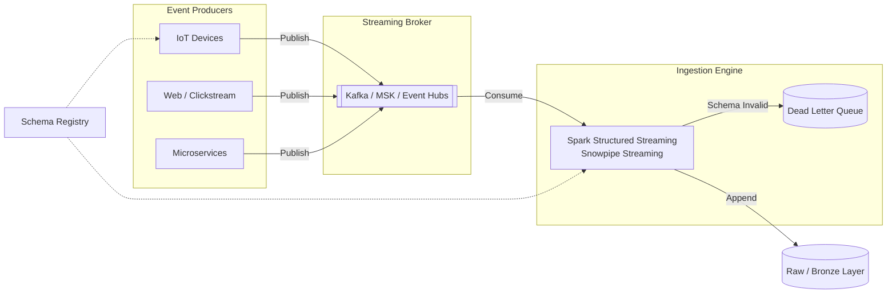
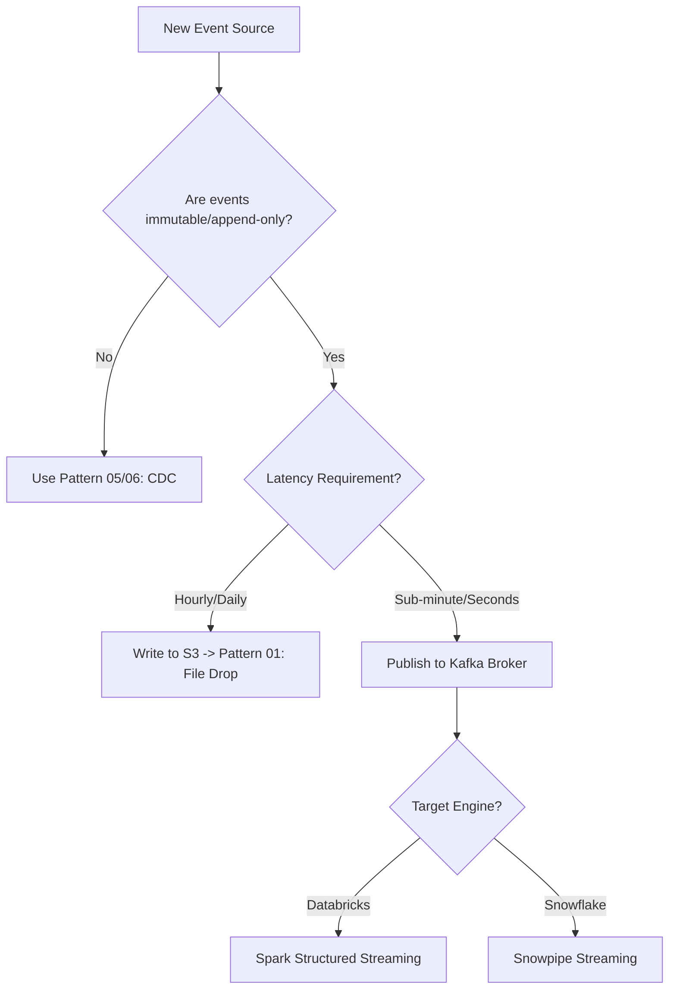

# Pattern 10: Event Streaming (Native Kafka)

## 1. Pattern Overview
- **Pattern Name:** Event Streaming (Native Kafka)
- **Pattern ID:** 10
- **Objective:** Ingest high-velocity, append-only event data directly from applications, devices, or APIs into the data platform via a distributed streaming broker.
- **Applicable Sources:** IoT devices, application telemetry, clickstream trackers, webhooks, server log aggregators.
- **Applicable Targets:** Databricks (Structured Streaming), Snowflake (Snowpipe Streaming), Data Lake (ADLS/S3).
- **Typical Use Cases:** Website clickstream analysis, IoT sensor telemetry, cybersecurity log ingestion, real-time fraud detection feeds.
- **When to Use:** For massive volume, immutable, append-only data where the source generates discrete events (time-series) rather than updating relational database rows, and sub-minute latency is required.
- **When NOT to Use:** For tracking state changes in relational databases (Use Pattern 05/06), or when data arrives as batch files (Use Pattern 01).

## 2. Pre-Ingestion Profiling
- **Event Velocity & Throughput:** Calculate average and peak Events Per Second (EPS) and MB/sec. This dictates Kafka partition counts, broker sizing, and Spark cluster sizing.
- **Payload Size:** Are these 1KB JSON messages or 5MB XML payloads? (Kafka struggles with individual messages > 1MB; large payloads require architectural adjustments like claim-check patterns).

## 3. Reference Architecture

## 4. End-to-End Data Flow
1. **Publish:** The application or device publishes an event payload directly to a Kafka topic.
2. **Buffer & Partition:** Kafka partitions the data (e.g., by `device_id` or `session_id` to guarantee ordering) and buffers it on disk.
3. **Consume:** A continuous streaming job (Databricks) or managed connector (Snowflake) pulls the data from the topics.
4. **Validation:** The payload is validated against a Schema Registry. Malformed events are routed to a Dead Letter Queue (DLQ).
5. **Target Append:** Because this is telemetry, data is *appended* to the target table. Complex `MERGE` statements are generally avoided in the raw layer.

## 5. Decision Criteria
- **Data Volume:** Capable of PB-scale ingestion. Scale is managed by increasing Kafka partitions and adding consumer workers.
- **Data Freshness:** Sub-second to seconds.
- **SLA:** Highly available. If target ingestion goes down, Kafka retains the data until the consumer recovers (based on retention policy).

## 6. Insert / Update / Delete Handling
- **Inserts:** 100% of the traffic.
- **Updates / Deletes:** N/A. Telemetry is immutable. If a sensor sends a bad reading, it sends a *new* correction event later; it does not "update" the previous event record.

## 7. Format Selection Decision Matrix (Payload Serialization)

| Requirement | JSON | Avro | Protobuf |
|---|---|---|---|
| Human Readable | High | Low (Binary) | Low (Binary) |
| Schema Enforcement | Low | High (Strict) | High (Strict) |
| Payload Compression | Low (Bloated) | High | High |
| Schema Evolution | Manual/Complex | Native (Forward/Backward) | Native |
| Recommended For | Prototyping | **Enterprise Standard** | Microservice Interop |

## 8. Target-Specific Considerations
- **Databricks:**
  - Read from Kafka using Spark Structured Streaming. 
  - **Cost Optimization:** If sub-second latency is not required, use `.trigger(availableNow=True)` to run the stream as a frequent micro-batch (e.g., every 5 minutes). This drastically reduces compute costs compared to 24/7 continuous cluster uptime.
  - Use `rescueDataColumn` in Auto Loader/Delta to safely catch JSON schema drift without failing the pipeline.
- **Snowflake:**
  - Use **Snowpipe Streaming** via the Snowflake Kafka Connector. It writes directly to Snowflake micro-partitions via API, bypassing cloud storage buckets entirely, achieving sub-second latency at a lower cost than traditional Snowpipe.
- **ADLS / S3:**
  - If bypassing compute engines, use Kafka Connect (e.g., S3 Sink Connector) to dump raw Parquet files directly into object storage.

## 9. AWS and Azure Considerations
- **AWS:** Use **Amazon MSK** (Managed Streaming for Apache Kafka) for native Kafka workloads, or **Amazon Kinesis Data Streams** for simpler, serverless telemetry ingestion.
- **Azure:** Use **Azure Event Hubs** with the Kafka API enabled. It removes the operational burden of managing Zookeeper/KRaft while remaining compatible with standard Kafka consumer libraries.

## 10. Reliability, Failure Handling, and Observability
- **Checkpointing:** Consumers must commit offsets to a persistent checkpoint location (e.g., S3/ADLS). If a consumer crashes, it reads the checkpoint and resumes exactly where it left off.
- **Observability (Crucial Metric):** **Consumer Lag**. You must monitor the delta between the latest message in Kafka and the last processed message. If lag grows continuously, the ingestion engine is under-provisioned and data will eventually age out and be lost.
- **Poison Records:** Implement a Dead Letter Queue (DLQ). A single malformed JSON payload must not crash the entire streaming pipeline.

## 11. Constraints & Red Lines
- **Red Line 1 - Schema Drift:** IoT devices and frontend apps are notorious for changing JSON structures without warning. You *must* use a Schema Registry (Avro) or utilize a `VARIANT` column to prevent pipeline crashes.
- **Red Line 2 - Unpartitioned High-Volume Data:** Do not send all events to a single Kafka partition. It creates a massive bottleneck. Always partition by a logical key (e.g., `user_id` or `device_id`).

## 12. Trade-Offs

| Decision | Option A | Option B | Trade-Off |
|---|---|---|---|
| Compute Execution | 24/7 Continuous Streaming | Micro-batch (Trigger.AvailableNow) | Continuous provides true real-time but costs significantly more in idle compute. Micro-batch satisfies most SLAs (e.g., 5 mins) for a fraction of the cost. |
| Target Schema | Strictly Typed Columns | Single JSON `VARIANT` Column | Strict typing fails fast on bad data but requires schema evolution management. A single JSON column never fails ingestion but pushes the parsing cost onto downstream analysts. |

## 13. Decision Tree

## 14. Pattern Selection Checklist
- [ ] Confirmed data is append-only telemetry/events (no updates/deletes).
- [ ] Kafka Partition Keys defined to ensure event ordering and parallel processing.
- [ ] Schema evolution strategy (Avro/Registry vs JSON Variant) explicitly decided.
- [ ] Kafka Consumer Lag monitoring and alerting configured.
- [ ] Dead Letter Queue (DLQ) configured for poison message handling.
- [ ] Compute execution model (Continuous vs Micro-batch) evaluated for cost.