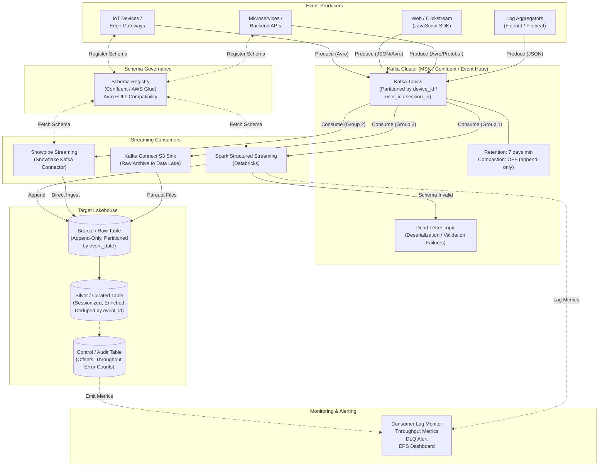
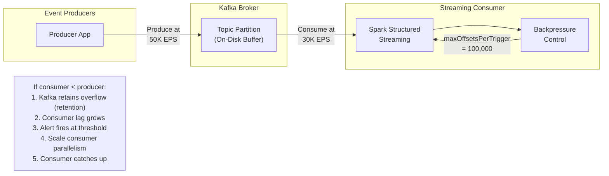
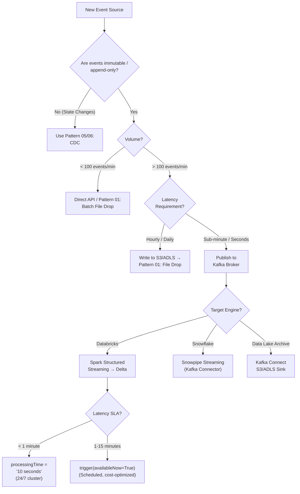

# Pattern 10: Event Streaming (Native Kafka)

## 1. Pattern Overview

- **Pattern Name:** Event Streaming (Native Kafka)
- **Pattern ID:** 10
- **Version:** 2.0
- **Objective:** Ingest high-velocity, append-only event data directly from applications, devices, or APIs into the data platform via a distributed streaming broker (Apache Kafka / Amazon MSK / Azure Event Hubs / Confluent Cloud).
- **Applicable Sources:** IoT devices, application telemetry, clickstream trackers, webhooks, server log aggregators, mobile app analytics, CDN access logs, cybersecurity event feeds.
- **Applicable Targets:** Databricks Lakehouse (Spark Structured Streaming → Delta Lake), Snowflake (Snowpipe Streaming), Data Lake (ADLS/S3 via Kafka Connect S3 Sink).
- **Typical Use Cases:**
  - Website clickstream analysis and session reconstruction.
  - IoT sensor telemetry ingestion (temperature, GPS, accelerometer).
  - Cybersecurity log ingestion (SIEM feeds, firewall logs, authentication events).
  - Real-time fraud detection feature pipelines.
  - Application performance monitoring (APM) and distributed tracing.
- **When to Use:**
  - Data is immutable, append-only, and time-series in nature (events, not state changes).
  - Sub-minute or sub-second ingestion latency is required.
  - Volume exceeds 10,000 events/second sustained, with burst potential to 100,000+ EPS.
  - The organization has access to a Kafka/streaming platform (MSK, Event Hubs, Confluent).
- **When NEVER to Use (Red Lines):**
  - **Tracking state changes in relational databases**: Use Pattern 05 (CDC → Object Storage) or Pattern 06 (CDC → Kafka). CDC requires before/after images, LSN ordering, and MERGE — event streaming is append-only.
  - **Data arrives as batch files**: Use Pattern 01 (Batch File Drop). Do not stream individual file records through Kafka.
  - **Low volume (< 100 events/minute)**: The operational cost of Kafka is not justified. Use direct API ingestion or batch file drops.
  - **No streaming platform team**: Kafka requires 24/7 operational expertise for broker management, partition rebalancing, and monitoring.

---

## 2. Pre-Ingestion Profiling

### 2.1 Volume & Velocity Assessment

| Assessment | Target | Impact |
|:---|:---|:---|
| **Average Events Per Second (EPS)** | Measured during normal hours | Determines Kafka partition count and consumer parallelism |
| **Peak Events Per Second** | Measured during burst scenarios (Black Friday, incident spike) | Kafka + consumer must handle 2× peak without backpressure |
| **Average Payload Size** | Measured in bytes per event | Kafka broker throughput = EPS × payload size. Messages > 1MB require architectural changes |
| **Daily Volume** | Calculated: EPS × 86,400 × payload size | Determines target table partitioning and storage costs |
| **Burst Duration** | Maximum sustained burst period | Determines Kafka retention + consumer recovery window |

### 2.2 Payload Analysis

```python
# Sample payload sizing script
import json, sys

sample_events = [
    {"event_id": "evt-001", "device_id": "dev-42", "event_type": "temperature_reading",
     "payload": {"temp_c": 23.5, "humidity": 0.65}, "ts": "2024-10-01T12:00:00Z"},
    # ... more samples
]

for e in sample_events:
    raw = json.dumps(e).encode('utf-8')
    print(f"JSON size: {len(raw)} bytes")
    # Avro with schema registry will be ~40-60% smaller
```

### 2.3 Critical Pre-Flight Checks

| Check | Target | Consequence of Failure |
|:---|:---|:---|
| Kafka cluster throughput tested | ≥ 2× peak EPS × payload size | Back-pressure → producer blocking → event loss at source |
| Kafka partition count | ≥ number of consumer tasks (Spark executors) | Under-partitioned → consumer bottleneck, cannot parallelize |
| Schema Registry deployed | Confluent or AWS Glue Schema Registry | No schema enforcement → consumer pipeline crashes on payload changes |
| Kafka retention policy | ≥ 2× maximum expected consumer downtime | Consumer offline > retention → **permanent data loss** |
| Producer `acks` setting | `acks=all` for critical data, `acks=1` for best-effort telemetry | `acks=0` → silent data loss on broker failure |
| Network path (producers → Kafka) | TLS 1.2+, SASL authentication | Unauthenticated producers → topic pollution, data injection attacks |

---

## 3. Reference Architecture

### 3.1 Detailed End-to-End Architecture



### 3.2 Backpressure Management Flow



---

## 4. End-to-End Data Flow

### Step 1 — Event Publish
The application, device, or log aggregator serializes the event payload (Avro recommended, JSON acceptable for prototyping) and publishes it to a Kafka topic. The producer partitions events by a logical key (`device_id`, `user_id`, `session_id`) to guarantee per-entity ordering.

> [!WARNING]
> Producers MUST use `acks=all` for critical event data (fraud detection, security logs). Using `acks=0` or `acks=1` risks silent data loss during broker failures. For best-effort telemetry (non-critical metrics), `acks=1` is acceptable.

### Step 2 — Buffer & Partition
Kafka partitions the data and buffers it on disk. Key design decisions:
- **Partition count**: ≥ number of consumer tasks for maximum parallelism. Typical: 12–64 partitions per topic for high-volume telemetry.
- **Retention**: Time-based (7 days minimum), NOT log compaction. Telemetry is append-only — compaction would lose historical events.
- **Replication factor**: `RF=3` (minimum) for production topics. `RF=1` is acceptable only for non-critical dev/test.

### Step 3 — Schema Validation
The consumer deserializes the payload using the Schema Registry. Events that fail schema validation are routed to a Dead Letter Topic (DLQ) rather than crashing the pipeline.

### Step 4 — Streaming Ingestion
A continuous or micro-batch streaming job consumes events and appends them to the Bronze/Raw table:
- **Databricks**: Spark Structured Streaming writes to Delta Lake.
- **Snowflake**: Snowpipe Streaming writes directly to micro-partitions via the Kafka Connector.
- **Data Lake Archive**: Kafka Connect S3/ADLS Sink writes raw Parquet files for long-term retention.

### Step 5 — Bronze → Silver Processing
Downstream processing (DLT, Dynamic Tables, or scheduled jobs) enriches, sessionizes, and deduplicates events:
- **Deduplication**: By `event_id` (idempotency key) to handle at-least-once delivery.
- **Sessionization**: Window functions to group clickstream events into user sessions.
- **Enrichment**: Join with dimension tables (user profiles, device catalog).

> [!IMPORTANT]
> Because event streaming is append-only, the Bronze layer uses `INSERT` / `APPEND` — not `MERGE`. There are no updates or deletes. This is fundamentally different from CDC patterns (P05, P06) where MERGE is the idempotency boundary.

---

## 5. Insert / Update / Delete Handling

| Operation | Frequency | Handling |
|:---|:---|:---|
| **Insert** | 100% of traffic | Append to Bronze. Every event is a new row. |
| **Update** | N/A | Telemetry is immutable. Corrections are published as new events with a `correction_type` field. |
| **Delete** | N/A | Data retention is managed via Delta Lake `VACUUM` or table lifecycle policies, not per-record deletes. |

**Late-Arriving Events:**
Events may arrive out of order (e.g., IoT device reconnects after offline period). Handle via:
- **Watermark-based windowing** in Spark Structured Streaming (`withWatermark`).
- **Event-time partitioning** in the target table (partition by `event_date`, not `ingestion_date`).

---

## 6. Schema Evolution & Schema Registry

### 6.1 Why a Schema Registry is Mandatory

IoT devices and frontend applications are notorious for changing JSON structures without warning. A single new field or type change can crash the entire streaming pipeline.

| Compatibility | Rule | Use Case |
|:---|:---|:---|
| **BACKWARD** | New schema can read old data | Consumer upgrades before producer |
| **FORWARD** | Old schema can read new data | Producer upgrades before consumer (IoT firmware updates) |
| **FULL** | Both backward and forward | **Recommended for event streaming topics** |

### 6.2 Serialization Format Decision

| Format | Schema Enforcement | Compression | Human Readable | Recommended |
|:---|:---|:---|:---|:---|
| **Avro** | ✅ Strict (Schema Registry) | ✅ High (binary) | ❌ No | ✅ **Enterprise Standard** |
| **Protobuf** | ✅ Strict (Schema Registry) | ✅ High (binary) | ❌ No | ✅ Good (microservice interop) |
| **JSON** | ❌ None (schema-on-read) | ❌ Low (text bloat) | ✅ Yes | ❌ Prototyping only |
| **JSON Schema** | 🟡 Optional (Schema Registry) | ❌ Low | ✅ Yes | 🟡 Acceptable |

> [!CAUTION]
> **JSON in production is a Red Line.** JSON payloads are 3–5× larger than Avro, have zero schema enforcement, and cause silent type coercion (e.g., `"123"` vs `123`). At 50,000 EPS, JSON vs. Avro is the difference between $500/month and $2,500/month in Kafka broker storage + network costs alone.

### 6.3 Schema Registry Configuration

```json
{
  "subject": "telemetry.iot.sensor-readings-value",
  "compatibilityLevel": "FULL",
  "schema": {
    "type": "record",
    "name": "SensorReading",
    "namespace": "com.company.iot",
    "fields": [
      {"name": "event_id", "type": "string"},
      {"name": "device_id", "type": "string"},
      {"name": "event_type", "type": "string"},
      {"name": "timestamp_ms", "type": "long"},
      {"name": "payload", "type": {
        "type": "record",
        "name": "SensorPayload",
        "fields": [
          {"name": "temperature_c", "type": ["null", "double"], "default": null},
          {"name": "humidity_pct", "type": ["null", "double"], "default": null},
          {"name": "battery_pct", "type": ["null", "double"], "default": null}
        ]
      }}
    ]
  }
}
```

---

## 7. Target-Side Implementation

### 7.1 Databricks (Spark Structured Streaming → Delta Lake)

```python
# Spark Structured Streaming: Kafka → Bronze Delta Table
from pyspark.sql.functions import (
    col, from_json, current_timestamp, expr, window
)
from pyspark.sql.types import (
    StructType, StructField, StringType, LongType, DoubleType
)

# Define expected event schema
event_schema = StructType([
    StructField("event_id", StringType()),
    StructField("device_id", StringType()),
    StructField("event_type", StringType()),
    StructField("timestamp_ms", LongType()),
    StructField("payload", StructType([
        StructField("temperature_c", DoubleType()),
        StructField("humidity_pct", DoubleType()),
        StructField("battery_pct", DoubleType())
    ]))
])

# Read from Kafka
kafka_df = (spark.readStream
    .format("kafka")
    .option("kafka.bootstrap.servers", "kafka-broker:9092")
    .option("subscribe", "telemetry.iot.sensor-readings")
    .option("startingOffsets", "latest")
    .option("kafka.security.protocol", "SASL_SSL")
    .option("kafka.sasl.mechanism", "PLAIN")
    .option("kafka.sasl.jaas.config",
            f'org.apache.kafka.common.security.plain.PlainLoginModule required '
            f'username="{dbutils.secrets.get("kv","kafka-user")}" '
            f'password="{dbutils.secrets.get("kv","kafka-pass")}";')
    .option("maxOffsetsPerTrigger", "500000")    # Backpressure: max 500K msgs/batch
    .option("minOffsetsPerTrigger", "10000")      # Don't trigger for tiny batches
    .load()
)

# Parse and transform
parsed_df = (kafka_df
    .select(
        col("key").cast("string").alias("_kafka_key"),
        from_json(col("value").cast("string"), event_schema).alias("event"),
        col("offset").alias("_kafka_offset"),
        col("partition").alias("_kafka_partition"),
        col("timestamp").alias("_kafka_ingest_ts")
    )
    .select(
        "_kafka_key", "_kafka_offset", "_kafka_partition", "_kafka_ingest_ts",
        "event.event_id", "event.device_id", "event.event_type",
        expr("CAST(event.timestamp_ms / 1000 AS TIMESTAMP)").alias("event_ts"),
        "event.payload.temperature_c", "event.payload.humidity_pct",
        "event.payload.battery_pct",
        current_timestamp().alias("_ingestion_ts")
    )
    # Add event date for partitioning
    .withColumn("event_date", expr("CAST(event_ts AS DATE)"))
)

# Write to Bronze Delta Table
(parsed_df.writeStream
    .format("delta")
    .partitionBy("event_date")                    # Partition by event date
    .option("checkpointLocation", "/mnt/checkpoints/telemetry/iot_sensors")
    .option("mergeSchema", "true")                # Handle schema evolution
    .outputMode("append")
    .trigger(processingTime="30 seconds")         # Or availableNow=True for micro-batch
    .toTable("catalog.bronze.iot_sensor_readings")
)
```

```python
# Backpressure-aware configuration for high-volume streams
# Use trigger(availableNow=True) for cost-optimized micro-batch
(parsed_df.writeStream
    .format("delta")
    .partitionBy("event_date")
    .option("checkpointLocation", "/mnt/checkpoints/telemetry/iot_sensors")
    .option("mergeSchema", "true")
    .outputMode("append")
    .trigger(availableNow=True)   # Process all available, then stop (run via schedule)
    .toTable("catalog.bronze.iot_sensor_readings")
)
```

```sql
-- DLT: Silver processing (deduplication + sessionization)
CREATE OR REFRESH STREAMING TABLE silver_sensor_readings
COMMENT "Deduplicated, enriched sensor readings"
AS
SELECT DISTINCT event_id, device_id, event_type, event_ts,
       temperature_c, humidity_pct, battery_pct,
       _ingestion_ts, event_date
FROM STREAM(LIVE.bronze_iot_sensor_readings)
WHERE event_id IS NOT NULL;

-- Sessionization example (clickstream)
CREATE OR REFRESH STREAMING TABLE silver_user_sessions
AS
SELECT
    user_id,
    session_id,
    MIN(event_ts) AS session_start,
    MAX(event_ts) AS session_end,
    COUNT(*) AS event_count,
    COLLECT_LIST(STRUCT(event_type, event_ts, page_url)) AS events
FROM STREAM(LIVE.bronze_clickstream)
GROUP BY user_id, session_id;
```

**Compaction & Maintenance:**

```sql
-- Compact small files from high-frequency streaming writes (run daily)
OPTIMIZE catalog.bronze.iot_sensor_readings
WHERE event_date >= CURRENT_DATE() - INTERVAL 3 DAYS;

-- Enable Deletion Vectors for efficient data retention cleanup
ALTER TABLE catalog.bronze.iot_sensor_readings
SET TBLPROPERTIES ('delta.enableDeletionVectors' = true);

-- Liquid Clustering for optimized query patterns
ALTER TABLE catalog.bronze.iot_sensor_readings
CLUSTER BY (device_id, event_date);

-- Data retention: VACUUM old files beyond retention policy
VACUUM catalog.bronze.iot_sensor_readings RETAIN 168 HOURS;  -- 7 days
```

### 7.2 Snowflake (Snowpipe Streaming via Kafka Connector)

```json
{
  "name": "snowflake-iot-telemetry",
  "config": {
    "connector.class": "com.snowflake.kafka.connector.SnowflakeSinkConnector",
    "tasks.max": "8",
    "topics": "telemetry.iot.sensor-readings",
    "snowflake.url.name": "org-account.snowflakecomputing.com",
    "snowflake.user.name": "${secretManager:sf-user}",
    "snowflake.private.key": "${secretManager:sf-private-key}",
    "snowflake.database.name": "RAW",
    "snowflake.schema.name": "IOT",
    "snowflake.role.name": "IOT_INGESTION_ROLE",
    "snowflake.ingestion.method": "SNOWPIPE_STREAMING",
    "buffer.count.records": "50000",
    "buffer.flush.time": "30",
    "buffer.size.bytes": "134217728",
    "key.converter": "io.confluent.connect.avro.AvroConverter",
    "value.converter": "io.confluent.connect.avro.AvroConverter",
    "key.converter.schema.registry.url": "http://schema-registry:8081",
    "value.converter.schema.registry.url": "http://schema-registry:8081",
    "behavior.on.null.values": "IGNORE",
    "errors.tolerance": "all",
    "errors.deadletterqueue.topic.name": "dlq.iot.sensor-readings",
    "errors.deadletterqueue.context.headers.enable": "true"
  }
}
```

```sql
-- Snowflake: Bronze table for streaming ingestion
CREATE OR REPLACE TABLE raw.iot.sensor_readings (
    event_id        VARCHAR     NOT NULL,
    device_id       VARCHAR     NOT NULL,
    event_type      VARCHAR,
    event_ts        TIMESTAMP_NTZ,
    temperature_c   FLOAT,
    humidity_pct    FLOAT,
    battery_pct     FLOAT,
    _kafka_offset   BIGINT,
    _kafka_partition INT,
    _ingestion_ts   TIMESTAMP_NTZ DEFAULT CURRENT_TIMESTAMP()
)
CLUSTER BY (event_ts::DATE, device_id);
```

```sql
-- Silver processing: Dynamic Table with deduplication
CREATE OR REPLACE DYNAMIC TABLE silver.iot.sensor_readings_deduped
  TARGET_LAG = '5 minutes'
  WAREHOUSE = WH_IOT_STREAMING
AS
SELECT * FROM (
    SELECT *,
           ROW_NUMBER() OVER (
               PARTITION BY event_id
               ORDER BY _ingestion_ts DESC
           ) AS _rn
    FROM raw.iot.sensor_readings
) WHERE _rn = 1;
```

### 7.3 Data Lake Archive (Kafka Connect S3/ADLS Sink)

```json
{
  "name": "s3-iot-archive",
  "config": {
    "connector.class": "io.confluent.connect.s3.S3SinkConnector",
    "tasks.max": "8",
    "topics": "telemetry.iot.sensor-readings",
    "s3.region": "us-east-1",
    "s3.bucket.name": "data-lake-raw",
    "topics.dir": "telemetry/iot/sensor-readings",
    "flush.size": "100000",
    "rotate.interval.ms": "600000",
    "rotate.schedule.interval.ms": "3600000",
    "format.class": "io.confluent.connect.s3.format.parquet.ParquetFormat",
    "parquet.codec": "zstd",
    "partitioner.class": "io.confluent.connect.storage.partitioner.TimeBasedPartitioner",
    "partition.duration.ms": "3600000",
    "path.format": "'year'=YYYY/'month'=MM/'day'=dd/'hour'=HH",
    "locale": "en-US",
    "timezone": "UTC",
    "timestamp.extractor": "RecordField",
    "timestamp.field": "timestamp_ms",
    "storage.class": "io.confluent.connect.s3.storage.S3Storage",
    "key.converter": "io.confluent.connect.avro.AvroConverter",
    "value.converter": "io.confluent.connect.avro.AvroConverter"
  }
}
```

---

## 8. Backpressure Handling

### 8.1 Producer-Side Backpressure

| Control | Configuration | Purpose |
|:---|:---|:---|
| `buffer.memory` | `67108864` (64MB default) | Producer blocks when send buffer is full |
| `max.block.ms` | `60000` (60s) | Maximum time producer blocks before throwing exception |
| `linger.ms` | `5`–`50` | Batch multiple events before sending (reduces request count) |
| `batch.size` | `65536` (64KB) | Maximum batch size per partition |
| `compression.type` | `zstd` or `snappy` | Reduces network bandwidth by 60–80% |

### 8.2 Consumer-Side Backpressure

| Engine | Control | Configuration |
|:---|:---|:---|
| **Spark Structured Streaming** | `maxOffsetsPerTrigger` | Limits records per micro-batch (e.g., `500000`) |
| **Spark Structured Streaming** | `minOffsetsPerTrigger` | Prevents triggering for trivially small batches |
| **Snowpipe Streaming** | `buffer.count.records` | Limits records per flush (e.g., `50000`) |
| **Snowpipe Streaming** | `buffer.size.bytes` | Limits bytes per flush (e.g., `128MB`) |
| **Kafka Connect S3 Sink** | `flush.size` | Records per Parquet file (e.g., `100000`) |

> [!WARNING]
> If the consumer cannot keep up with the producer for an extended period, **Kafka consumer lag will grow continuously**. If lag exceeds the topic's retention period, those messages are **permanently lost**. This is the most critical monitoring metric for event streaming pipelines.

---

## 9. AWS and Azure Implementation Reference

### 9.1 AWS

| Component | Service | Configuration |
|:---|:---|:---|
| **Kafka Broker** | Amazon MSK (Managed Kafka) | `kafka.m5.2xlarge`+. TLS encryption. SASL/SCRAM auth. Auto-scaling storage. |
| **Schema Registry** | Confluent Schema Registry on ECS, or AWS Glue Schema Registry | Avro compatibility: `FULL`. |
| **Kafka Connect** | MSK Connect (managed) or self-hosted on ECS/EKS | S3 Sink, Snowflake Sink, Elasticsearch Sink. |
| **Streaming Compute** | Databricks on AWS / EMR | Structured Streaming with S3 checkpoints. |
| **Secrets** | AWS Secrets Manager | Kafka SASL credentials, Snowflake private key. Rotated every 90 days. |
| **Networking** | VPC-internal only | MSK: Private endpoints within VPC. Producers: VPC peering or PrivateLink. |
| **Monitoring** | CloudWatch + MSK Metrics | `ConsumerLag`, `MessagesInPerSec`, `BytesInPerSec`, `UnderReplicatedPartitions`. |

### 9.2 Azure

| Component | Service | Configuration |
|:---|:---|:---|
| **Kafka Broker** | Azure Event Hubs (Kafka API) or Confluent Cloud | Event Hubs Premium: Kafka protocol support, up to 100 partitions per topic. |
| **Schema Registry** | Azure Schema Registry (Event Hubs) or Confluent Schema Registry | Avro compatibility: `FULL`. |
| **Kafka Connect** | Self-hosted on AKS / ACI | S3/ADLS Sink, Snowflake Sink. |
| **Streaming Compute** | Databricks on Azure / HDInsight | Structured Streaming with ADLS checkpoints. |
| **Secrets** | Azure Key Vault | Kafka connection strings, Snowflake credentials via Managed Identity. |
| **Networking** | VNet integration | Event Hubs: Private Endpoint. Producers: VNet peering. |
| **Monitoring** | Azure Monitor + Event Hubs metrics | Consumer lag, throughput, errors, throttling events. |

---

## 10. Security & Governance

### 10.1 Mandatory Security Controls

| Control | Implementation | Non-Compliance Consequence |
|:---|:---|:---|
| **Kafka Encryption in Transit** | TLS 1.2+ for all producer and consumer connections. `security.protocol = SASL_SSL`. | Event data intercepted on the wire. |
| **Kafka Authentication** | SASL/SCRAM or mTLS for all producers and consumers. Never `PLAINTEXT`. | Unauthorized event injection (topic pollution). |
| **Kafka Authorization (ACLs)** | Producers: `WRITE` to specific topics only. Consumers: `READ` from specific topics only. | Unauthorized data access or cross-topic contamination. |
| **Producer Identity** | Each producer application has a unique service principal / API key. | Cannot trace event origin during security incidents. |
| **Secrets Management** | All Kafka credentials, Snowflake keys, and API tokens in Key Vault / Secrets Manager. | Credential rotation impossible. Leaked credentials in source code. |
| **PII in Events** | Tokenize/hash PII fields at the producer level before publishing to Kafka. | PII exposed to all Kafka consumers and archived in data lake permanently. |
| **Data Retention Compliance** | Configure topic retention aligned with data retention policies (GDPR right-to-deletion). | Regulatory violation. |

### 10.2 RBAC Model

```
IoT Producer Application:
  └─ Kafka ACLs:
       ├─ WRITE → telemetry.iot.* (telemetry topics only)
       └─ READ  → (none — producer only)

Web Clickstream Producer:
  └─ Kafka ACLs:
       ├─ WRITE → telemetry.web.* (clickstream topics only)
       └─ READ  → (none — producer only)

Lakehouse Consumer (Spark):
  └─ Kafka ACLs:
       ├─ READ  → telemetry.* (all telemetry topics)
       └─ GROUP → consumer-group-lakehouse

Snowflake Consumer (Snowpipe Streaming):
  └─ Kafka ACLs:
       ├─ READ  → telemetry.iot.* (IoT topics only)
       └─ GROUP → consumer-group-snowflake-iot

DLQ Consumer (Ops Team):
  └─ Kafka ACLs:
       ├─ READ  → dlq.* (all dead letter topics)
       └─ GROUP → consumer-group-dlq-ops
```

---

## 11. Reliability, Resumability & Failure Recovery

### 11.1 Failure Scenarios & Recovery Playbook

| Failure Scenario | Impact | Recovery Procedure |
|:---|:---|:---|
| **Consumer crashes mid-batch** | Events buffered in Kafka. No data loss if within retention. | Consumer restarts from last committed checkpoint (Spark checkpointLocation or Kafka consumer group offset). Exactly-once with Delta Lake transactional writes. |
| **Kafka broker failure** | Depends on replication factor. RF=3 → no data loss. | Kafka auto-rebalances partitions to surviving brokers. No action needed if RF ≥ 3. |
| **Consumer offline > retention period** | ❌ **Permanent data loss.** Messages aged out of Kafka. | Re-ingest from source (if possible) or accept data gap. **Prevention**: set retention ≥ 2× max expected downtime + alerting. |
| **Producer backpressure (buffer full)** | Events dropped at source if `max.block.ms` exceeded. | Scale Kafka partitions + brokers. Increase producer `buffer.memory`. Add producer-side buffering (local disk queue). |
| **Schema incompatible change** | Schema Registry rejects new schema version. Producer blocks. | Fix schema to comply with compatibility rules. Use `FULL` compatibility. Never force-register incompatible schemas in production. |
| **Poison message (bad payload)** | Consumer deserialization failure | Route to Dead Letter Topic. Alert ops team. Never crash the pipeline for a single bad message. |
| **Small file problem (streaming to Delta)** | Thousands of tiny Parquet files degrade query performance | Schedule daily `OPTIMIZE` on Bronze table. Use `trigger(availableNow=True)` for larger, less frequent batches. |
| **Late-arriving events** | Events arrive after watermark window has closed | Configure Spark `withWatermark()` with appropriate delay threshold (e.g., 1 hour for IoT). Late events written to a separate late-arrivals table. |
| **Kafka partition rebalance during scale-up** | Brief consumer pause during rebalance | Use Kafka `cooperative-sticky` partition assignment strategy to minimize rebalance disruption. |

### 11.2 Delivery Guarantees

| Layer | Guarantee | Mechanism |
|:---|:---|:---|
| **Producer → Kafka** | At-least-once (`acks=all`) or best-effort (`acks=1`) | Producer retries on failure. Duplicate events possible. |
| **Kafka** | Ordering within partition | Partition by entity key guarantees per-entity ordering. |
| **Kafka → Spark** | Exactly-once (with checkpointing) | Spark commits Kafka offsets + Delta writes atomically in a single transaction. |
| **Kafka → Snowpipe Streaming** | Exactly-once | Snowflake Kafka Connector tracks offsets internally. |
| **Kafka → S3 Sink** | At-least-once | S3 Sink may re-write files on failure → dedup at read time. |
| **Bronze → Silver** | Exactly-once | Dedup by `event_id` removes duplicates from at-least-once delivery. |

---

## 12. Observability & Monitoring

### 12.1 Mandatory Alerts

| Metric | Threshold | Alert Severity | Action |
|:---|:---|:---|:---|
| **Consumer lag (messages)** | > 500,000 messages | 🟡 P2 WARNING | Scale consumer. Add Spark executors or Kafka Connect tasks. |
| **Consumer lag (time)** | > 50% of Kafka retention period | 🔴 P0 SEV-1 | **EMERGENCY.** Consumer will lose data. Scale immediately. Page on-call. |
| **Consumer lag (time)** | > 80% of Kafka retention period | 🔴 P0 SEV-0 | **CRITICAL.** Data loss imminent. Kill non-critical consumers. Dedicate all resources. |
| **Kafka broker under-replicated partitions** | > 0 | 🔴 P1 CRITICAL | Broker failure. Kafka ops team investigate immediately. |
| **Producer error rate** | > 1% of publish attempts | 🟡 P2 WARNING | Check Kafka broker health, network, authentication. |
| **DLQ topic message count** | > 0 | 🟡 P2 WARNING | Deserialization failures. Investigate poison messages. Review producer schema. |
| **DLQ topic message count** | > 1,000 in 1 hour | 🔴 P1 CRITICAL | Systematic schema mismatch. Halt producer or roll back schema change. |
| **Schema Registry errors** | Any compatibility rejection | 🟡 P2 WARNING | Source schema changed incompatibly. Coordinate with producer team. |
| **Spark streaming batch duration** | > 2× trigger interval | 🟡 P2 WARNING | Consumer falling behind. Scale cluster. Check for data skew. |
| **Bronze table small file count** | > 1,000 files/day under 10MB each | 🟡 P2 WARNING | Run `OPTIMIZE`. Consider increasing trigger interval or `maxOffsetsPerTrigger`. |

### 12.2 Control / Audit Table

```sql
CREATE TABLE IF NOT EXISTS control.streaming_pipeline_audit (
    pipeline_id         STRING      NOT NULL,
    topic_name          STRING      NOT NULL,
    consumer_group      STRING      NOT NULL,
    batch_id            STRING      NOT NULL,
    batch_start_ts      TIMESTAMP   NOT NULL,
    batch_end_ts        TIMESTAMP,
    kafka_start_offset  BIGINT,
    kafka_end_offset    BIGINT,
    events_consumed     BIGINT,
    events_written      BIGINT,
    events_to_dlq       BIGINT,
    min_event_ts        TIMESTAMP,
    max_event_ts        TIMESTAMP,
    processing_time_ms  BIGINT,
    status              STRING      NOT NULL,   -- RUNNING | SUCCESS | FAILED
    error_message       STRING,
    PRIMARY KEY (pipeline_id, batch_id)
);
```

---

## 13. Cost Model

### 13.1 Cost Components

| Component | Cost Driver | Optimization Lever |
|:---|:---|:---|
| **Kafka Cluster** | Broker instance hours + storage (retention × throughput) | Right-size brokers. Reduce retention to minimum safe period. Use tiered storage for cold partitions. Avro compression reduces storage 60–80% vs JSON. |
| **Kafka Connect** | Worker instance hours (S3 Sink, Snowflake Sink) | Scale workers to match throughput. Use MSK Connect (serverless) for variable loads. |
| **Schema Registry** | Instance hours (self-hosted) or API calls (managed) | Minimal cost. Single instance for most deployments. |
| **Streaming Compute** | 24/7 Spark cluster or Snowpipe Streaming credits | `trigger(availableNow=True)` for non-real-time (60–80% savings). Databricks Job Clusters with auto-termination. |
| **Target Storage** | Delta Lake / Snowflake storage (append-only growth) | Time-based retention policies. `VACUUM` old data. Compress with ZSTD. |
| **Network Egress** | Cross-region producer-to-broker or broker-to-consumer traffic | Co-locate all components in same region/VPC. |

### 13.2 Execution Mode Cost Comparison

| Mode | Latency | Monthly Compute Cost (Typical) | Use Case |
|:---|:---|:---|:---|
| **24/7 Continuous Streaming** (`processingTime="10 seconds"`) | ~10 seconds | **$3,000–$8,000** (always-on cluster) | Hard real-time SLA: fraud detection, trading |
| **Frequent Micro-Batch** (`processingTime="5 minutes"`) | ~5 minutes | **$500–$1,500** (mostly idle) | Near-real-time: dashboards, operational reporting |
| **Scheduled Micro-Batch** (`trigger(availableNow=True)`, every 15 min) | ~15 minutes | **$200–$600** (on-demand only) | Analytics: telemetry aggregation, batch reporting |

> [!TIP]
> **Default to `trigger(availableNow=True)` scheduled via Databricks Workflows** unless the business has explicitly committed to paying for 24/7 streaming compute. At 50,000 EPS, the difference between continuous and scheduled micro-batch is **$2,400–$7,400/month** — with no difference in data completeness, only latency.

### 13.3 End-to-End Monthly Cost Estimate

| Component | Low Volume (10K EPS) | Medium Volume (50K EPS) | High Volume (200K EPS) |
|:---|:---|:---|:---|
| Kafka Cluster (MSK/Event Hubs) | $300–$600 | $800–$2,000 | $3,000–$8,000 |
| Schema Registry | $50 | $50 | $100 |
| Kafka Connect Workers | $100–$300 | $300–$800 | $800–$2,000 |
| Streaming Compute (Databricks) | $200–$600 | $500–$1,500 | $3,000–$8,000 |
| Target Storage (Delta/Snowflake) | $50–$200 | $200–$800 | $800–$3,000 |
| **Total (Micro-Batch)** | **$700–$1,750** | **$1,850–$5,150** | **$7,600–$21,100** |
| **Total (24/7 Continuous)** | **$2,700–$5,750** | **$5,850–$13,150** | **$15,600–$37,100** |

---

## 14. Decision Tree



---

## 15. Constraints & Red Lines

| # | Red Line | Consequence | Mitigation |
|:---|:---|:---|:---|
| 1 | **Schema Drift Without Registry** | IoT devices and frontend apps change JSON structures without warning → **pipeline crash** across all consumers. | Schema Registry with `FULL` compatibility is mandatory. Use `VARIANT` column as last resort. |
| 2 | **Unpartitioned High-Volume Topics** | All events to a single partition → massive consumer bottleneck, cannot parallelize. | Always partition by a logical key (`device_id`, `user_id`). Min 12 partitions for high-volume topics. |
| 3 | **JSON Serialization in Production** | 3–5× more storage, 3–5× more network bandwidth, zero schema enforcement. | **Avro or Protobuf only** for production event topics. JSON permitted for development/testing only. |
| 4 | **Retention < Max Consumer Downtime** | Consumer goes offline for 4 days, retention is 3 days → **permanent data loss** for that consumer. | Retention ≥ 2× maximum expected downtime. Alert when consumer lag exceeds 50% of retention. |
| 5 | **No Dead Letter Queue** | A single malformed event crashes the entire streaming pipeline. | DLQ topic is mandatory. `errors.tolerance = all` + DLQ routing. |
| 6 | **24/7 Continuous Compute Without Justification** | $3,000–$8,000/month wasted if business SLA doesn't actually require sub-minute latency. | Default to `trigger(availableNow=True)`. Require explicit business sign-off for 24/7 streaming. |

---

## 16. Trade-Offs

| Decision | Option A | Option B | Trade-Off Analysis |
|:---|:---|:---|:---|
| **Serialization** | Avro / Protobuf | JSON | Avro is 3–5× more compressed and strictly typed. JSON is human-readable but lacks enforcement. **Avro is the enterprise standard.** |
| **Compute Execution** | 24/7 Continuous Streaming | Scheduled Micro-Batch (`availableNow=True`) | Continuous provides true real-time but costs 3–5× more in idle compute. Micro-batch satisfies most SLAs for a fraction of the cost. **Default to micro-batch.** |
| **Target Schema** | Strictly Typed Columns | Single `VARIANT` / JSON Column | Strict typing fails fast on bad data but requires schema evolution management. A single JSON column never fails ingestion but pushes parsing cost to downstream analysts. **Strict typing with Schema Registry is preferred.** |
| **Kafka vs. Event Hubs** | Apache Kafka (MSK/Confluent) | Azure Event Hubs (Kafka API) | Event Hubs eliminates Kafka operational burden but has partition limits and Kafka API compatibility gaps. **Use Event Hubs for Azure-native shops without a Kafka platform team.** |
| **Exactly-Once vs. At-Least-Once** | Kafka transactions + idempotent producer | Standard producer (`acks=all`) + consumer dedup | Exactly-once adds 10–20% latency and complexity. At-least-once + `event_id` dedup in Silver achieves the same end result with less operational risk. **At-least-once + Silver dedup is preferred.** |
| **Data Lake Archive** | Kafka Connect S3 Sink (parallel archive) | Read from Delta Lake (sequential) | S3 Sink provides an independent raw archive decoupled from Spark. Reading from Delta requires Spark to be the sole consumer. **S3 Sink for compliance/audit archives.** |

---

## 17. Pattern Selection Checklist

> [!NOTE]
> This checklist must be completed and submitted to the Architecture Review Board before pipeline provisioning.

- [ ] Confirmed data is **append-only** telemetry/events (no updates/deletes required).
- [ ] Pattern 01 (File Drop) confirmed **insufficient** — sub-minute latency or volume > 10K EPS required.
- [ ] Average and peak **Events Per Second (EPS)** measured and documented.
- [ ] Average **payload size** measured (confirm < 1MB per event).
- [ ] Kafka **partition keys** defined to ensure per-entity ordering and parallel processing.
- [ ] Kafka cluster provisioned and **load-tested** against 2× peak EPS.
- [ ] Kafka **retention policy** ≥ 2× maximum expected consumer downtime.
- [ ] Kafka topic **replication factor** ≥ 3 for production topics.
- [ ] **Schema Registry** deployed with **FULL** compatibility mode for event topics.
- [ ] Serialization format is **Avro or Protobuf** (JSON prohibited for production).
- [ ] **Dead Letter Queue (DLQ)** topic configured for deserialization and validation failures.
- [ ] **Consumer lag** monitoring and alerting configured (threshold: 50% of retention).
- [ ] Compute execution model explicitly decided: **24/7 continuous vs. scheduled micro-batch**.
- [ ] 24/7 streaming compute costs **reviewed and approved** by business stakeholders (if applicable).
- [ ] **Backpressure controls** configured (`maxOffsetsPerTrigger` for Spark, `buffer.*` for Kafka Connect).
- [ ] All credentials in **Key Vault / Secrets Manager** (Kafka SASL, Snowflake keys, Schema Registry).
- [ ] Kafka ACLs configured: producers `WRITE` only, consumers `READ` only.
- [ ] Network connectivity: **TLS 1.2+** for all producer/consumer connections. **SASL authentication** required.
- [ ] PII fields **tokenized or hashed** at the producer level before publishing to Kafka.
- [ ] Daily `OPTIMIZE` scheduled for Bronze Delta tables to combat small file problem.
- [ ] Data retention policy configured on Bronze table (`VACUUM` schedule aligned with compliance).
- [ ] Bronze → Silver **deduplication** strategy documented (by `event_id`).