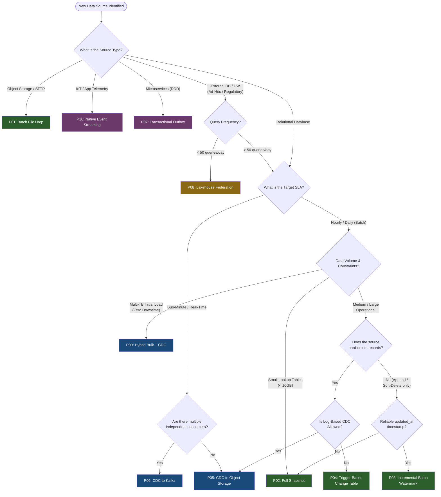

# Master Ingestion Pattern Decision Matrix

## 1. Overview
This matrix serves as the primary routing guide for Data Architects and Platform Engineers. Before designing a custom data pipeline, use the dimensions below to select the appropriate standardized enterprise ingestion pattern.

## 2. Requirements & Pattern Mapping

| Requirement / Scenario | Source Characteristics | Recommended Pattern | Fallback / Alternative |
|:---|:---|:---|:---|
| **Standard File Drop** | Files (CSV, JSON, Parquet) in S3/ADLS | **P01: Batch File Drop** | N/A |
| **Small DB Table (< 10GB)** | Low volume, hard deletes occur | **P02: Full Snapshot** | P03: Incremental (if no deletes) |
| **Medium DB Table (10GB–1TB)** | `updated_at` exists, soft deletes only | **P03: Incremental Batch** | P05: CDC to Object Storage |
| **Legacy DB (No CDC, No Timestamps)** | Exact history and hard deletes required | **P04: Trigger-Based Change Table** | P02: Full Snapshot |
| **High-Volume DB (Minutes SLA)** | Heavy update/delete churn, exact history | **P05: CDC to Object Storage** | P03: Incremental Batch |
| **High-Volume DB (Sub-minute SLA)** | Multiple downstream Kafka consumers | **P06: CDC to Kafka** | P05: CDC to Object Storage |
| **Domain-Driven Microservices** | Semantic business events needed | **P07: Transactional Outbox** | P06: CDC to Kafka (raw rows) |
| **Regulatory / Zero-Copy** | Data cannot physically move (Snowflake/DBX) | **P08: Lakehouse Federation** | N/A |
| **Massive Historical Migration** | Multi-TB initial load, zero downtime | **P09: Hybrid Bulk + CDC Tail** | P02: Full Snapshot (requires downtime) |
| **IoT / App Telemetry** | High-velocity, append-only Kafka feeds | **P10: Native Event Streaming** | P01: Batch File Drop (if latency allows) |

## 3. Cross-Pattern Capability Comparison

| Pattern | Ingestion Mode | Captures Hard Deletes? | Tracks Full History (SCD2)? | Operational Complexity | Compute/Storage Cost |
|:---|:---|:---|:---|:---|:---|
| **P01: File Drop** | Batch | Handled Downstream | Handled Downstream | Low | Low |
| **P02: Full Snapshot** | Batch | Yes (Implicitly) | No (Latest state only) | Low | Medium (Network Egress) |
| **P03: Incremental** | Batch | **No** | No (Latest state only) | Low | Low |
| **P04: DB Triggers** | Micro-Batch | Yes | Yes | High (DBA Overhead) | Low |
| **P05: CDC to S3** | Micro-Batch | Yes | Yes | Medium | Medium |
| **P06: CDC to Kafka** | Streaming | Yes | Yes | **High** | **High** |
| **P07: Outbox** | Streaming/Batch | Yes (Logical) | Yes (Semantic) | High (App Dev) | Medium |
| **P08: Federation** | Real-Time Read | N/A | N/A | Low | Zero Storage, Variable Compute |
| **P09: Hybrid Load** | Batch + Stream | Yes | Yes (Post-cutover) | High (One-Time) | High (Temporary) |
| **P10: Telemetry** | Streaming | N/A (Append-only) | Yes | Medium–High | Medium–High |

## 4. Cost Comparison

| Pattern | Monthly Cost Range (Typical) | Primary Cost Driver | Break-Even Consideration |
|:---|:---|:---|:---|
| **P01: File Drop** | $50–$500 | Storage + compute (micro-batch) | Cheapest option for file-based sources |
| **P02: Full Snapshot** | $100–$1,000 | Network egress + compute (bulk load) | Cheaper than CDC for tables < 10GB |
| **P03: Incremental** | $50–$500 | Compute (scheduled queries) | Cheapest for medium tables without hard deletes |
| **P04: DB Triggers** | $100–$500 | Source DB overhead + compute | Cheapest CDC alternative when log access is blocked |
| **P05: CDC to S3** | $200–$2,000 | CDC tool + compute (micro-batch) | 5–10× cheaper than P06 for single-consumer CDC |
| **P06: CDC to Kafka** | $2,000–$15,000+ | Kafka cluster + 24/7 streaming compute | Only justified with multiple consumers OR sub-second SLA |
| **P07: Outbox** | $500–$3,000 | Kafka cluster + Debezium + compute | Justified for microservices needing semantic events |
| **P08: Federation** | $0–$500 | Per-query egress + source compute | Cheaper than physical replication below ~50 queries/day |
| **P09: Hybrid** | $1,000–$5,000 (one-time) | Bulk extract + CDC compute (temporary) | One-time cost for initial migration, then transitions to P05/P06 |
| **P10: Telemetry** | $700–$21,000+ | Kafka cluster + streaming/micro-batch compute | Cost scales with EPS and execution mode (24/7 vs. micro-batch) |

## 5. Security Requirements by Pattern

| Pattern | Network Isolation Required | Secrets Management | PII Handling Point | IAM Granularity |
|:---|:---|:---|:---|:---|
| **P01: File Drop** | Landing zone bucket policy | Source credentials in vault | Bronze → Silver transformation | `PutObject` / `GetObject` per prefix |
| **P02: Full Snapshot** | JDBC via Private Link | DB credentials in vault | Bronze → Silver transformation | `SELECT` on source tables |
| **P03: Incremental** | JDBC via Private Link | DB credentials in vault | Bronze → Silver transformation | `SELECT` on source tables |
| **P04: DB Triggers** | JDBC via Private Link | DB + trigger credentials in vault | Change table → Silver | `SELECT` + trigger permissions |
| **P05: CDC to S3** | Private Link (DB → CDC → S3) | DB + S3 credentials in vault | Bronze → Silver | `SELECT` + `REPLICATION` + `PutObject` |
| **P06: CDC to Kafka** | Private Link (DB → Debezium → Kafka) | DB + Kafka SASL + Schema Registry | Debezium transforms or Silver | `SELECT` + `REPLICATION` + Kafka ACLs |
| **P07: Outbox** | Private Link (DB → Debezium → Kafka) | DB + Kafka credentials in vault | Application layer (before outbox) | App DB user + Kafka ACLs |
| **P08: Federation** | Private Link (Target → Source Replica) | DB credentials in vault | Unity Catalog row/column masks | `SELECT` only on approved tables |
| **P09: Hybrid** | Private Link (Replica + CDC) | DB + S3/Kafka credentials | Bronze → Silver | `SELECT` + `REPLICATION` |
| **P10: Telemetry** | TLS 1.2+ (Producers → Kafka) | Kafka SASL + consumer credentials | Producer-level tokenization | Kafka ACLs per producer/consumer |

## 6. Master Architectural Decision Tree

## 7. Multi-Cloud & Target Technology Mapping

While the patterns are vendor-agnostic, enterprise implementations typically utilize the following proven tech stacks:

| Capability | AWS Ecosystem | Azure Ecosystem | Target: Databricks | Target: Snowflake |
|:---|:---|:---|:---|:---|
| **File Landing** | S3 + SNS/SQS | ADLS Gen2 + Event Grid | Auto Loader (`cloudFiles`) | Snowpipe |
| **Log-Based CDC** | AWS DMS | ADF CDC / Event Hubs | DLT `APPLY CHANGES INTO` | Dynamic Tables / Streams |
| **Event Broker** | Amazon MSK / Kinesis | Azure Event Hubs | Spark Structured Streaming | Snowpipe Streaming |
| **Federation** | Athena / Glue Catalog | Synapse Serverless | Unity Catalog Foreign Catalogs | External Tables (Iceberg) |
| **Orchestration** | MWAA (Airflow) / Step Functions | Azure Data Factory | Databricks Workflows | Snowflake Tasks |
| **Secrets** | AWS Secrets Manager | Azure Key Vault | Databricks Secret Scopes | Snowflake Secrets |
| **Monitoring** | CloudWatch | Azure Monitor | System Tables / Lakeview | Account Usage / Alerts |

## 8. Operational Burden Comparison

| Pattern | Team Skill Required | 24/7 Ops Needed? | Typical FTE Allocation | Self-Service Potential |
|:---|:---|:---|:---|:---|
| **P01: File Drop** | Junior DE | No | 0.1 FTE | High (templated) |
| **P02: Full Snapshot** | Junior DE | No | 0.1 FTE | High (templated) |
| **P03: Incremental** | Junior DE | No | 0.1 FTE | High (templated) |
| **P04: DB Triggers** | Senior DBA + DE | No | 0.25 FTE | Low (DBA dependency) |
| **P05: CDC to S3** | Mid-Senior DE | Monitoring only | 0.25 FTE | Medium |
| **P06: CDC to Kafka** | Senior DE + Kafka Ops | **Yes** | 1–2 FTE | Low |
| **P07: Outbox** | Senior App Dev + DE | **Yes** | 0.5–1 FTE | Low |
| **P08: Federation** | Junior-Mid DE | No | 0.05 FTE | High |
| **P09: Hybrid** | Senior DE (one-time) | During migration only | 0.5 FTE (temporary) | Low |
| **P10: Telemetry** | Mid-Senior DE + Kafka | **Yes** (if continuous) | 0.5–1 FTE | Medium |

## 9. Architecture Review Board Submission

To approve a new ingestion pipeline, engineers must provide:

1. The **Pattern ID** selected from this matrix.
2. The completed **Pattern Selection Checklist** (found at the bottom of the corresponding pattern document).
3. Written justification if choosing an "Alternative/Fallback" pattern over the "Recommended" pattern.
4. **Cost estimate** using the Cost Model section of the selected pattern document.
5. **Security controls** verified against the Security & Governance section of the selected pattern.
6. **Monitoring plan** based on the Observability section (mandatory alerts configured before go-live).